# 14: Math Guide: what every piece of the code is doing

The code in `software/deskarm` and `tools/` is compact. This guide is the long version. For each module it gives the
picture, a **derivation** that starts from things you already know and shows every step, the same math **worked with
this arm's numbers**, and a table that maps every symbol to the variable or function that implements it. Read it next
to the source, one section at a time.

- **Figures** are drawn by `python3 tools/math_figures.py` from the real code and `arm.toml`, so they change when the
  design does. They live in `docs/img/math/`.
- **Code blocks marked `python`** are runnable from the `software/` folder (`pip install -e ".[sim,dev]"`). A test
  (`software/tests/test_math_guide.py`) runs every one of them, so they can't go stale. The worked numbers in the text
  come from the same code; if `arm.toml` changes, re-run the blocks to get the new ones.
- Each module's docstring points back to its section here ("Math: docs/14 §N").
- **Equations render on GitHub and in VS Code.** GitHub's Markdown strips a backslash in front of punctuation before
  the math is drawn, so this file never uses `\\`, `\,`, `\;`, `\!`, `\{` or `\_` inside math: matrix rows end in
  `\cr`, small spaces are `\thinspace`, braces are `\lbrace \rbrace`. A test checks it. (Found 14 Oct 2026: before
  that, every matrix in this guide rendered on GitHub as a single row.)

| § | Topic | Code | Figure |
|---|---|---|---|
| [1](#1-rotations-and-rigid-transforms) | Rotations, transforms, rotation vectors, quaternions | `kinematics.py`, `ik.py`, `cartesian.py`, `twin.py`, `urdf.py` | - |
| [2](#2-the-arm-as-a-chain-dh-parameters-and-forward-kinematics) | DH parameters and forward kinematics | `kinematics.py` | arm frames |
| [3](#3-the-jacobian-how-joint-speeds-become-tool-motion) | Jacobian, statics, manipulability, singularities | `kinematics.py`, `ik.py` | Jacobian columns |
| [4](#4-closed-form-inverse-kinematics-6-dof-mode) | Closed-form IK (J3 locked) | `ik.py` | IK triangle |
| [5](#5-numerical-inverse-kinematics-damped-least-squares) | Damped least squares, locks, null space, tasks | `ik.py` | DLS damping |
| [6](#6-redundancy-the-elbow-swivel-arm-angle) | Elbow swivel (arm angle), closed-form 7-DOF IK, planning it along a line | `ik.py`, `elbow.py` | swivel circle |
| [7](#7-point-to-point-timing-trapezoid-and-s-curve) | Trapezoid and S-curve profiles | `trajectory.py` | position / velocity / acceleration |
| [8](#8-straight-line-moves) | Straight-line (Cartesian) moves | `cartesian.py` | - |
| [9](#9-time-optimal-timing-topp-ra) | Time-optimal path timing (TOPP-RA) | `topp.py` | phase plane |
| [10](#10-masses-gravity-torque-and-the-torque-budget) | Masses, gravity torque, torque budget | `kinematics.py`, `urdf.py`, `tools/torque_budget.py` | mass levers |
| [11](#11-stepper-torque-vs-speed) | Stepper torque vs speed | `motor.py` | motor curves, J2 curve |
| [12](#12-the-physics-simulation) | Servo model, springy gearbox, stalls | `physics.py` | two-mass joint, wind-up |
| [13](#13-the-counterbalance-spring) | Counterbalance spring | `counterbalance.py` | geometry, torque |
| [14](#14-self-collision-capsules) | Self-collision with capsules | `collision.py` | capsules |
| [15](#15-gear-geometry-design-tools) | Cycloid and planetary geometry, the J2 gearbox numbers | `tools/cycloid.py`, `tools/gears.py` | gear profiles |
| [16](#16-absolute-joint-angle-from-the-motor-encoder) | Absolute joint angle from a coarse reading + the motor encoder | `backends.py` | motor-turn grid |
| [17](#17-backlash-and-stiffness-from-a-push-test) | Gearbox backlash and stiffness from the bench push test | `bench.py` | hysteresis line |
| [18](#18-output-encoder-calibration) | Output encoder: raw reading to link angle, calibration sweep and fit | `encoders.py`, `backends.py` | calibration sweep |
| [19](#19-dual-loop-control-putting-the-link-on-target) | Dual-loop control: feed-forward of the gear sag plus an integral on the link, and its stability bound | `control.py` | link error over time |
| [20](#20-contact-detection-from-gear-wind-up) | Contact detection: external torque from the encoder difference, momentum observer, threshold and give-way | `control.py`, `physics.py` | estimate over time |
| [21](#21-singularities-in-7-dof-mode-damping-and-cyclic-coordinate-descent) | Singularities with seven joints, adaptive damping, cyclic coordinate descent (a study) | `tools/ik_study.py` | DLS vs CCD |
| [22](#22-what-has-no-math) | Modules without math | `backends.py`, `mks.py`, `drivers.py`, `program.py`, `bridge.py`, firmware | - |
| [23](#23-where-to-read-more) | Reading list per section | | |

**Conventions used everywhere.** Lengths in metres, angles in radians inside the code (`arm.toml` is in degrees and is
converted on load). Vectors are columns. The base frame has **z up**, x forward, origin on the desk under J1. Code
indices start at 0, so `q[1]` is J2 and `arm.joints[3]` is J4. $c_i = \cos q_i$, $s_i = \sin q_i$. The worked numbers
use the **home pose** $q = (0, 30, 0, 60, 0, 60, 0)$° unless a section says otherwise.

---

## 1. Rotations and rigid transforms

**What it's for.** Everything about pose: where a link is, where the tool points, how far an orientation is from the
target.

### Derivation

**Step 1: a rotation about z.** Turn the frame by $a$ about z. The x unit vector $(1,0,0)$ goes to $(\cos a, \sin a, 0)$,
the y unit vector $(0,1,0)$ goes to $(-\sin a, \cos a, 0)$, and z stays put. A matrix sends each unit vector to its
column, so those three images are the columns:

$$
R_z(a)=\begin{bmatrix}\cos a&-\sin a&0\cr \sin a&\cos a&0\cr 0&0&1\end{bmatrix}
$$

The same argument about x and y (cycle the axes x→y→z→x) gives

$$
R_x(a)=\begin{bmatrix}1&0&0\cr 0&\cos a&-\sin a\cr 0&\sin a&\cos a\end{bmatrix},\qquad
R_y(a)=\begin{bmatrix}\cos a&0&\sin a\cr 0&1&0\cr -\sin a&0&\cos a\end{bmatrix}
$$

This is also why the code reads `T[:3, 2]` as "the direction this frame's z axis points": it is the third column.

**Step 2: the inverse is the transpose.** The columns are unit vectors at right angles to each other, so every entry of
$R^\top R$ is a dot product of two columns: 1 on the diagonal, 0 elsewhere. $R^\top R = I$, so $R^{-1} = R^\top$.

**Step 3: rotation plus translation in one matrix.** A point $p_1$ given in frame 1 is at $p_0 = R\thinspace p_1 + t$ in
frame 0. Append a 1 to every point and that affine map becomes one matrix product:

$$
\begin{bmatrix}p_0\cr 1\end{bmatrix}=\begin{bmatrix}R&t\cr 0&1\end{bmatrix}\begin{bmatrix}p_1\cr 1\end{bmatrix}
$$

Chaining two frames: $p_0 = R_1(R_2 p_2 + t_2) + t_1 = (R_1R_2)\thinspace p_2 + (R_1t_2 + t_1)$, which is exactly the
4×4 product $T_{0\to1}T_{1\to2}$. Solving $p_0 = Rp_1 + t$ for $p_1$ with Step 2 gives the inverse:

$$
p_1 = R^\top p_0 - R^\top t\qquad\Rightarrow\qquad T^{-1}=\begin{bmatrix}R^\top&-R^\top t\cr 0&1\end{bmatrix}
$$

**Step 4: rotating about any axis (Rodrigues' formula).** Take a unit axis $k$ and an angle $\theta$. Split a vector
$v$ into the part along the axis and the part across it:

$$
v_\parallel = k\thinspace(k\cdot v),\qquad v_\perp = v - v_\parallel
$$

The rotation leaves $v_\parallel$ alone and turns $v_\perp$ by $\theta$ in the plane spanned by $v_\perp$ and
$k\times v$ (which has the same length as $v_\perp$, at 90° to it):

$$
\operatorname{rot}(v)=v_\parallel+\cos\theta\thinspace v_\perp+\sin\theta\thinspace(k\times v)
$$

Write the cross product as a matrix, $Kv = k\times v$ with

$$
K=\begin{bmatrix}0&-k_z&k_y\cr k_z&0&-k_x\cr -k_y&k_x&0\end{bmatrix}
$$

Applying it twice, $K^2v = k\times(k\times v) = k\thinspace(k\cdot v) - v = -v_\perp$. So $v_\perp = -K^2v$ and
$v_\parallel = v + K^2v$. Substituting:

$$
\operatorname{rot}(v)=v+K^2v-\cos\theta\thinspace K^2v+\sin\theta\thinspace Kv
\qquad\Rightarrow\qquad
R=\exp(w)=I+\sin\theta\thinspace K+(1-\cos\theta)\thinspace K^2
$$

with $w = \theta k$, the **rotation vector** (`rotation_exp` in `cartesian.py`).

**Step 5: going back, the logarithm.** Take the trace of that formula. $\operatorname{tr}I = 3$,
$\operatorname{tr}K = 0$, and $K^2 = kk^\top - I$ has trace $1-3 = -2$:

$$
\operatorname{tr}R = 3 - 2(1-\cos\theta) = 1 + 2\cos\theta\qquad\Rightarrow\qquad\theta=\arccos\frac{\operatorname{tr}R-1}{2}
$$

$K$ is antisymmetric and $K^2$ symmetric, so $R - R^\top = 2\sin\theta\thinspace K$. Reading $k$ off $K$'s entries:

$$
w=\theta k=\frac{\theta}{2\sin\theta}\begin{bmatrix}R_{32}-R_{23}\cr R_{13}-R_{31}\cr R_{21}-R_{12}\end{bmatrix}
$$

That is `rotation_log` in `ik.py`. It divides by $\sin\theta$, so it has two special cases: for $\theta\to0$ the factor
$\theta/(2\sin\theta)\to1/2$, and for $\theta\to\pi$ the antisymmetric part vanishes and the axis comes from
$B=(R+I)/2 = kk^\top$ (at $\theta = \pi$), whose diagonal holds $k_x^2, k_y^2, k_z^2$.

**Step 6: orientation error** (`pose_error`). The rotation that takes the current orientation $R$ to the target is
$R_\text{target}R^\top$. Its rotation vector is the orientation error, in the base frame, which is the frame the
Jacobian's angular rows use (§3):

$$
e_R=\log\left(R_\text{target}R^\top\right),\qquad e_p=p_\text{target}-p,\qquad e=\begin{bmatrix}e_p\cr e_R\end{bmatrix}\in\mathbb{R}^6
$$

**Step 7: roll, pitch, yaw** (`rot_to_rpy` in `urdf.py`). The URDF convention is $R=R_z(\gamma)R_y(\beta)R_x(\alpha)$.
Multiplying out, its third row is $(-\sin\beta,\ \cos\beta\sin\alpha,\ \cos\beta\cos\alpha)$ and its first column is
$(\cos\gamma\cos\beta,\ \sin\gamma\cos\beta,\ -\sin\beta)$. So $\beta=\arcsin(-R_{31})$,
$\alpha=\operatorname{atan2}(R_{32},R_{33})$, $\gamma=\operatorname{atan2}(R_{21},R_{11})$.

**Quaternions** (`rot_to_wxyz`, `wxyz_to_rot` in `twin.py`) are only used to talk to the 3-D viewer. The conversion
divides by the largest of $w,x,y,z$, so it never divides by a number near zero.

### With numbers

The example below builds $R = R_z(0.4)R_x(-1.1)$:

$$
R=\begin{bmatrix}0.9211&-0.1766&-0.3471\cr 0.3894&0.4178&0.8209\cr 0&-0.8912&0.4536\end{bmatrix}
$$

- Trace: $0.9211+0.4178+0.4536 = 1.7924$, so $\cos\theta = (1.7924-1)/2 = 0.3962$ and $\theta = 1.1634$ rad (66.66°).
- Antisymmetric part: $R_{32}-R_{23} = -0.8912-0.8209 = -1.7121$, $R_{13}-R_{31} = -0.3471-0 = -0.3471$,
  $R_{21}-R_{12} = 0.3894+0.1766 = 0.5660$.
- Factor: $\theta/(2\sin\theta) = 1.1634/(2\times0.9182) = 0.6335$.
- So $w = 0.6335\times(-1.7121,\ -0.3471,\ 0.5660) = (-1.0847,\ -0.2199,\ 0.3586)$, which is what `rotation_log`
  returns, and its length is 1.1634 = $\theta$.

```python
import numpy as np
from deskarm.kinematics import rot_x, rot_z
from deskarm.ik import rotation_log
from deskarm.cartesian import rotation_exp

R = rot_z(0.4) @ rot_x(-1.1)                 # some orientation
w = rotation_log(R)                          # axis * angle
assert np.allclose(rotation_exp(w), R)       # exp undoes log
assert np.isclose(np.linalg.norm(w), np.arccos((np.trace(R) - 1) / 2))
```

---

## 2. The arm as a chain: DH parameters and forward kinematics

**What it's for.** Given the seven joint angles $q$, where is every joint and the tool? This is `ArmModel.frames(q)`
and `ArmModel.fk(q)`; everything else is built on it.

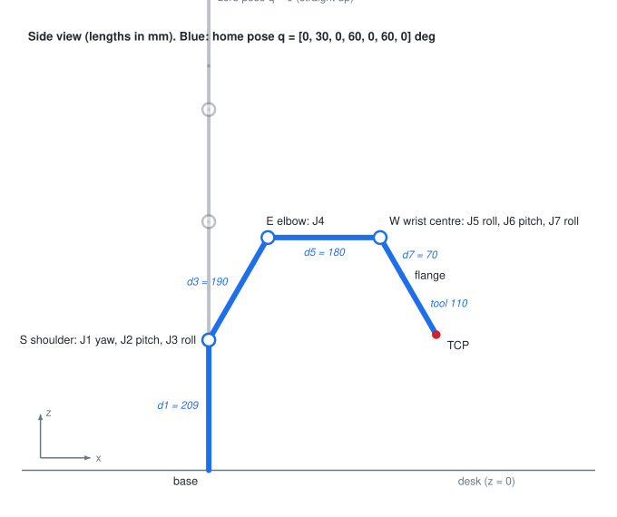

### Derivation

**Step 1: one joint is four simple moves.** The Denavit-Hartenberg recipe (`dh_transform`) places frame $i$ relative
to frame $i-1$ by: turn by the joint angle $q$ about z, slide $d$ along z, slide $a$ along x, tip z over by $\alpha$
about x. Multiply the four matrices of §1 in that order. The first two give

$$
R_z(q)\thinspace\mathrm{Trans}_z(d)=\begin{bmatrix}c&-s&0&0\cr s&c&0&0\cr 0&0&1&d\cr 0&0&0&1\end{bmatrix}
$$

Sliding $a$ along the new x adds $a$ times the first column to the translation, $(ac,\ as,\ d)$. Tipping by $\alpha$
multiplies the rotation block on the right by $R_x(\alpha)$:

$$
R_z(q)R_x(\alpha) = \begin{bmatrix}c&-sc_\alpha&ss_\alpha\cr s&cc_\alpha&-cs_\alpha\cr 0&s_\alpha&c_\alpha\end{bmatrix}
$$

Together:

$$
T_i(q_i)=\begin{bmatrix}c&-s\thinspace c_\alpha&s\thinspace s_\alpha&a\thinspace c\cr
s&c\thinspace c_\alpha&-c\thinspace s_\alpha&a\thinspace s\cr
0&s_\alpha&c_\alpha&d\cr
0&0&0&1\end{bmatrix}
$$

**Step 2: chain them.** Each $T_i$ is in the previous joint's frame, so the base-frame pose of frame $k$ is the product
from the base out (§1 Step 3), and the tool adds one fixed transform at the end:

$$
F_k(q)=T_1(q_1)\thinspace T_2(q_2)\cdots T_k(q_k),\qquad T_\text{TCP}(q)=F_7(q)\thinspace T_\text{tool}
$$

This arm's table (`arm.toml`, every $a_i=0$, no angle offsets):

| Joint | $d$ (m) | $\alpha$ | What the $\alpha$ does |
|---|---|---|---|
| J1 base yaw | 0.209 | −90° | tips z from vertical to horizontal: the next axis (J2) is a pitch axis |
| J2 shoulder pitch | 0 | +90° | tips z back along the upper arm: J3 is a roll axis |
| J3 upper-arm roll | 0.190 | −90° | slides to the elbow, tips z sideways: J4 pitches |
| J4 elbow pitch | 0 | +90° | z along the forearm: J5 rolls |
| J5 forearm roll | 0.180 | −90° | slides to the wrist centre, z sideways: J6 pitches |
| J6 wrist pitch | 0 | +90° | z along the tool: J7 rolls |
| J7 tool roll | 0.070 | 0 | slides to the flange |

### With numbers

**At $q = 0$.** Every $R_z(0) = I$, so $T_i = \mathrm{Trans}_z(d_i)R_x(\alpha_i)$. Follow the z axis:
$R_x(-90°)$ sends $(0,0,1)$ to $(0,1,0)$, so after J1 the z axis points along +y (the J2 pitch axis). $R_x(+90°)$ sends
it straight back up, so after J2 z is vertical again and J3's $d = 0.190$ is a move straight up. The pairs alternate the
same way all the way out, so the origins stack on the z axis at

| Frame | 0 | 1 = shoulder | 3 = elbow | 5 = wrist centre | 7 = flange | TCP |
|---|---|---|---|---|---|---|
| z (m) | 0 | 0.209 | 0.209 + 0.190 = 0.399 | 0.399 + 0.180 = 0.579 | 0.579 + 0.070 = 0.649 | 0.649 + 0.110 = 0.759 |

These are the levels the Fusion skeleton is built on ([16](16_packaging_and_routing.md) §4).

**At the home pose.** With J1, J3, J5, J7 at 0 every pitch happens in the xz plane, and each link's direction from
vertical is the running sum of the pitch angles before it: upper arm 30°, forearm 30 + 60 = 90°, tool 30 + 60 + 60 = 150°.
Walking out from the shoulder $S = (0, 0, 0.209)$:

$$
\begin{aligned}
E &= S + 0.190\thinspace(\sin 30°,\ 0,\ \cos 30°) = (0.095,\ 0,\ 0.3735)\cr
W &= E + 0.180\thinspace(\sin 90°,\ 0,\ \cos 90°) = (0.275,\ 0,\ 0.3735)\cr
p_\text{TCP} &= W + (0.070+0.110)\thinspace(\sin 150°,\ 0,\ \cos 150°) = (0.275+0.090,\ 0,\ 0.3735-0.1559) = (0.365,\ 0,\ 0.2176)
\end{aligned}
$$

The code prints `[0.365, 0, 0.218]` for the same pose. (The TCP is 0.110 m past the flange since the 3-prong gripper
was drawn on 20 Oct; with the earlier 0.080 m this came to (0.350, 0, 0.2436).)

| Symbol | In the code |
|---|---|
| $F_0\dots F_7$, $T_\text{TCP}$ | `arm.frames(q)` returns `[F0, F1, ..., F7, TCP]` (9 matrices) |
| $T_\text{TCP}$ | `arm.fk(q)` = `arm.frames(q)[-1]` |
| joint $k+1$'s axis and a point on it | `F[k][:3, 2]` and `F[k][:3, 3]` (frame $k$'s z axis **is** the next joint's axis) |
| shoulder S, elbow E, wrist centre W | `arm.srs_points(q)` = origins of `F[1]`, `F[3]`, `F[5]` |
| body frame of the link joint $k+1$ moves | `arm.link_frames(q)[k]` = $F_kR_z(q_{k+1})$, used for masses and the URDF |

```python
import numpy as np
from deskarm import load_arm
from deskarm.kinematics import dh_transform

arm = load_arm()
q = arm.home
T = np.eye(4)
for qi, j in zip(q, arm.joints):             # the product, written out
    T = T @ dh_transform(qi, j.d, j.a, j.alpha)
assert np.allclose(T @ arm.tool, arm.fk(q))
print(arm.fk(q)[:3, 3])                      # TCP position at the home pose: [0.365, 0, 0.218]
```

---

## 3. The Jacobian: how joint speeds become tool motion

**What it's for.** IK (§5), the swivel (§6), singularity warnings and the manipulability number all need to know "if
joint $i$ turns a little, how does the tool move?"

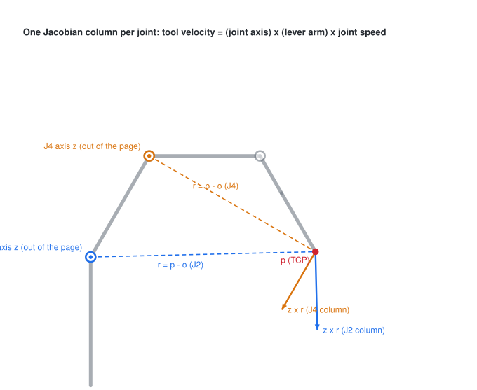

### Derivation

**Step 1: one joint.** Joint $i$ turns everything beyond it about the line through $o_i$ along the unit vector $z_i$.
A body spinning at rate $\dot q_i$ about that line has angular velocity $\omega = \dot q_i z_i$, and a point $p$ on it
moves at $v = \omega\times(p-o_i)$: the speed is the rate times the lever arm, the direction is at right angles to
both. So per unit of $\dot q_i$:

$$
v = z_i\times(p-o_i),\qquad \omega = z_i
$$

**Step 2: all joints.** For small motions the effects of the joints add (each is linear in its own $\dot q_i$), so the
tool's velocity is a sum of columns, one per joint:

$$
\begin{bmatrix}v\cr \omega\end{bmatrix}=J(q)\thinspace\dot q,\qquad
J(q)=\begin{bmatrix}z_1\times(p-o_1)&\cdots&z_7\times(p-o_7)\cr z_1&\cdots&z_7\end{bmatrix}\in\mathbb{R}^{6\times7}
$$

Seven joints, six task directions: $J$ is wider than it is tall. The extra column is the redundancy §5 and §6 use.

**Step 3: forces go the other way (statics).** Push on the tool with force $f$ (and moment). If the joints move by a
small $\delta q$, the tool moves by $\delta x = J\thinspace\delta q$. With no losses the work in equals the work out
for **every** $\delta q$:

$$
\tau^\top\delta q = f^\top\delta x = f^\top J\thinspace\delta q\quad\text{for all }\delta q\qquad\Rightarrow\qquad\tau = J^\top f
$$

The gravity torque of §10 is this, applied to every mass.

**Step 4: manipulability.** Factor $J = U\Sigma V^\top$ (singular value decomposition). Joint speeds of length 1 map to
an ellipsoid of tool velocities whose half-axes are the singular values $\sigma_1\dots\sigma_6$. Its volume is
proportional to their product, and $\det(JJ^\top) = \det(U\Sigma\Sigma^\top U^\top) = \prod\sigma_i^2$, so

$$
w=\sqrt{\det(JJ^\top)}=\prod_i\sigma_i
$$

At a **singularity** one $\sigma_i$ is zero: some tool direction can't be produced at all. This arm has three
(`singularity_warnings` in `ik.py`):

| Singularity | Condition | What is lost |
|---|---|---|
| Wrist | $\sin q_6\approx0$: J5 and J7 axes line up | one rotation direction; J5 and J7 do the same thing |
| Elbow | $q_4\approx0$: arm straight | motion along the arm (it can't get longer) |
| Shoulder | wrist centre on the J1 axis | sideways motion of the wrist |

### With numbers

At the home pose (§2), J2's axis is frame 1's z axis, $z_2 = (0, 1, 0)$, through the shoulder $o_2 = (0, 0, 0.209)$.
The TCP is at $p = (0.365, 0, 0.2176)$, so $p - o_2 = (0.365,\ 0,\ 0.0086)$ and

$$
z_2\times(p-o_2) = (1\cdot0.0086-0\cdot0,\ \ 0\cdot0.365-0\cdot0.0086,\ \ 0\cdot0-1\cdot0.365) = (0.0086,\ 0,\ -0.365)
$$

which is the second column of `arm.jacobian(arm.home)`: turning J2 at 1 rad/s moves the tool down at 0.365 m/s and
forward at 0.009 m/s. Step 3 then says a 1 kg payload, $f = (0, 0, -9.81)$ N, needs
$\tau_2 = 0.0086\cdot0 + 0\cdot0 + (-0.365)(-9.81) = 3.58$ N·m at J2 in this pose, for the payload alone. The
manipulability at home is $w = 0.0097$.

| Symbol | In the code (`ArmModel.jacobian`) |
|---|---|
| $z_i$, $o_i$ | `F[i][:3, 2]`, `F[i][:3, 3]` for code index `i` = 0…6 |
| $p$ | `F[-1][:3, 3]`, the TCP |
| top 3 rows | linear velocity of the TCP, base frame |
| bottom 3 rows | angular velocity of the tool, base frame |
| $w$ | `ArmModel.manipulability` |

```python
import numpy as np
from deskarm import load_arm

arm = load_arm()
q, dq = arm.home, 1e-6 * np.arange(1, 8)
moved = arm.fk(q + dq)[:3, 3] - arm.fk(q)[:3, 3]          # finite difference
assert np.allclose(moved, arm.jacobian(q)[:3] @ dq, atol=1e-10)
```

---

## 4. Closed-form inverse kinematics (6-DOF mode)

**What it's for.** Given a tool pose, find the joint angles **exactly and instantly**, with J3 held at 0. Used in
6-DOF mode and as a source of good starting points for the numerical solver. Function: `analytic_ik_6dof` in `ik.py`.

**Why it can be solved by hand (Pieper's idea).** The last three axes meet in one point, the wrist centre W. Turning
J5-J7 changes the tool's orientation but not where W is. So: (1) find W from the target, (2) put W there with J1, J2,
J4, (3) fix the orientation with J5, J6, J7.

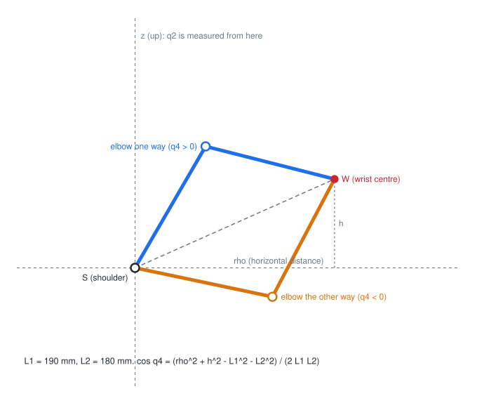

### Derivation

**Step 1: wrist centre.** Remove the tool offset, then step back from the flange along its z axis by $d_7$, and
measure from the shoulder:

$$
T_\text{flange}=T_\text{target}T_\text{tool}^{-1},\qquad p_W=p_\text{flange}-d_7\thinspace\hat z_\text{flange},\qquad v=p_W-(0,\ 0,\ d_1)
$$

**Step 2: base yaw.** With J3 = 0 the upper arm and forearm lie in one vertical plane through the J1 axis, so that plane
must contain W: $q_1=\operatorname{atan2}(v_y,v_x)$, or that plus 180° (reaching over the back).

**Step 3: the shoulder-elbow triangle.** In that plane, let $\rho = \sqrt{v_x^2+v_y^2}$ (horizontal distance) and
$h = v_z$ (height above the shoulder). With $L_1$, $L_2$ the upper arm and forearm and the angles measured from vertical
as in §2:

$$
\rho=L_1\sin q_2+L_2\sin(q_2+q_4),\qquad h=L_1\cos q_2+L_2\cos(q_2+q_4)
$$

Square both and add. The $\sin^2+\cos^2$ pairs become 1, and the cross terms combine with
$\sin A\sin B+\cos A\cos B=\cos(A-B)$:

$$
\rho^2+h^2 = L_1^2+L_2^2+2L_1L_2\big(\sin q_2\sin(q_2+q_4)+\cos q_2\cos(q_2+q_4)\big)=L_1^2+L_2^2+2L_1L_2\cos q_4
$$

$$
\Rightarrow\qquad \cos q_4=\frac{\rho^2+h^2-L_1^2-L_2^2}{2L_1L_2}
$$

$q_4=\pm\arccos(\cdot)$: two elbow configurations. If the right side is outside $[-1, 1]$, W is out of reach.

For $q_2$, expand $\sin(q_2+q_4)$ and $\cos(q_2+q_4)$ and collect by $\sin q_2$ and $\cos q_2$. With
$k_1 = L_1+L_2\cos q_4$ and $k_2 = L_2\sin q_4$:

$$
\rho = k_1\sin q_2+k_2\cos q_2,\qquad h = k_1\cos q_2-k_2\sin q_2
$$

That is the vector $(k_1, k_2)$ turned by $q_2$: in complex numbers, $h + i\rho = (k_1+ik_2)\thinspace e^{iq_2}$. Angles
add when complex numbers multiply, so $\operatorname{atan2}(\rho,h)=q_2+\operatorname{atan2}(k_2,k_1)$:

$$
q_2=\operatorname{atan2}(\rho,h)-\operatorname{atan2}(L_2\sin q_4,\ L_1+L_2\cos q_4)
$$

**Step 4: the wrist.** With J1-J4 known, compute the forearm's orientation $R_{04}$; what the wrist must still do is
$M=R_{04}^\top R_\text{flange}$. From the DH table the last three joints are
$R_z(q_5)R_x(-90°)R_z(q_6)R_x(90°)R_z(q_7)$, and a z rotation sandwiched between $R_x(-90°)$ and $R_x(90°)$ is the same
rotation about the axis $R_x(-90°)$ sends z to, which is y. So the wrist is $R_z(q_5)R_y(q_6)R_z(q_7)$ (Z-Y-Z Euler
angles). Multiplied out:

$$
M=\begin{bmatrix}c_5c_6c_7-s_5s_7&-c_5c_6s_7-s_5c_7&c_5s_6\cr
s_5c_6c_7+c_5s_7&-s_5c_6s_7+c_5c_7&s_5s_6\cr
-s_6c_7&s_6s_7&c_6\end{bmatrix}
$$

The third column is $(c_5s_6,\ s_5s_6,\ c_6)$ and the third row $(-s_6c_7,\ s_6s_7,\ c_6)$, so (`_zyz`):

$$
q_6=\operatorname{atan2}\left(\sqrt{M_{13}^2+M_{23}^2},\ M_{33}\right),\qquad q_5=\operatorname{atan2}(M_{23},M_{13}),\qquad q_7=\operatorname{atan2}(M_{32},-M_{31})
$$

The second solution is $(q_5+\pi,\ -q_6,\ q_7+\pi)$: the wrist flipped. When $\sin q_6=0$ only $q_5+q_7$ is defined (the
wrist singularity of §3), and the code keeps $q_5$ where it was.

**How many answers.** 2 (yaw) × 2 (elbow) × 2 (wrist) = up to **8**. `_nearest_in_limits` shifts each angle by whole
turns to fit the joint limits, solutions outside the limits are dropped, each survivor is checked with forward
kinematics, and the list is sorted by distance from the reference pose so the arm doesn't flip configuration needlessly.

### With numbers

The example below asks for the pose of $q = (20, 40, 0, 70, 30, 50, -10)$° and gets it back. By hand, with
$d_1 = 0.209$, $L_1 = 0.190$, $L_2 = 0.180$:

1. Wrist centre: $p_W = (0.2737,\ 0.0996,\ 0.2930)$, so $v = (0.2737,\ 0.0996,\ 0.0840)$.
2. Yaw: $q_1 = \operatorname{atan2}(0.0996, 0.2737) = 20.0°$.
3. $\rho = \sqrt{0.2737^2+0.0996^2} = 0.2913$, $h = 0.0840$.
4. $\cos q_4 = (0.08484+0.00705-0.03610-0.03240)/(2\times0.190\times0.180) = 0.02339/0.0684 = 0.3420$, so $q_4 = 70.0°$.
5. $k_1 = 0.190+0.180\times0.3420 = 0.2516$, $k_2 = 0.180\times0.9397 = 0.1691$.
   $\operatorname{atan2}(\rho, h) = 73.92°$, $\operatorname{atan2}(k_2, k_1) = 33.92°$, so $q_2 = 40.0°$.

All 8 solutions come back; the nearest one is the original pose.

| Symbol | In the code |
|---|---|
| $d_1, L_1, L_2, d_7$ | `arm.joints[0].d`, `[2].d`, `[4].d`, `[6].d` |
| $p_W$, $v$, $\rho$, $h$ | `p_w`, `v`, `rho`, `h` |
| $\cos q_4$ | `D` |
| $R_{04}$, $M$ | `R04 = arm.frames(q_arm)[4][:3, :3]`, `R04.T @ R` |

```python
import numpy as np
from deskarm import load_arm, analytic_ik_6dof

arm = load_arm()
q = np.deg2rad([20, 40, 0, 70, 30, 50, -10])       # J3 = 0
sols = analytic_ik_6dof(arm, arm.fk(q), q_ref=q)
assert np.allclose(sols[0], q, atol=1e-9)          # the nearest solution is the pose we started from
print(len(sols), "solutions reach the same tool pose")
```

---

## 5. Numerical inverse kinematics: damped least squares

**What it's for.** The general solver (`solve_dls` in `ik.py`): all seven joints, any joints locked, partial tasks
("position only", "keep the tool vertical"), and a secondary goal in the spare degree of freedom. It iterates: measure
the error, move the joints a little in the direction that reduces it, repeat.

### Derivation

**Step 1: the linear guess.** Near the current pose the error changes linearly with the joints (§3): moving by
$\Delta q$ removes $J\Delta q$ of the error $e$. We want $J\Delta q = e$. Seven unknowns, six equations: many answers.

**Step 2: pick the small one, but never a huge one.** Minimise the leftover error plus a penalty on step size:

$$
f(\Delta q)=\lVert J\Delta q-e\rVert^2+\lambda^2\lVert\Delta q\rVert^2
$$

Set the gradient to zero:

$$
\nabla f = 2J^\top(J\Delta q-e)+2\lambda^2\Delta q=0\qquad\Rightarrow\qquad(J^\top J+\lambda^2I)\thinspace\Delta q=J^\top e
$$

That needs a 7×7 inverse. The identity $J^\top(JJ^\top+\lambda^2I) = (J^\top J+\lambda^2I)J^\top$ (multiply out both
sides) moves it to a 6×6 one:

$$
\Delta q=(J^\top J+\lambda^2I)^{-1}J^\top e=J^\top(JJ^\top+\lambda^2I)^{-1}e
$$

With $\lambda = 0$ this is the pseudo-inverse $J^+ = J^\top(JJ^\top)^{-1}$, the smallest exact step.

**Step 3: what the damping does.** Write $J = \sum_i\sigma_iu_iv_i^\top$ (SVD). Substituting, each direction is
handled separately:

$$
\Delta q=\sum_i\frac{\sigma_i}{\sigma_i^2+\lambda^2}\thinspace(u_i^\top e)\thinspace v_i
$$

Undamped the gain is $1/\sigma_i$, which explodes as $\sigma_i\to0$ near a singularity. Damped, the gain
$g(\sigma)=\sigma/(\sigma^2+\lambda^2)$ has $g'(\sigma) = (\lambda^2-\sigma^2)/(\sigma^2+\lambda^2)^2 = 0$ at
$\sigma = \lambda$, so its largest value is $1/(2\lambda)$. With $\lambda = 0.02$ no direction ever gets more than 25×.

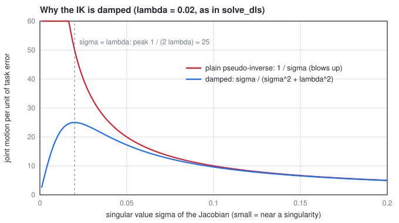

**Step 4: moving without moving the tool (null space).** For the undamped $J^+$,
$J(I-J^+J) = J - JJ^\top(JJ^\top)^{-1}J = J - J = 0$. So any joint motion passed through $N = I - J^+J$ leaves the tool
where it is (to first order). That is where secondary goals go: $\Delta q \mathrel{+}= N\thinspace n(q)$.

**The pieces around that formula**, in the order the code applies them:

| Step | Math | In `solve_dls` |
|---|---|---|
| Error | $e$ from §1 (or a reduced task, below) | `task_error` |
| Weights | $W=\operatorname{diag}(1,1,1,w,w,w)$, $w=0.3$: a radian of orientation error counts as 0.3 m of position error | `rot_weight`, `W` |
| Locked joints | delete their columns: those joints simply aren't unknowns | `free` mask, `[:, free]` |
| Damped step | $J_w=WJ$, $e_w=We$, $J_w^\sharp=J_w^\top(J_wJ_w^\top+\lambda^2I)^{-1}$, $\Delta q=J_w^\sharp e_w$ | `J_pinv`, `damping` (λ = 0.02) |
| Null space | $\Delta q\mathrel{+}=(I-J_w^\sharp J_w)\thinspace n(q)$ | `nullspace` |
| Step limit | scale $\Delta q$ so $\lVert\Delta q\rVert\le0.2$ rad | `max_step` |
| Joint limits | clip $q$ to its range | `arm.clamp` |
| Stop | position error < 0.1 mm and rotation error < 1 mrad | `pos_tol`, `rot_tol` |

**The null-space objective** `joint_centering` pushes every joint toward the middle of its range:
$n_i(q)=g\thinspace(q_{\text{mid},i}-q_i)/h_i^2$ with $h_i$ half the range. It is the downhill direction of
$\sum_i (q_i - q_{\text{mid},i})^2/(2h_i^2)$, so joints with a small range are pulled harder.

**Tasks** (`task_error`, `task_jacobian`): what must match the target.

| Task | Error (size) | Jacobian |
|---|---|---|
| `"pose"` | $(e_p,\ e_R)$ (6) | all of $J$ |
| `"position"` | $e_p$ (3): orientation is free | top 3 rows |
| `"axis"` | $(e_p,\ e_z)$ (6, rank 5): the tool's z axis must point along the target's, spin about it is free | top 3 rows and $P J_\omega$ with $P=I-\hat z\hat z^\top$ |

For the axis task, `axis_error` is the shortest rotation from the tool axis $\hat z$ to the target axis $\hat z_t$:
direction $\hat z\times\hat z_t$, angle $\operatorname{atan2}(\lVert\hat z\times\hat z_t\rVert,\ \hat z\cdot\hat z_t)$. $P$
removes the component of $\omega$ along $\hat z$ (since $P\hat z = \hat z-\hat z(\hat z\cdot\hat z) = 0$), because spinning
about its own axis doesn't change where the axis points.

**`solve_ik`** is the dispatcher the twin calls: closed form (§4) in 6-DOF mode when nothing else is locked, otherwise
DLS; and if DLS fails from the current pose it restarts from each closed-form solution.

### With numbers

The example moves the target 3 cm forward, 2 cm sideways and 2 cm up from home ($\lVert e_p\rVert = 4.1$ cm) with J1
locked. The position error after each iteration is 26.1, 13.6, 4.1, 1.07, 0.31, 0.100 and 0.033 mm: it shrinks by roughly
3× per step and stops at 7 iterations, under the 0.1 mm tolerance (the sixth lands right on it). With the 0.080 m TCP
used before 20 Oct it took 6. Each step does only part of the correction because the
damping (Step 3) and the orientation weight pull it short; an undamped step would converge faster near the target and
blow up near a singularity.

```python
import numpy as np
from deskarm import load_arm, solve_dls

arm = load_arm()
T = arm.fk(arm.home)
T[:3, 3] += [0.03, -0.02, 0.02]                          # move the target about 4 cm
res = solve_dls(arm, T, arm.home, locked={0})            # J1 is not allowed to move
assert res.success and res.q[0] == arm.home[0]
print(f"{res.iterations} iterations, {res.pos_err * 1e6:.1f} micrometres off")
```

---

## 6. Redundancy: the elbow swivel (arm angle)

**What it's for.** With seven joints the tool pose doesn't fix the arm's shape: the elbow can swing while the tool
stays put. The swivel angle $\psi$ names where on that swing it is (`swivel_angle`, `swivel` in `ik.py`).

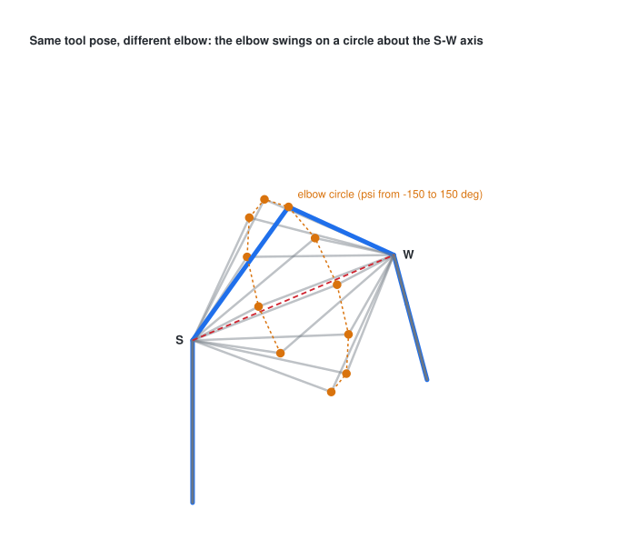

### Derivation

**Step 1: the elbow lives on a circle.** S and W are fixed by the tool pose. E must be $L_1$ from S and $L_2$ from W:
the intersection of two spheres, which is a circle about the line S-W. Let $\ell = \lVert W-S\rVert$ and
$\hat u = (W-S)/\ell$. Subtracting the two sphere equations $\lVert E-S\rVert^2 = L_1^2$ and
$\lVert E-W\rVert^2 = L_2^2$ gives the distance $x$ of the circle's plane from S along $\hat u$, and Pythagoras its
radius $r$:

$$
x=\frac{L_1^2-L_2^2+\ell^2}{2\ell},\qquad r=\sqrt{L_1^2-x^2}
$$

**Step 2: an angle on that circle.** $\psi$ is E's angle on the circle, measured from a reference direction $x$ that
lies in the circle's plane (perpendicular to $\hat u$). The obvious reference is "up": project the world $\hat z$ onto
the plane. That was the code until 26 Oct, and it breaks twice: when the arm points straight up or straight down, the
projection is zero. Near those directions $\psi$ swings fast, and passing through them flips it by 180°, even though
the elbow hasn't moved. With the elbow at 60°, that happened at J2 ≈ −29°, where the wrist passes over the shoulder
(figure below, red).

No reference can avoid this everywhere. $x(\hat u)$ is a tangent vector field on the sphere of directions, and the
hairy ball theorem says such a field must vanish somewhere; Elias and Wen (2024) show the vanishing points must add up
to order two. The best case is to put all of it at one direction and point that where the arm can't go. The code uses
their **stereographic SEW angle** with the singular direction $e_t$ straight down (into the base) and a reference
$e_r$ along −x:

$$
k=\big((\hat u-e_t)\times e_r\big)\times\hat u,\qquad x=\frac{k}{\lVert k\rVert},\qquad
\psi=\operatorname{atan2}\big((\hat u\times x)\cdot(E-S),\ x\cdot(E-S)\big),\qquad e_t=-\hat z,\ e_r=-\hat x
$$

$k$ is zero only when $\hat u=e_t$: the shoulder-to-wrist line pointing straight down through the J1 column, which the
base and the desk block. Everywhere else $\psi$ is smooth (blue).

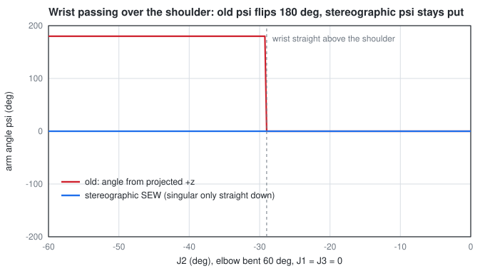

What it means in use:

- **Reaching forward (+x side), $\psi = 0$ is the elbow as high as it can be**, the same as before. Over the top the
  reading stays continuous.
- **The reference turns with the reach direction.** With J1 turned by θ, the elbow-up pose reads $\psi\approx\theta$
  (90° at J1 = 90°, ±180° reaching backwards). That is the price of a single singular direction: a field that pointed
  "up" all round the horizon would need a second singularity straight up.
- If the arm is straight, $r = 0$, E is on the axis and $\psi$ is undefined (`nan`); the same happens exactly at
  $\hat u = e_t$.

**Step 3: moving along the circle** (`swivel`). Rather than a closed form, it uses the null space of §5: the gradient
$g=\partial\psi/\partial q$ (numerical), the step that changes $\psi$ fastest, projected so the tool doesn't move, plus a
correction for the small drift that first-order steps leave:

$$
\Delta q_0=k\thinspace\Delta\psi\thinspace\frac{g}{g\cdot g},\qquad \Delta q=J^\sharp e_\text{hold}+(I-J^\sharp J)\thinspace\Delta q_0
$$

$g/(g\cdot g)$ is the shortest joint step that changes $\psi$ by 1: along $g$, scaled so $g\cdot\Delta q_0 = k\Delta\psi$.

**Step 4: the joints straight from $\psi$** (`analytic_ik_7dof`). Steps 1-2 give the elbow point for any $\psi$:

$$
E = S + x_c\thinspace\hat u + r\big(\cos\psi\thinspace x + \sin\psi\thinspace(\hat u\times x)\big)
$$

($x_c$ is Step 1's $x$, renamed so it isn't confused with the reference $x$.) The rest is reading angles off the DH
frames (§2), the same subproblems Elias and Wen use for this layout:

- **Elbow, J4.** The triangle S-E-W has sides $L_1$, $L_2$, $\ell$, and with the DH zero at a straight arm,
  $\ell^2 = L_1^2+L_2^2+2L_1L_2\cos q_4$, so $q_4=\pm\arccos\big((\ell^2-L_1^2-L_2^2)/(2L_1L_2)\big)$.
- **Shoulder, J1 and J2.** The elbow sits $L_1$ along frame 2's z axis, which works out to
  $z_2=(\cos q_1\sin q_2,\ \sin q_1\sin q_2,\ \cos q_2)$. With $z_2=(E-S)/L_1$:
  $q_2=\pm\arccos z_{2,z}$ and $q_1=\operatorname{atan2}(\pm z_{2,y},\ \pm z_{2,x})$, the signs together.
- **Upper-arm roll, J3.** Seen from frame 2 the wrist is at
  $w=R_{02}^{\top}(W-S)=(L_2\cos q_3\sin q_4,\ L_2\sin q_3\sin q_4,\ L_1+L_2\cos q_4)$, so
  $q_3=\operatorname{atan2}(w_y\operatorname{sgn}\sin q_4,\ w_x\operatorname{sgn}\sin q_4)$.
- **Wrist, J5-J7.** The same Z-Y-Z step as §4: $R_{04}^{\top}R = R_z(q_5)R_y(q_6)R_z(q_7)$.

Two shoulder signs, two elbow signs and two wrist flips give up to **8 solutions for each $\psi$**, all with the elbow
at the same point. The code drops those outside the joint limits, checks each with forward kinematics and sorts them
nearest to the current joints first. There is no solution when the target is out of reach, when the elbow would be
straight ($\psi$ undefined) or when every branch breaks a limit.

Sweeping $\psi$ shows which elbow positions a tool pose allows (`feasible_psi`). Near $\psi=0$ the example and home
poses keep fewer branches because J3 is close to 0 there, and the branches that turn it by 180° hit its ±170° limit;
straight down ($\psi\approx\pm180°$) nothing fits. A long reach leaves fewer branches everywhere:

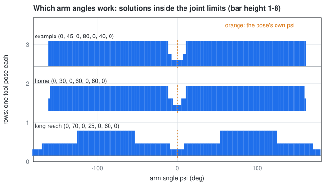

**How `solve_ik` uses it.** With `psi=` (7-DOF mode, full pose, nothing locked) it returns the closed-form solution
nearest the current joints at exactly that arm angle. Without it, damped least squares (§5) runs first as before; if
that fails, the closed form is tried at arm angles moving out from the current one in 5° steps, so the elbow stays as
close to where it was as the limits allow. This replaced restarting least squares from the 6-DOF solutions. On 200
random targets from random far starting points both reach all 200; least squares alone reaches 154, and the
closed-form fallback answers the other 46 exactly. One call returns all 8 solutions in about 1.6 ms (pure Python).

**Step 5: choosing $\psi$ along a whole line** (`plan_arm_angle` in `elbow.py`, used by `cartesian.linear_path`). A
straight tool line fixes the pose at every point and leaves $\psi$. Warm-started IK keeps whatever $\psi$ the arm
drifts into, which can carry it into a joint limit or into itself. Choosing $\psi$ for the whole line at once is a
shortest-path problem on a grid, solved by dynamic programming:

- **Stages** every 5 path points (1 cm or 0.1 rad), $k=0\ldots K$. Stage 0 is the arm as it is.
- **Nodes** at each stage: $\psi$ on a 10° grid anchored at the start's own $\psi$ (so holding the elbow is always an
  option), each solved by Step 4 in the branch the arm starts in. Changing branch needs a singularity, so a straight
  move never does it.
- **Node cost**, for clearance $g$ (the smallest capsule gap, §14) and each joint's distance $d_i$ to its nearer limit:

$$
c(q)=w_c\Big(1-\frac{g}{m_c}\Big)_+^2+w_\ell\sum_i\Big(1-\frac{d_i}{m_\ell}\Big)_+^2,\qquad c=\infty \text{ if } g\lt 0
$$

  with $m_c$ = 20 mm, $m_\ell$ = 5°, $w_c$ = 10, $w_\ell$ = 1 and $(x)_+=\max(x,0)$.
- **Edge cost** between neighbouring stages: joint motion in seconds at full speed, squared, scaled by $K$ so it doesn't
  depend on how finely the line is cut. Steps where any joint would move more than 0.15 rad per path point are barred
  (the same jump limit `linear_path` always had):

$$
e(q,q')=\sum_i\Big(K\frac{q'_i-q_i}{v_{\max,i}}\Big)^2
$$

- **Bellman's recursion** gives the cheapest cost $J$ of reaching node $j$ at stage $k$, keeping a back-pointer to the
  best predecessor $i$; the plan is the cheapest end node, traced back:

$$
J_k(j)=c(q_{k,j})+\min_i\big(J_{k-1}(i)+e(q_{k-1,i},q_{k,j})\big)
$$

**Checking clearance lazily.** One clearance check costs ~4 ms and a 15 cm line has ~16 × 36 nodes. So the search
first runs as if every gap were wide, checks only the nodes on the chain it picked, adds their real cost, and runs
again until the chain it picks has been checked everywhere. Unchecked nodes can only be underestimated, so the result
is still the cheapest chain. In practice it needs one stage's worth of checks, about 15.

**Filling in.** Between stages $\psi$ is interpolated (the short way round) and Step 4 is solved at every path point,
nearest the previous one. Near $q_2=0$ or $q_6=0$ (J1 in line with J3, or J5 with J7, §21) a small change in $\psi$
swings that pair of joints a lot. Where the interpolated $\psi$ would make a joint step of more than half the jump
limit, the fill tries $\psi$ within one grid step and keeps the smallest step. If no chain or fill works,
`linear_path` falls back to warm-started IK, so planning never makes a move fail that worked before.

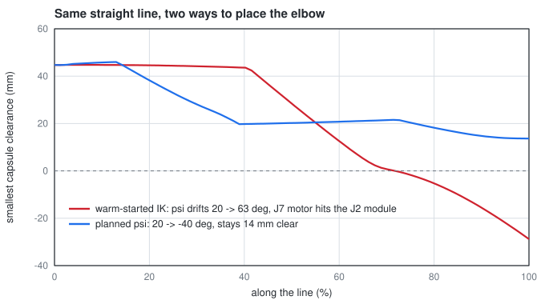

The example in the figure came out of a random sweep. From
$q=(114.1, 74.2, -64.1, 78.9, -73.6, 1.1, -1.3)$° the tool moves (−56, −103, +97) mm. Warm-started IK lets $\psi$
drift from 20° to 63°, and the J7 motor runs 27 mm into the J2 module. The plan swings the elbow the other way, to
−40°, and stays at least 14 mm clear. Over 80 random lines of 8-20 cm (most of them leave the reach): each method
completes 25, with one line apiece the other can't do; warm-started IK collides on 2 that it "completes", the plan on
none; where both work, the plan keeps more clearance on 7 of 24. With the fallback, 26 complete. A 15 cm line takes
about 0.4 s to plan, against about 0.1 s warm-started (pure Python).

### With numbers

For the example pose $q = (0, 45, 0, 80, 0, 40, 0)$°: $S = (0, 0, 0.209)$, $W = (0.2818, 0, 0.2401)$, so
$\ell = 0.2835$, $x = (0.0361-0.0324+0.0804)/(2\times0.2835) = 0.1483$ and $r = \sqrt{0.0361-0.0220} = 0.1188$ m: the
elbow can swing on a circle of radius 11.9 cm. It starts at $\psi = 0$ (straight up, J3 = 0); asking for 40° gives
39.95° and the tool moves less than a micrometre.

Step 4 at $\psi = 40°$ for the same tool pose: $\cos q_4 = (0.0804-0.0361-0.0324)/(2\times0.19\times0.18) = 0.1736$, so
$q_4=\pm80°$ (the pose's own elbow). The reference is $x=(-0.110, 0, 0.994)$, nearly straight up for this forward
reach, and the elbow lands at $E=(0.137, -0.076, 0.316)$, so $z_2=(0.723, -0.402, 0.562)$, $q_2=\arccos 0.562 = 55.8°$
and $q_1=\operatorname{atan2}(-0.402, 0.723)=-29.1°$. Then $q_3=50.6°$ and the wrist gives
$(q_5,q_6,q_7)=(-53.6, 52.2, 32.5)°$: the first of 8 solutions, all of which put the tool on the same pose within
$10^{-11}$.

| Symbol | In the code |
|---|---|
| $\hat u$, $k$, $x$, $e$ | `u`, `k`, `x`, `e` in `swivel_angle` |
| $e_t$, $e_r$ | `E_T`, `E_R` in `ik.py` |
| $x_c$, $r$, $E$, $z_2$, $w$ | `xc`, `r`, `E`, `z2`, `w` in `analytic_ik_7dof` |
| $c$, $e$, $J$, $m_c$, $m_\ell$, $w_c$, $w_\ell$ | `limit_cost` + `clear`, `edges`, `best`, `clear_margin`, `limit_margin`, `w_clear`, `w_limit` in `plan_arm_angle` |
| $g$ | `_swivel_gradient` (central differences) |
| $e_\text{hold}$ | `pose_error(T_hold, arm.fk(q))` |

Step 4 follows Shimizu et al. (2008) and Elias and Wen (2024); see §23.

```python
import numpy as np
from deskarm import analytic_ik_7dof, load_arm, swivel, swivel_angle

arm = load_arm()
q = np.deg2rad([0, 45, 0, 80, 0, 40, 0])
res = swivel(arm, q, np.deg2rad(40))
assert res.success
sols = analytic_ik_7dof(arm, arm.fk(q), np.deg2rad(40), q)          # Step 4: same arm angle, in closed form
assert np.allclose(arm.fk(sols[0]), arm.fk(q), atol=1e-9) and len(sols) == 8
assert np.allclose(arm.fk(res.q), arm.fk(q), atol=1e-3)            # tool did not move
print(np.rad2deg(swivel_angle(arm, q)), "->", np.rad2deg(swivel_angle(arm, res.q)))
```

---

## 7. Point-to-point timing: trapezoid and S-curve

**What it's for.** A path says *where*; a profile says *when*. `trajectory.py` turns "go from $q_0$ to $q_1$" into
position as a function of time, within each joint's speed, acceleration and (for the S-curve) jerk limits.

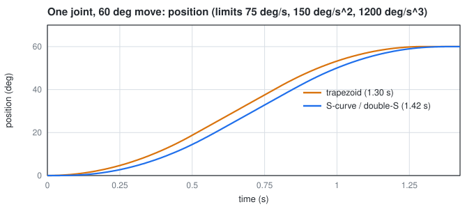
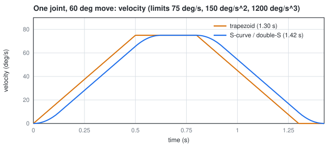
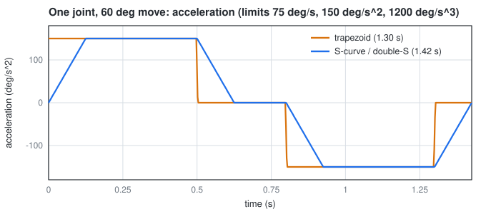

### Derivation: trapezoid

**Step 1: the fastest move under two limits** (`TrapezoidalTrajectory`). Accelerate at the limit $a$ until the speed
limit $v$, cruise, brake at $a$. Reaching $v$ takes $t_a = v/a$ and covers $\tfrac12at_a^2 = v^2/(2a)$; braking the same.
The cruise covers what is left, $d - v^2/a$, at speed $v$:

$$
T=2\frac{v}{a}+\frac{d-v^2/a}{v}=\frac{d}{v}+\frac{v}{a}\qquad\text{if } d\ge\frac{v^2}{a}
$$

If $d \lt  v^2/a$ the joint never reaches $v$: accelerate for half the distance and brake for the other half (a
triangle). Each half is $\tfrac{d}{2}=\tfrac12a\thinspace(T/2)^2$, so

$$
T=2\sqrt{d/a}\qquad\text{if } d\lt \frac{v^2}{a}
$$

**Step 2: every joint finishes together.** The slowest joint sets the duration $T=\max_iT_i$. Every other joint keeps its
acceleration and lowers its cruise speed $v_i$ until it also takes exactly $T$. From Step 1, $d_i = v_iT - v_i^2/a$, a
quadratic in $v_i$:

$$
v_i^2 - aT\thinspace v_i + a\thinspace d_i = 0\qquad\Rightarrow\qquad v_i=\frac{aT-\sqrt{a^2T^2-4a\thinspace d_i}}{2},\qquad t_{\text{acc},i}=\frac{v_i}{a}
$$

The smaller root is the one with a cruise phase (the larger one would brake before accelerating).

### Derivation: S-curve

The trapezoid's acceleration jumps, which is a hammer blow on printed gears and makes the arm ring (§12). The S-curve
(`DoubleS`) limits **jerk** $j$, the rate of change of acceleration, so acceleration ramps. Seven segments with jerk
$(+j,0,-j,\ 0,\ -j,0,+j)$: ramp the acceleration up, hold it, ramp it down, cruise, and the mirror image.

**Step 3: the acceleration phase.** Ramping acceleration from 0 to $a$ at jerk $j$ takes $t_j = a/j$. Over the whole
acceleration phase (length $t_a$: ramp up, hold, ramp down) the speed gained is the area under the acceleration, a
trapezoid of height $a$ with top $t_a - 2t_j$ and bottom $t_a$: $a(t_a - t_j)$. Setting that equal to $v$:

$$
t_a=\frac{v}{a}+t_j=\frac{v}{a}+\frac{a}{j}\qquad(\text{acceleration limit reached: } t_a\ge2t_j\Leftrightarrow vj\ge a^2)
$$

If $vj \lt  a^2$ the acceleration never reaches $a$: ramp up and straight down, $v = j\thinspace t_j^2$, so
$t_j=\sqrt{v/j}$ and $t_a=2t_j$.

**Step 4: cruise.** The acceleration phase is symmetric (speed goes from 0 to $v$ along an odd-symmetric curve about its
midpoint), so it covers $v\thinspace t_a/2$; acceleration and braking together cover $v\thinspace t_a$. The rest is cruise:

$$
t_v = \frac{h}{v}-t_a
$$

If $t_v\lt 0$ the move is too short to reach $v$: keep $t_j = a/j$ and solve $h = v_p t_a$ with $v_p = a(t_a - t_j)$ for the
peak speed, $a t_a^2 - a t_j t_a - h = 0$, so $t_a=\tfrac12\big(t_j+\sqrt{t_j^2+4h/a}\big)$. If that also gives
$t_a\lt 2t_j$ (too short for full acceleration), the profile is pure jerk ramps:
$h = 2j\thinspace t_j^3$ gives $t_j=\sqrt[3]{h/(2j)}$ and $t_a=2t_j$.

The code integrates the seven segments once and stores each one's starting state (`self._segs`), so `sample(t)` is a
cubic polynomial in the time since the segment began.

**Step 5: several joints on one S-curve** (`SCurveTrajectory`). All joints follow the straight line
$q(s)=q_0+s\thinspace(q_1-q_0)$ with a single profile $s(t)$ from 0 to 1. Joint $i$'s speed is
$\dot q_i = \Delta q_i\thinspace\dot s$, so its limit $\lvert\dot q_i\rvert\le v_i$ becomes $\dot s\le v_i/\lvert\Delta q_i\rvert$,
and the tightest joint sets the limit on $s$ (the same for acceleration and jerk). If no jerk limit is given in
`arm.toml`, it is 8× the acceleration limit.

### With numbers

**J2 lifts 60°** with $v$ = 55°/s and $a$ = 110°/s². $v^2/a = 55^2/110 = 27.5°$, less than 60°, so there is a cruise:
$T = 60/55 + 55/110 = 1.091 + 0.500 = 1.591$ s.

**J4 moves 30° at the same time.** On its own it would take $30/75 + 75/150 = 0.900$ s, so J2 is slowest and $T = 1.591$
s. J4 slows down: $v = \big(150\times1.591-\sqrt{(150\times1.591)^2-4\times150\times30}\big)/2 = 20.64$°/s, accelerating
for $20.64/150 = 0.138$ s.

**The same J2 move as an S-curve** with $j = 8\times110 = 880$°/s³: $t_j = 110/880 = 0.125$ s and
$t_a = 55/110 + 0.125 = 0.625$ s; $t_v = 60/55 - 0.625 = 0.466$ s; total $2t_a + t_v = 1.716$ s, 0.125 s (one $t_j$)
slower than the trapezoid. That is the price of smooth acceleration.

| Symbol | In the code |
|---|---|
| $d_i$, $T_i$, $T$ | `dist`, `t_min`, `self.duration` |
| $v_i$, $t_{\text{acc},i}$ | `self.v`, `self.t_acc` |
| $t_j$, $t_a$, $t_v$ | `tj`, `ta`, `tv` in `DoubleS` |

```python
import numpy as np
from deskarm.trajectory import DoubleS, TrapezoidalTrajectory

tr = TrapezoidalTrajectory([0.0], [1.0], [1.0], [2.0])
assert np.isclose(tr.duration, 1.0 / 1.0 + 1.0 / 2.0)             # d/v + v/a
s = DoubleS(1.0, 1.0, 2.0, 10.0)
assert s.duration > tr.duration                                   # smoothness costs time
assert np.isclose(s.sample(s.duration / 2)[0], 0.5)               # symmetric: halfway at half time
```

---

## 8. Straight-line moves

**What it's for.** A joint move sends the tool along a curve. `cartesian.py` makes the tool travel a **straight line**
and turn evenly, which is what you want for inserting, drawing or approaching a part.

### Derivation

**Step 1: interpolate the pose** (`interpolate_pose`). Position goes linearly. For orientation, the turn from $R_0$ to
$R_1$ is $R_0^\top R_1$ (in $R_0$'s frame); §1 turns it into one axis and angle, $w = \log(R_0^\top R_1)$. Doing the
fraction $s$ of that turn about the same axis gives constant angular speed (this is what SLERP does):

$$
p(s)=(1-s)\thinspace p_0+s\thinspace p_1,\qquad R(s)=R_0\exp\big(s\log(R_0^\top R_1)\big),\qquad s\in[0,1]
$$

Check the ends: $R(0) = R_0\exp(0) = R_0$ and $R(1) = R_0R_0^\top R_1 = R_1$.

**Step 2: sample it densely** (`linear_path`): points at most 2 mm and 0.02 rad apart, IK (§5) at each one, starting
from the previous answer so the arm keeps its configuration. If a point has no solution, or the joints would jump more
than 0.15 rad between neighbours (a singularity on the line), the move is refused with `CartesianError`.

**Step 3: time it** (`linear_move`): a trapezoid or S-curve (§7) on $s$. The tool moves $L\thinspace\dot s$ along the
line and turns $\theta\thinspace\dot s$, so the tool limits become limits on $s$:
$\dot s\le\min(v_\text{lin}/L,\ \omega_\text{ang}/\theta)$ for a line of length $L$ and turn angle $\theta$.

**Step 4: slow down if a joint can't keep up.** Run the same path $k$ times slower: $s(t/k)$. Every speed scales by
$1/k$ and every acceleration by $1/k^2$ (two time derivatives). If the fastest joint is at $f_v$ times its speed limit and
$f_a$ times its acceleration limit, the smallest $k$ that fixes both is

$$
k=\max\left(1,\ f_v,\ \sqrt{f_a}\right)
$$

The time-optimal option skips Steps 3-4 and hands the sampled path to §9.

### With numbers

The example moves the tool 12 cm sideways and 4 cm down from home: $L = \sqrt{0.12^2+0.04^2} = 0.1265$ m, no turn. At
$v_\text{lin}$ = 0.1 m/s and the default 0.4 m/s² it takes $0.1265/0.1 + 0.1/0.4 = 1.515$ s (§7 Step 1). The path is
65 samples (one per 1.98 mm, under the 2 mm cap), no joint is near its limits, so $k = 1$.

| Symbol | In the code |
|---|---|
| $L$, $\theta$ | `L`, `th` |
| $\dot s$, $\ddot s$, jerk limits | `vs`, `as_`, `js` |
| $f_v$, $f_a$, $k$ | `f_v`, `f_a`, `slow` (reported as `slowed_by`) |

```python
import numpy as np
from deskarm import load_arm
from deskarm.cartesian import linear_move

arm = load_arm()
T1 = arm.fk(arm.home)
T1[:3, 3] += [0.0, 0.12, -0.04]
traj, info = linear_move(arm, arm.home, T1, v_lin=0.1)
mid = arm.fk(traj.sample(traj.duration / 2)[0])[:3, 3]
assert np.allclose(mid, (arm.fk(arm.home)[:3, 3] + T1[:3, 3]) / 2, atol=1e-4)   # halfway along the line
```

---

## 9. Time-optimal timing (TOPP-RA)

**What it's for.** Given a fixed path, find the **fastest** timing that keeps every joint within its speed and
acceleration limits and every motor within its torque limit. The fixed profiles of §7 use one acceleration for the
whole move; this one accelerates as hard as the arm can at each point. `time_optimal` in `topp.py`.

### Derivation

**Step 1: a path turns seven joints into one variable.** Write the path as $q(s)$, $s\in[0,1]$. Timing is then just the
function $s(t)$. With $'$ meaning $d/ds$ and the chain rule:

$$
\dot q=q'\dot s,\qquad \ddot q=\frac{d}{dt}(q'\dot s)=q''\dot s^2+q'\ddot s
$$

**Step 2: make the limits linear.** Name $x=\dot s^2$ and $u=\ddot s$. Then $\dot q = q'\sqrt x$ and
$\ddot q = q'u + q''x$, and every limit is linear in $(u, x)$:

| Limit | Becomes |
|---|---|
| joint speed $\lvert\dot q_i\rvert\le v_i$ | $x\le(v_i/\lvert q_i'\rvert)^2$ |
| joint acceleration $\lvert\ddot q_i\rvert\le a_i$ | $\lvert q_i'u+q_i''x\rvert\le a_i$ |
| motor torque $\lvert\tau_i\rvert\le\tau_{\max,i}$ | $\lvert a_i(s)\thinspace u+b_i(s)\thinspace x+c_i(s)\rvert\le\tau_{\max,i}$ |

The torque row: the equation of motion is $\tau=M(q)\ddot q+C(q,\dot q)\dot q+g(q)$. Substituting Step 1, the $M$ term
gives $Mq'u + Mq''x$, the Coriolis term is quadratic in $\dot q = q'\dot s$ so it is a vector times $x$, and gravity
has no $\dot s$. So $a = Mq'$, $b$ is $Mq''$ plus the Coriolis term evaluated with $\dot q = q'$, and $c = g$. The code never forms $M$ or $C$: it
gets the three vectors from three inverse-dynamics calls per grid point (ID($q,\dot q,\ddot q$) returns $\tau$):

$$
c=\mathrm{ID}(q,0,0),\qquad a=\mathrm{ID}(q,0,q')-c,\qquad b=\mathrm{ID}(q,q',q'')-c
$$

**Step 3: how $x$ changes along the path.**

$$
\frac{dx}{ds}=\frac{d(\dot s^2)}{dt}\Big/\frac{ds}{dt}=\frac{2\dot s\ddot s}{\dot s}=2u
\qquad\Rightarrow\qquad x_{k+1}=x_k+2\thinspace\Delta s\thinspace u_k
$$

on a grid with spacing $\Delta s$, holding $u$ constant over a cell.

**Step 4: two passes over the grid** (the "RA" is reachability analysis).
1. **Backward:** starting from "at rest at the end" ($x_N=0$), find for every grid point the interval $[lo_k,hi_k]$ of
   $x$ from which the end can still be reached without breaking a limit. Each point is a linear programme in two
   variables $(u, x)$, solved by trying every corner of the feasible polygon (`_lp_x`).
2. **Forward:** starting from rest, at each point take the **largest** $u$ that is allowed there and still lands inside
   the next interval (`_u_range`).

**Step 5: time from speed.** With $u$ constant over a cell, $\dot s$ changes linearly in time, so the cell is crossed at
the average speed:

$$
\Delta s=\frac{\dot s_k+\dot s_{k+1}}{2}\thinspace\Delta t_k\qquad\Rightarrow\qquad\Delta t_k=\frac{2\thinspace\Delta s}{\dot s_k+\dot s_{k+1}},\qquad \dot s_k=\sqrt{x_k}
$$

**Torque that depends on speed.** A stepper's torque limit falls with speed (§11), which would make the torque row
nonlinear in $x$. Two additions keep the structure:
- a **speed cap** per grid point: no joint may turn faster than the speed at which its motor still covers the static
  load there with 15% to spare (`speed_headroom`), found by inverting the torque curve (`arm.speed_at_torque`);
- the limits are frozen per grid point and the problem is solved a few times. Limits taken from a faster profile are too
  tight (safe), limits from a slower one too loose, so alternating brackets the answer, and the last solve always uses
  limits from a profile at least as fast as the result. Each grid point takes the limit at the **faster end of its
  cell**: the joint speeds up across the cell, and near a motor's corner speed the torque drops noticeably within one
  cell (found when the 0.85 N·m LDO motors, with their steeper curve, went into J1).

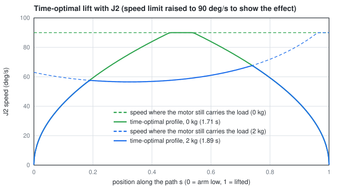

The solid curves are the speed along the path. With a 2 kg payload the profile rides along the dashed cap in the
middle of the lift, where the arm is horizontal and the load on J2 is largest.

### With numbers

The example turns J1 alone by 40°, at $v$ = 90°/s and $a$ = 180°/s². $v^2/a = 45°$, more than 40°: the joint can't
reach full speed, so the fastest profile is §7's **triangle**, $T = 2\sqrt{40/180} = 0.9428$ s. TOPP-RA, which knows
nothing about trapezoids, finds 0.9428 s. (Until 14 Oct this example compared against $d/v + v/a = 0.944$ s, the
cruise formula, which doesn't apply here; a loose tolerance hid it.)

| Symbol | In the code |
|---|---|
| $s$ grid, $\Delta s$ | `s`, `ds` (100 intervals by default) |
| $q'$, $q''$ | `qs`, `qss` |
| $x$, $u$ | `x`, `u_seg` |
| $a$, $b$, $c$ | `a`, `bq`, `c` |
| $[lo_k,hi_k]$ | `lo`, `hi` |
| speed cap on $x$ | `xmax` |

```python
import numpy as np
from deskarm import load_arm
from deskarm.topp import joint_path, time_optimal

arm = load_arm()
q1 = arm.home + np.deg2rad([40, 0, 0, 0, 0, 0, 0])               # J1 only
traj, info = time_optimal(arm, joint_path(arm.home, q1))
d, v, a = np.deg2rad(40), arm.vmax[0], arm.amax[0]
assert d < v * v / a                                             # too short to reach full speed: a triangle
assert abs(traj.duration - 2 * np.sqrt(d / a)) < 0.005           # equals the triangle optimum, 0.943 s
```

---
## 10. Masses, gravity torque and the torque budget

**What it's for.** How much torque does each joint need just to hold the arm up? This sizes the motors and gear
ratios (`tools/torque_budget.py`), feeds the torque guard, and sets the spring (§13).

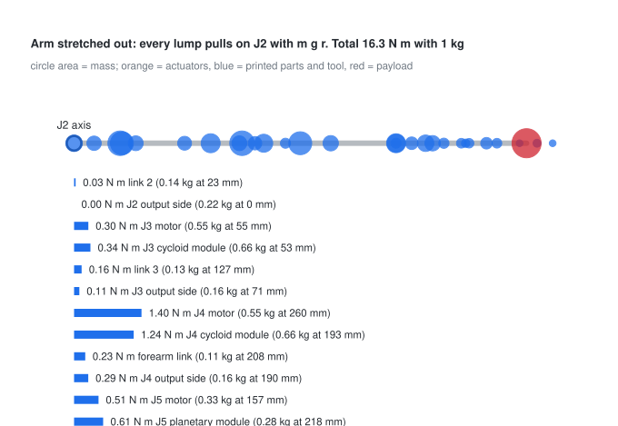

### Derivation

**Step 1: torque of one weight about one joint.** A force $F$ acting at point $p$ has moment $(p-o)\times F$ about a
point $o$; the part that loads a joint is its component along the joint axis $\hat z_k$. The weight of a mass $m$ is
$F = -mg\thinspace\hat z_\text{up}$, and the motor must supply the opposite to hold it. With $r = p - o_k$:

$$
\tau_k = -\hat z_k\cdot\big(r\times(-mg\thinspace\hat z_\text{up})\big)=m\thinspace g\thinspace\hat z_k\cdot\big(r\times\hat z_\text{up}\big)
$$

$r\times\hat z_\text{up}$ only sees the horizontal part of $r$, so this is "weight times horizontal lever arm", signed
by which way it turns the joint. Each joint carries every mass beyond it, so `ArmModel.gravity_torque` sums over those.
(This is $\tau = J^\top f$ of §3, applied to each mass.)

**Step 2: merging lumps on one link** (`ArmModel._lump_inertials`). The total mass and centre of mass are the
mass-weighted sum and average, $M=\sum m_k$, $c=\frac1M\sum m_kp_k$. For the inertia, each lump is a solid sphere of
radius $r_k$ (own inertia $\tfrac25m_kr_k^2$ about any axis through its centre), moved to the common centre by the
**parallel-axis theorem**. Its derivation: the inertia about $c$ of a point mass at offset $d$ is
$m(\lVert d\rVert^2\mathbf 1-dd^\top)$ (the definition $\sum m(\lVert x\rVert^2\mathbf 1 - xx^\top)$ with $x = d$). So:

$$
I=\sum_k\left[\tfrac25m_kr_k^2\thinspace\mathbf 1+m_k\big(\lVert d_k\rVert^2\thinspace\mathbf 1-d_kd_k^\top\big)\right],\qquad d_k=p_k-c
$$

**Step 3: the budget** (`tools/torque_budget.py`).

| Quantity | Definition |
|---|---|
| static | $\max\lvert\tau_k\rvert$ over every combination of J2…J6 at −90°, 0, +90° (the worst cases of an arm like this are at right angles) |
| design | static × 1.5 (acceleration) × 1.3 (safety). J1 carries no gravity load: its design torque is $I_\text{yaw}\ddot q_{1,\max}\times1.3$, with $I_\text{yaw}=\sum m(x^2+y^2)$ for the stretched arm |
| at 0 | $0.75\times T_\text{hold}\times\text{ratio}\times\text{efficiency}$ |
| at vmax | the same at the joint's speed limit, from §11 |
| pass | at 0 ≥ design, and at vmax ≥ static × 1.3 |

**Tipping** uses the same moment: the arm tips about the edge of its base board when the J2 moment exceeds
$M_\text{total}\thinspace g$ times the distance $\ell$ from the arm to the edge, so $M_\text{total}\ge\tau_{J2}/(g\thinspace\ell)$.

### With numbers

**J2 with the arm stretched out horizontally** ($q_2 = 90°$, everything else 0) and 1 kg in the gripper. Turning the
arm 90° about the J2 axis makes each mass's lever its height in the zero pose minus 0.209 m (the shoulder), whatever its
offset to the side. The `arm.toml` lumps (from the CAD, [20](20_cad_full_arm.md) §9) grouped by the joint that carries
them, with mass-weighted levers:

| Carried by | $m$ (kg) | lever (m) | $m\thinspace g\thinspace r$ (N·m) |
|---|---|---|---|
| J2 (J2 output, link 2, J3 module and motor) | 1.569 | 0.044 | 0.670 |
| J3 (J3 output, link 3, J4 module and motor) | 1.490 | 0.199 | 2.911 |
| J4 (J4 output, forearm, J5 module and motor) | 0.885 | 0.189 | 1.641 |
| J5 (J5 output, link 5, J6 module and motor) | 0.828 | 0.348 | 2.828 |
| J6 (J6 output, link 6, J7 module and motor, slip ring) | 0.524 | 0.401 | 2.064 |
| J7 (J7 output, tool changer, 3-prong gripper 0.116 kg) | 0.233 | 0.463 | 1.059 |
| payload | 1.000 | 0.550 | 5.396 |
| **sum** | 6.53 | | **16.57** |

`gravity_torque` returns −16.57 N·m for J2 (26 Oct masses; 16.60 before the edge treatment): the sign says the weight
turns J2 the negative way. The payload and gripper ($0.116\times9.81\times0.486 = 0.55$ N·m) are
$(5.396+0.55)/16.57$ = 36% of it. (The TCP moved from 80 to 110 mm
past the flange when the 3-prong gripper was drawn on 20 Oct, so the payload lever grew from 0.52 to 0.55 m.) (With the hand estimates used until 20 Oct,
5.39 kg on centreline lumps, it was 14.92 N·m.)

**Does J2 hold it?** Design torque $16.57\times1.5\times1.3 = 32.31$ N·m. Available at standstill, from the derate,
the 1.9 N·m holding torque, the ratio and the efficiency: $0.75\times1.9\times48\times0.63 = 43.09$ N·m.
Margin $43.09/32.31 = 1.33$ in this pose. The budget reports 1.32: with the CAD's off-centre lumps, its search finds a
slightly worse pose between the grid points (16.76 N·m).

```python
import numpy as np
from deskarm import load_arm
from deskarm.kinematics import G

arm = load_arm()
stretched = np.deg2rad([0, 90, 0, 0, 0, 0, 0])
tau = arm.gravity_torque(stretched, payload_kg=1.0)
by_hand = sum(m.mass * G * (m.pos[2] - 0.209) for m in arm.masses if m.link >= 1) + 1.0 * G * 0.55
assert np.isclose(abs(tau[1]), by_hand)               # J2: sum of m g r
print(np.round(tau, 2))
```

---

## 11. Stepper torque vs speed

**What it's for.** A stepper's rated torque is a standstill number. `motor.py` computes how much is left at speed,
which is what limits how fast a loaded joint can move.

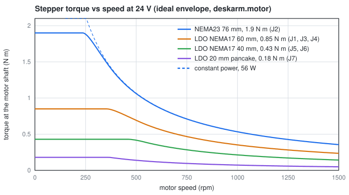

### Derivation

**Step 1: one winding.** Each phase is a resistance $R$ and inductance $L$ with a back-EMF $e$ from the spinning
magnet: $v = Ri + L\thinspace di/dt + e$.

**Step 2: look from the rotor.** A hybrid stepper with $p = 50$ pole pairs is a two-phase synchronous motor whose
electrical angle turns $p$ times faster than the shaft. Write the two phase currents as one vector and view it from a
frame turning with the rotor at electrical speed $p\omega$ (the d-q frame, the one FOC drivers control in). In a turning
frame a constant vector still changes in the fixed frame, which adds a cross term $p\omega L$ times the current turned by
90°. At steady speed nothing changes in the rotor frame ($di/dt = 0$), leaving, with $X = p\omega L$:

$$
v_d=R\thinspace i_d-X\thinspace i_q,\qquad v_q=R\thinspace i_q+X\thinspace i_d+E,\qquad E=K_t\thinspace\omega,\qquad T=K_t\thinspace i_q
$$

Only the q current (at 90° to the magnet) makes torque; the back-EMF lies on q.

**Step 3: two limits.** The driver can push at most the rated current in each phase. Holding torque is specified with
both phases at rated current, a current vector of length $\sqrt2\thinspace I_\text{rated}$, so

$$
i_d^2+i_q^2\le I_{\max}^2,\qquad I_{\max}=\sqrt2\thinspace I_\text{rated},\qquad K_t=\frac{T_\text{hold}}{I_{\max}}
$$

and the supply caps the voltage vector: $v_d^2+v_q^2\le V^2$. Substitute Step 2 and expand. The cross terms in $i_d i_q$
cancel ($-2RXi_di_q$ from the first square, $+2RXi_di_q$ from the second), leaving a quadratic in $i_q$:

$$
(X^2+R^2)\thinspace i_q^2+2RE\thinspace i_q+\big[(R\thinspace i_d)^2+(X\thinspace i_d+E)^2-V^2\big]\le0
$$

For each $i_d\le0$ the code takes the larger root of that, the current-circle bound $\sqrt{I_{\max}^2-i_d^2}$, the smaller
of the two, and then the best over a grid of $i_d$ (negative $i_d$ is "field weakening", which a stepper does by itself
as its load angle grows).

**Step 4: the shape of the answer.** Ignore $R$ for a moment. Full current with $i_d = 0$ needs
$(XI_{\max})^2+E^2\le V^2$, which holds up to the **corner speed**

$$
\omega_c=\frac{V}{\sqrt{(pLI_{\max})^2+K_t^2}}
$$

Above it, the best choice is $i_d=-E/X$ (it cancels the back-EMF in $v_q$), leaving $(Xi_q)^2\le V^2$, so $i_q = V/X$ and

$$
T\approx\frac{K_tV}{p\thinspace\omega\thinspace L}\qquad\Rightarrow\qquad P=T\omega\approx\frac{K_tV}{pL}=\text{constant}
$$

Above the corner a stepper is a **constant-power** device, set by the supply voltage and the winding inductance. A
gearbox trades torque for speed but cannot add power, which is why a higher ratio does not make a loaded joint faster.

### With numbers

**J2's motor** (LKD57HS76: $T_\text{hold}$ = 1.9 N·m, 2.8 A, 1.13 Ω, 3.6 mH, 24 V):

- $I_{\max} = \sqrt2\times2.8 = 3.96$ A, $K_t = 1.9/3.96 = 0.480$ N·m/A.
- Corner: $pLI_{\max} = 50\times0.0036\times3.96 = 0.713$, so $\omega_c = 24/\sqrt{0.713^2+0.480^2} = 27.9$ rad/s = 267 rpm.
  Through the 48:1 drive that is 33°/s at the joint: above that J2 starts losing torque.
- Constant power, ignoring $R$: $0.480\times24/(50\times0.0036) = 64$ W. The full model, with $R$, gives 55.9 W: 1.13 Ω
  takes about an eighth of the voltage, and the torque starts to fall a little earlier, at ~250 rpm.
- The model's torque: 1.90 N·m at 20 rad/s, 1.76 at 30, 1.11 at 50, 0.70 at 80; $T\omega$ = 53, 56, 56 W from 30 rad/s on.
- At J2's 55°/s limit the motor turns at $55\times48/6 = 440$ rpm (46.1 rad/s) and gives 1.205 N·m, so the joint has
  $0.75\times1.205\times48\times0.63 = 27.3$ N·m, which is `ArmModel.torque_limit` at that speed.

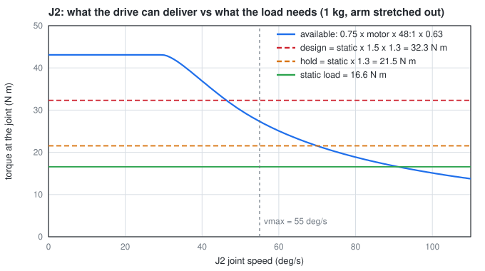

The model is an upper bound (no iron losses, no resonance, no pull-out margin), so the arm is planned at
`torque_derate` = 0.75 of it. `ArmModel.torque_limit(qd)` is this curve seen at the joint (× derate × ratio ×
efficiency, at joint speed `qd`), and `speed_at_torque` is its inverse.

| Symbol | In the code (`stepper_torque`) |
|---|---|
| $T_\text{hold}$, $I_\text{rated}$, $R$, $L$, $V$, $p$ | `hold_torque`, `rated_current`, `resistance`, `inductance`, `voltage`, `pole_pairs` |
| $I_{\max}$, $K_t$ | `i_max`, `kt` |
| $X$, $E$ | `X`, `E` |
| voltage-limit root, current-circle bound | `iq_voltage`, `iq_current` |

```python
import numpy as np
from deskarm.motor import stepper_torque

n17 = dict(hold_torque=0.65, rated_current=2.1, resistance=1.6, inductance=3.0e-3)
w = np.array([0.0, 100.0, 200.0])                    # rad/s: 0, 955 and 1910 rpm
t = stepper_torque(w, **n17, voltage=24.0)
assert np.isclose(t[0], 0.65)                        # holding torque at standstill
assert abs(t[1] * w[1] - t[2] * w[2]) < 1.0          # same power (W) at both speeds
```

---

## 12. The physics simulation

**What it's for.** `physics.py` runs the arm in MuJoCo with gravity, inertia, torque-limited motors and springy
gearboxes, so a move that would stall or ring the real arm does so on screen first.

### Derivation

**Step 1: the servo** (`_servo_gains`, `MujocoBackend.step`). Each joint is a position controller with a torque ceiling:

$$
\tau=\operatorname{clip}\Big(k_p(q_\text{ref}-q)+k_v(\dot q_\text{ref}-\dot q),\ \pm\tau_{\max}(\dot q)\Big)
$$

A closed-loop stepper delivers full torque once the rotor lags the commanded position by one full step (1.8° at the
motor, $1.8°/\text{ratio}$ at the joint). Making the proportional term reach $\tau_{\max}$ at that lag fixes $k_p$:

$$
k_p=\frac{\tau_{\max}}{1.8°/\text{ratio}}
$$

For the damping, one joint alone is $M\ddot q + k_v\dot q + k_pq = 0$. Its characteristic equation
$M\lambda^2+k_v\lambda+k_p=0$ has a repeated root, the fastest response without overshoot, when the discriminant
$k_v^2-4Mk_p$ is zero:

$$
k_v=2\sqrt{k_p\thinspace M_{ii}}
$$

with $M_{ii}$ the inertia that joint feels at the home pose. MuJoCo's position actuator computes $k_p(\text{ctrl}-q)-k_v\dot q$,
so the code folds the velocity feed-forward into the target: $\text{ctrl}=q_\text{ref}+(k_v/k_p)\dot q_\text{ref}$ gives
$k_p(q_\text{ref}-q) + k_v\dot q_\text{ref} - k_v\dot q$, the same thing. The reference chases the commanded target at no
more than the joint's speed limit (with `streamed=True`, spread evenly over the poll instead, like `CanBackend`'s F5
moves: §20 Step 4), and $\tau_{\max}(\dot q)$ is §11's curve, updated every 0.5 ms step.

**Step 2: the gearbox as a spring with a gap** (`build_model(compliant=True)`).

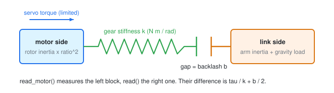

Each joint is two inertias, the motor (rotor inertia × ratio², the "armature") and the link, joined by a spring of
stiffness $k$ that only engages once the gap, the backlash $b$, is taken up. With $\delta=q_\text{link}-q_\text{motor}$:

$$
\tau_\text{gear}=\begin{cases}-k(\delta-b/2)&\delta\gt b/2\cr 0&\lvert\delta\rvert\le b/2\cr -k(\delta+b/2)&\delta\lt -b/2\end{cases}
$$

At rest under a load $\tau$ the spring must push back with exactly $\tau$, so $k(\lvert\delta\rvert-b/2) = \lvert\tau\rvert$:

$$
\lvert\delta\rvert=\frac{\lvert\tau\rvert}{k}+\frac b2
$$

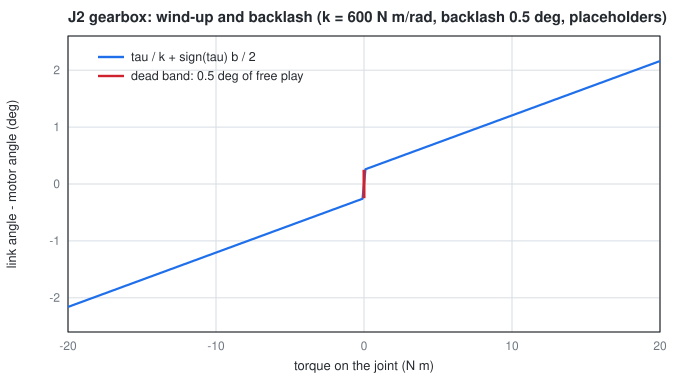

That sag is what the output encoders will see and the motor encoders won't: `read()` is the link, `read_motor()` the
motor. Reversing the load gives §17's push test.

**Step 3: how fast it rings.** With the motor held, the link on the spring is $I\ddot\delta = -k\delta$, a harmonic
oscillator with $\delta = A\sin(\omega t)$ and $\omega^2 = k/I$:

$$
f=\frac{\omega}{2\pi}=\frac{1}{2\pi}\sqrt{\frac{k}{I_\text{link}}}
$$

The spring also carries damping $c=2\zeta\sqrt{k\thinspace I_\text{link}}$ with $\zeta=0.1$ per joint (an assumption; same
discriminant argument as Step 1, scaled to 10% of critical).

**Step 4: stalls.** If a motor lags its reference by more than 5° for 0.15 s, the joint is reported stalled and the arm
disables, which is what a closed-loop stepper driver does.

**Inverse dynamics** (`TorqueModel.inverse`) is the other direction: given a planned $q,\dot q,\ddot q$, what torque is
needed? $\tau=M(q)\ddot q+C(q,\dot q)\dot q+g(q)$, minus the spring's help (§13). The torque guard compares that with
$\tau_{\max}(\dot q)$ at every sample of a move.

### With numbers

**J2's servo gain.** $\tau_{\max}$ at standstill is 43.09 N·m (§10); one motor step is $1.8°/48 = 0.0375°$ =
$6.545\times10^{-4}$ rad at the joint, so $k_p = 43.09/6.545\times10^{-4} = 65\thinspace840$ N·m/rad. The servo is about 100
times stiffer than the gearbox spring behind it (600 N·m/rad), which is why the link's sag is almost all gearbox.

**J2's sag, stretched with 1 kg.** $\tau = 16.57$ N·m, $k = 600$ N·m/rad, $b = 0.5°$:
$\lvert\delta\rvert = 16.57/600 + 0.5°/2 = 0.02762$ rad $+ 0.25° = 1.582° + 0.25° = 1.83°$. At the tool, 0.55 m out, that is
$0.55\times\sin(1.83°) = 18$ mm.

**J2's ringing.** Treat the stretched arm as point masses: $I = \sum m r^2 = 0.639$ kg·m² (the masses and levers of §10,
with 1 kg at 0.55 m). $f = \sqrt{600/0.639}/(2\pi) = 4.9$ Hz. With the elbow and wrist springs in series the arm's first
mode comes out at 3.64 Hz in the simulation (`tools/sim_modes.py`, CAD masses; 3.7 Hz with the hand estimates). The simulation starts with every link already sagged onto its spring,
because starting with slack springs would drop the arm onto them and overshoot to twice the static torque (a mass
released onto a spring swings to twice its rest deflection).

| Symbol | In the code |
|---|---|
| $k_p$, $k_v$, $\tau_{\max}$ | `kp`, `kv`, `lim` in `_servo_gains`; `actuator_forcerange` |
| $q_\text{ref}$ | `self._ref` |
| $k$, $b$, $c$ | `gear_stiffness`, `backlash`; tendon `stiffness`, `springlength`, `damping` |
| $\delta$ | a MuJoCo fixed tendon: link angle − motor angle |
| stall thresholds | `stall_deg`, `stall_time` |

```python
import numpy as np
from dataclasses import replace
from deskarm import load_arm
from deskarm.physics import MujocoBackend

arm = replace(load_arm(), counterbalance=None)
stretched = np.deg2rad([0, 90, 0, 0, 0, 0, 0])
be = MujocoBackend(arm, q0=stretched, payload_kg=1.0)
sag = (be.read_motor() - be.read())[1]                   # J2: link behind the motor
j = arm.joints[1]
tau = arm.gravity_torque(stretched, 1.0)[1]
assert np.isclose(sag, tau / j.gear_stiffness + np.sign(tau) * j.backlash / 2)
```

---

## 13. The counterbalance spring

**What it's for.** A spring that carries part of the arm's weight, so J2's motor doesn't hold all of it
(`counterbalance.py`).

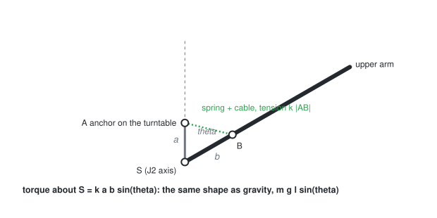

### Derivation

**Step 1: set up.** Put the J2 axis S at the origin. The anchor A sits a height $a$ above it, on the part that doesn't
pitch: $A = a\hat z$. The spring attaches at B, a distance $b$ along the upper arm, whose direction $\hat u$ is at angle
$\theta$ from vertical: $B = b\hat u$.

**Step 2: a zero-length spring.** It pulls with tension proportional to its whole length (not its stretch), toward A:
$F = k(A-B)$. Its moment about S:

$$
\begin{aligned}
\tau &= (B-S)\times F = b\hat u\times k(a\hat z-b\hat u)\cr
&= k\thinspace a\thinspace b\thinspace(\hat u\times\hat z)-k\thinspace b^2(\hat u\times\hat u)\cr
&= k\thinspace a\thinspace b\thinspace(\hat u\times\hat z)\qquad(\text{a vector crossed with itself is zero})
\end{aligned}
$$

$\hat u$ and $\hat z$ are unit vectors at angle $\theta$, so $\lvert\hat u\times\hat z\rvert = \sin\theta$:

$$
\lvert\tau\rvert=k\thinspace a\thinspace b\thinspace\sin\theta
$$

**Step 3: it matches gravity.** A rigid arm of weight $mg$ with its centre at distance $\ell$ needs
$mg\ell\sin\theta$ (§10, the horizontal lever is $\ell\sin\theta$). Same shape. Choose $kab = mg\ell$ and the arm is
balanced at **every** angle. In practice the spring's own length is hidden by running a cable over a pulley at A.

**Step 4: why it can't be perfect here.** The arm is not rigid: bending the elbow or picking something up changes
$mg\ell$. So `size_spring` picks $k$ to make the **worst case** as small as possible, over ~600 random reachable poses $q$
and both ends of the payload range $m_p$:

$$
k^\ast=\arg\min_k\ \max_{q,m_p}\ \big\lvert g_2(q,m_p)-k\thinspace s(q)\big\rvert
$$

where $g_2$ is J2's gravity torque (§10) and $s(q)$ the torque of a unit-stiffness spring. Each term inside the max is
the absolute value of a straight line in $k$, which is convex (V-shaped); a maximum of convex functions is convex, so it
has one minimum and a ternary search finds it.

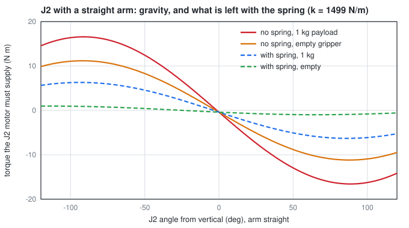

### With numbers

`arm.toml`: $k$ = 1499 N/m, $a$ = 0.070 m, $b$ = 0.098 m, so $kab = 1499\times0.070\times0.098 = 10.28$ N·m, the spring's torque
with the upper arm horizontal ($\sin90° = 1$). Stretched out horizontally, gravity on J2 is 11.17 N·m empty and 16.57 N·m
with 1 kg (§10). What the motor still holds: $11.17-10.28 = 0.89$ N·m empty, $16.57-10.28 = 6.29$ N·m loaded. The spring
takes 62% of the loaded case. (D41: the spring is deferred, so for now the motor holds all of it.) Only the product $kab$ matters, so a longer $a$ and $b$ buy a softer spring and less
force on the printed anchor: the peak spring force is $k\lVert A-B\rVert$, at most $1499\times(0.070+0.098) = 252$ N
(219 N over the ±120° J2 range). The CAD sets the short $a$ and $b$: the lug on link 2 must pass under link 3 and
clear the pulley ([20](20_cad_full_arm.md)); $a$ = 0.10, $b$ = 0.15 m did the same with 574 N/m and at most 144 N.

| Symbol | In the code |
|---|---|
| S, A, B, joint axis | `spring_geometry` |
| $a$, $b$, $k$ | `anchor_height`, `attach_distance`, `stiffness` in `[counterbalance]` |
| $\tau$ | `spring_torque` (general 3-D cross product, also handles a spring with a free length) |
| $g_2$, $s$, worst case | `G`, `unit`, `worst(k)` in `worst_case_torque` |

```python
import numpy as np
from deskarm import load_arm
from deskarm.counterbalance import spring_torque

arm = load_arm()
cb = arm.counterbalance
theta = np.deg2rad(50)
tau = spring_torque(arm, [0, theta, 0, 0, 0, 0, 0])[1]
assert np.isclose(abs(tau), cb.stiffness * cb.anchor_height * cb.attach_distance * np.sin(theta))
```

---

## 14. Self-collision: capsules

**What it's for.** Refuse moves that fold the arm into itself (`collision.py`). Joint limits can't catch these because
they depend on several joints at once.

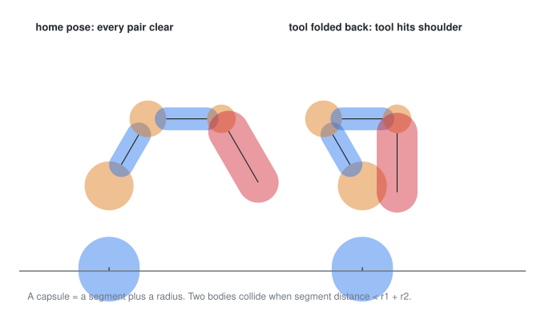

**Model.** Each body is a **capsule**: all points within a radius $r$ of a line segment (a sphere when the segment has
zero length). Two capsules overlap exactly when the distance between their segments is less than $r_1+r_2$, so the whole
check reduces to segment-to-segment distance.

### Derivation

**Step 1: the squared distance.** Points on the two segments are $P(s)=p_1+s\thinspace d_1$ and $Q(t)=p_2+t\thinspace d_2$,
$s,t\in[0,1]$. With $r = p_1-p_2$:

$$
f(s,t)=\lVert P(s)-Q(t)\rVert^2=\lVert r+s\thinspace d_1-t\thinspace d_2\rVert^2
$$

**Step 2: set both partial derivatives to zero.**

$$
\frac{\partial f}{\partial s}=2\thinspace d_1\cdot(r+s\thinspace d_1-t\thinspace d_2)=0,\qquad
\frac{\partial f}{\partial t}=-2\thinspace d_2\cdot(r+s\thinspace d_1-t\thinspace d_2)=0
$$

Name the dot products $a=d_1\cdot d_1$, $b=d_1\cdot d_2$, $c=d_1\cdot r$, $e=d_2\cdot d_2$, $f=d_2\cdot r$. The two
equations are $as - bt = -c$ and $bs - et = -f$. The second gives $t = (bs+f)/e$; putting it in the first:

$$
as-\frac{b(bs+f)}{e}=-c\quad\Rightarrow\quad s\thinspace(ae-b^2)=bf-ce\quad\Rightarrow\quad
s=\frac{bf-ce}{ae-b^2},\qquad t=\frac{bs+f}{e}
$$

**Step 3: stay on the segments.** Clip $s$ to $[0,1]$ and compute $t$; if $t$ falls outside $[0,1]$, clip it and
recompute $s = (bt - c)/a$ for that $t$ (clipped again). When $ae - b^2 = 0$ the segments are parallel ($b^2 = ae$ is
equality in Cauchy-Schwarz), every $s$ gives the same distance, and the code takes $s = 0$.

**Which pairs.** Seven bodies: base column, shoulder, upper arm, elbow, forearm, wrist, tool. Neighbours (up to one
housing apart) always touch and are left to the joint limits; the remaining 10 pairs are checked. The clearance is
`distance − r1 − r2`, and anything under 5 mm is reported.

### With numbers

Segment 1 from $(0,0,0)$ to $(1,0,0)$, segment 2 from $(0.5,1,-1)$ to $(0.5,1,1)$ (they cross at right angles, 1 apart):
$d_1 = (1,0,0)$, $d_2 = (0,0,2)$, $r = (-0.5,-1,1)$. Then $a = 1$, $b = 0$, $c = -0.5$, $e = 4$, $f = 2$, so
$s = (0\cdot2-(-0.5)\cdot4)/(1\cdot4-0) = 0.5$ and $t = (0+2)/4 = 0.5$: the closest points are $(0.5,0,0)$ and $(0.5,1,0)$,
distance 1. In the folded pose of the example the tool's capsule overlaps the J3 motor's by 26 mm (clearance −26 mm,
with the 3-prong gripper's r 50 mm tool capsule; −3.8 mm against the shoulder before the CAD capsules), so the move
is refused.

| Symbol | In the code |
|---|---|
| $a$, $b$, $c$, $e$, $f$ | `a`, `b`, `c`, `e`, `f` |
| body radii | `Geometry` and `ATTACHED` (from the CAD, [21](21_checks_and_review.md) §5) |
| checked pairs | `PAIRS` |

```python
import numpy as np
from deskarm import load_arm
from deskarm.collision import min_clearance, self_collisions

arm = load_arm()
assert self_collisions(arm, arm.home) == []
tucked = np.deg2rad([0, -30, 0, 120, 0, 90, 0])            # tool folded back into the shoulder
gap, pair = min_clearance(arm, tucked)
assert gap < 0 and "tool" in pair
```

---

## 15. Gear geometry (design tools)

**What it's for.** `tools/cycloid.py` and `tools/gears.py` generate the tooth shapes you import into Fusion. This
section also derives every number in the J2 bench gearbox plans.

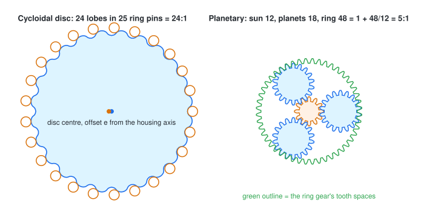

### Derivation: the cycloid's ratio

$N$ fixed ring pins on a circle of radius $R$; the disc has $N-1$ lobes and its centre is offset from the axis by the
eccentricity $e$; the input shaft carries the disc's centre around a circle of radius $e$.

**Step 1: treat it as an internal gear pair.** The disc meshes inside the pin ring like an external gear with $N-1$ teeth
inside an internal gear with $N$. For any gear pair on a moving carrier (here the eccentric, angle speed $\omega_c$), the
speeds relative to the carrier are in the inverse ratio of the tooth counts, with the same sign for an internal mesh:

$$
\frac{\omega_\text{disc}-\omega_c}{\omega_\text{ring}-\omega_c}=\frac{N}{N-1}
$$

**Step 2: hold the ring.** $\omega_\text{ring}=0$:

$$
\omega_\text{disc}=\omega_c\left(1-\frac{N}{N-1}\right)=-\frac{\omega_c}{N-1}
$$

One input turn moves the disc back by one lobe: the ratio is $N-1$ and the output **reverses**. J2: $N = 25$, so 24:1.
The output pins take the disc's rotation and ignore its wobble (Step 6).

### Derivation: the disc outline

**Step 3: where a pin goes, seen from the disc.** Use complex numbers for points in the plane. With input angle
$\varphi$, the disc centre is at $e\thinspace e^{i\varphi}$ and the disc has turned by $\beta = -\varphi/(N-1)$ (Step 2).
A pin fixed at $Re^{i\gamma}$, seen from the disc (shift to the disc centre, then undo the disc's turn), is at

$$
p = e^{-i\beta}\big(Re^{i\gamma}-e\thinspace e^{i\varphi}\big)=Re^{i(\gamma+\varphi/(N-1))}-e\thinspace e^{i\varphi N/(N-1)}
$$

Call the pin's angle as seen from the disc $t = \gamma+\varphi/(N-1)$. For the pin at $\gamma = 0$, $\varphi = (N-1)t$ and
the second exponent is $Nt$:

$$
p(t)=Re^{it}-e\thinspace e^{iNt}\qquad\Rightarrow\qquad x=R\cos t-e\cos(Nt),\quad y=R\sin t-e\sin(Nt)
$$

This **pitch curve** is the path every pin centre traces on the disc (the other pins trace the same curve, shifted in
$t$). The second term turns $N-1$ times faster than the first relative to it, so the curve has $N-1$ lobes. The code
writes $y$ with the opposite sign, which is the same curve run backwards.

**Step 4: offset by the pin.** The disc's edge is the pitch curve moved inward by the pin radius $R_r$ (plus clearance),
along the curve's normal. The normal's direction relative to the radius is the angle $\psi$:

$$
\psi(t)=\operatorname{atan2}\big(\sin((1-N)t),\ \tfrac{R}{eN}-\cos((1-N)t)\big)
$$

$$
x=R\cos t-R_r\cos(t+\psi)-e\cos(Nt),\qquad y=-R\sin t+R_r\sin(t+\psi)+e\sin(Nt)
$$

**Step 5: the limits.**
- *Radii.* $\lvert p(t)\rvert$ is largest when the two terms line up ($R+e$) and smallest when they oppose ($R-e$).
  Offsetting inward by $R_r$: the disc runs from $r_{\min} = R-e-R_r$ to $r_{\max} = R+e-R_r$.
- *No loops.* $p'(t) = i\big(Re^{it}-Ne\thinspace e^{iNt}\big)$ has length at least $R-Ne$, so it never stops (no cusp or
  loop) as long as $e \lt  R/N$.
- *No undercut.* The inward offset works only where the pitch curve bends more gently than a circle of radius $R_r$.
  Its curvature is $\kappa=\dfrac{x'y''-y'x''}{(x'^2+y'^2)^{3/2}}$, and `min_convex_radius` returns
  $\rho_{\min} = 1/\max\kappa$ over the convex parts: the pin radius plus clearance must be less.
- *Pins can't be thinner than the wobble*: $e \lt  R_r$.

**Step 6: the output holes.** The output pins are fixed to the output flange, which turns about the main axis. The
disc's centre is $e$ off that axis and orbits it, so seen from the disc an output pin moves on a circle of radius $e$. A
hole of diameter (pin + $2e$) lets it do that while always touching one side, which is how it takes the torque:

$$
d_\text{hole}=d_\text{pin}+2e
$$

### With numbers: the J2 disc

$N = 25$, $R = 50$ mm, pins Ø6 ($R_r = 3$, plus 0.1 clearance, so 3.1), $e = 1.6$ mm (`tools/cycloid.py`, all checks pass):

| Quantity | Formula | Value |
|---|---|---|
| ratio | $N-1$ | 24:1, reversing |
| no loops | $e \lt  R/N$ | 1.6 < 50/25 = 2.0 |
| pins thicker than the wobble | $e \lt  R_r$ | 1.6 < 3 |
| no undercut | $R_r+0.1 \lt  \rho_{\min}$ | 3.1 < 5.76 |
| disc radius | $R\pm e-R_r$ | 50 − 1.6 − 3.1 = 45.3 to 50 + 1.6 − 3.1 = 48.5 (Ø97.0) |
| output holes | $6+2\times1.6$ | Ø9.2 |
| output pin circle | halfway between the bearing seat (r 16) and $r_{\min}$ | (16 + 45.3)/2 = 30.65 |
| web, bore to hole | $30.65-4.6-16$ | 10.05 |
| web, hole to lobe root | $45.3-30.65-4.6$ | 10.05 |
| web, hole to hole (8 holes) | $2\times30.65\sin(180°/8)-9.2$ | 23.46 − 9.2 = 14.26 |

J3/J4 ($R = 36$, Ø5 pins, $e = 1.1$): disc 32.3-34.5, holes Ø7.2 on r 24, webs 4.4 and 4.7. J1 ($N = 26$, $R = 40$,
$e = 1.2$): 25:1, disc 36.2-38.6.

### Derivation: the J2 belt and shaft

**Step 7: belt length** (open belt, pitch diameters $D_1 \lt  D_2$, centre distance $C$). The straight runs leave each
pulley tangentially at an angle $\alpha$ off the centre line, with $\sin\alpha=(D_2-D_1)/(2C)$. Each straight run is
$C\cos\alpha$ long; the big pulley is wrapped over $\pi+2\alpha$ and the small one over $\pi-2\alpha$:

$$
L=2C\cos\alpha+\frac{D_2}{2}(\pi+2\alpha)+\frac{D_1}{2}(\pi-2\alpha)=2C\cos\alpha+\frac{\pi}{2}(D_1+D_2)+\alpha(D_2-D_1)
$$

For small $\alpha$: $\alpha\approx(D_2-D_1)/(2C)$ and $\cos\alpha\approx1-\alpha^2/2$, so
$2C\cos\alpha+\alpha(D_2-D_1)\approx2C-C\alpha^2+2C\alpha^2 = 2C+C\alpha^2$:

$$
L\approx2C+\frac{\pi}{2}(D_1+D_2)+\frac{(D_2-D_1)^2}{4C}
$$

HTD-3M has a 3 mm pitch, so a $Z$-tooth pulley has pitch diameter $3Z/\pi$: 20T is 19.10 mm, 40T is 38.20 mm. Then
$\tfrac{\pi}{2}(19.10+38.20) = 90.00$ and $(38.20-19.10)^2/4 = 91.19$:

$$
L\approx2C+90.00+\frac{91.19}{C}
$$

For the bought 276 mm belt: $2C^2-186C+91.19=0$, so $C=\big(186+\sqrt{186^2-8\times91.19}\big)/4 = 92.51$ mm. The exact
formula gives 92.507 ($\alpha = 5.9°$). That is the motor's centre distance in the plans; J3/J4's 231 mm belt gives 69.85 mm.

**Step 8: belt pull.** The motor's torque $T$ comes out as a difference in belt tension at the 20T pulley's pitch radius:
$F = T/(D_1/2)$. At full holding torque, $F = 1.9/0.00955 = 199$ N; at the planned 0.75 of it, 149 N. The shaft and the
motor's front bearing see this plus whatever pretension the belt is set to.

**Step 9: getting a bearing onto an eccentric lobe.** A 6804 has a Ø20 bore. To reach lobe 1 it slides along the input
shaft over the rear journal, then shifts sideways by $e$ onto the lobe. Sitting where it will on the lobe, its bore is a
circle of radius 10 centred $e$ off the axis; it clears the journal (radius $r_j$, centred on the axis) only if

$$
r_j+e\le10\qquad\Rightarrow\qquad r_j\le10-1.6=8.4\text{ mm, a journal of at most Ø16.8}
$$

The plans use Ø15, so the 6804s that sit on journals (B1, B4) need printed sleeves Ø15→Ø20. The thinnest wall of a lobe
(Ø20, centre $e$ off the axis) around the Ø8 bore is $10-e-4 = 4.4$ mm.

**Step 10: is the printed shaft strong enough?** It carries twice the motor torque (the belt is 2:1): at full holding
torque $T = 2\times1.9 = 3.8$ N·m = 3800 N·mm. A hollow round section (outside $D$, bore $d$) has polar moment
$J_p = \pi(D^4-d^4)/32$ and bending moment of area $I = J_p/2$. Torsion stress $\tau = T(D/2)/J_p$, bending stress
$\sigma = M(D/2)/I$, and the two combine (von Mises) as $\sqrt{\sigma^2+3\tau^2}$.

- **Full section, at bearing B1** (Ø15/Ø8): $J_p = \pi(15^4-8^4)/32 = 4568$ mm⁴, so $\tau = 3800\times7.5/4568 = 6.2$ MPa.
  The belt pull acts about 15 mm behind B1: $M = 199\times15 = 2985$ N·mm and $\sigma = 2985\times7.5/2284 = 9.8$ MPa.
- **At the double-D flats under the pulley** (treated as a Ø13 section, which is a little kind to it):
  $J_p = \pi(13^4-8^4)/32 = 2402$ mm⁴, $\tau = 3800\times6.5/2402 = 10.3$ MPa; 8.5 mm from the pulley centre
  $M = 199\times8.5 = 1691$ N·mm, $\sigma = 1691\times6.5/1201 = 9.2$ MPa; combined $\sqrt{9.2^2+3\times10.3^2} = 20.0$ MPa,
  or 15 MPa at the planned 0.75 of holding torque.

PETG is roughly 45-50 MPa in tension, less across layers and much less in fatigue. So the shaft is fine for the bench
but has no generous margin at the flats, before belt pretension is added. If it cracks or twists there, the fixes in
order: print it standing up (layers across the shaft are the weak direction otherwise), a Ø4 steel cross pin instead of
flats, or a metal tube core. (The plans first quoted only the 6.2 MPa torsion figure; corrected 14 Oct.)

### Derivation: the planetary

**Step 11: the ratio (Willis).** Relative to the carrier, a planetary is an ordinary gear train: sun → planet (external,
sign flips) → ring (internal, sign kept), so

$$
\frac{\omega_s-\omega_c}{\omega_r-\omega_c}=-\frac{Z_r}{Z_s}
$$

Hold the ring ($\omega_r = 0$): $\omega_s-\omega_c = \omega_c Z_r/Z_s$, so

$$
\frac{\omega_s}{\omega_c}=1+\frac{Z_r}{Z_s}
$$

**Step 12: will it go together?** The pitch radii must stack across the gearbox, $r_r = r_s+2r_p$, and with one module
radius is proportional to teeth: $Z_r=Z_s+2Z_p$. For $n$ evenly spaced planets to mesh at once, the sun and ring teeth
must line up the same way at every planet, which needs $(Z_s+Z_r)/n$ to be a whole number. Neighbouring planets must not
touch: the planet centres sit on radius $a = m(Z_s+Z_p)/2$, $360°/n$ apart, so they are $2a\sin(\pi/n)$ apart, and that
must exceed a planet's outside diameter $m(Z_p+2)$.

**Step 13: the tooth shape** (`gear_outline`). The flank is an involute: the path of the end of a string unwound from the
base circle $r_b = r\cos\alpha$ ($\alpha = 20°$). At radius $\rho$ on it, the pressure angle is $\alpha_\rho=\arccos(r_b/\rho)$
and the polar angle has advanced by $\operatorname{inv}(\alpha_\rho) = \tan\alpha_\rho-\alpha_\rho$ (unwound length $r_b\tan\alpha_\rho$
over radius $r_b$, minus the angle turned). Measured from the tooth's centre line, the flank at radius $\rho$ is at

$$
\theta(\rho)=\frac{s}{2r}+\operatorname{inv}(\alpha)-\operatorname{inv}(\alpha_\rho),\qquad s=\frac{\pi m}{2}-\frac{\text{backlash}}{2}
$$

with $s$ the tooth thickness at the pitch circle. The outline runs from the root radius $r-1.25m$ to the tip $r+m$ along
$\pm\theta(\rho)$. The ring gear is drawn as its tooth *spaces* (an external gear shape subtracted from a disc).
Herringbone teeth twist the profile by $\Delta\varphi=(\text{face}/2)\tan\beta/r$ over half the face and mirror it.

### With numbers: the J5/J6 wrist planetary

Sun 14, planet 19, ring 52, 3 planets, module 1.0:

- Geometry: $14+2\times19 = 52$. Assembly: $(14+52)/3 = 22$, a whole number.
- Ratio per stage: $1+52/14 = 4.7143$; two stages: $4.7143^2 = 22.2245$, the exact value in `arm.toml`.
- Planets: $a = (14+19)/2 = 16.5$ mm; spacing $2\times16.5\times\sin60° = 28.58$ mm, more than the planet's Ø21 outside
  diameter, so 7.6 mm between neighbours.

```python
import math, sys, pathlib
sys.path.insert(0, str(pathlib.Path.cwd().parent / "tools"))
import cycloid, gears

assert cycloid.min_convex_radius(50.0, 25, 1.6) > 3.0 + 0.1          # 6 mm pins don't undercut the 24:1 disc
sets = [s for s in gears.single_stage_sets(1.25, 3) if (s["zs"], s["zp"]) == (12, 18)]
assert sets[0]["zr"] == 48 and math.isclose(sets[0]["ratio"], 5.0)
p = 3.0 / math.pi                                                    # HTD-3M: pitch diameter per tooth
D1, D2, C = 20 * p, 40 * p, 92.5
alpha = math.asin((D2 - D1) / (2 * C))
L = 2 * C * math.cos(alpha) + math.pi / 2 * (D1 + D2) + alpha * (D2 - D1)
assert abs(L - 276) < 0.1                                            # the bought belt fits at C = 92.5
```

---

## 16. Absolute joint angle from the motor encoder

**What it's for.** After an E-stop cuts the power, the MKS drivers restart. Each still knows its motor's angle *within
one turn* (a 14-bit magnetic encoder on the motor shaft), but not how many whole turns it has made. `absolute_angle` in
`backends.py` gets the exact joint angle back from any rough reading of the joint that is good to half a motor turn: an
output encoder, or the angle saved before the power went. `CanBackend` uses it at start-up. The hardware side (which
sensor reads which joint, and the error budget) is in [16](16_packaging_and_routing.md) §3.

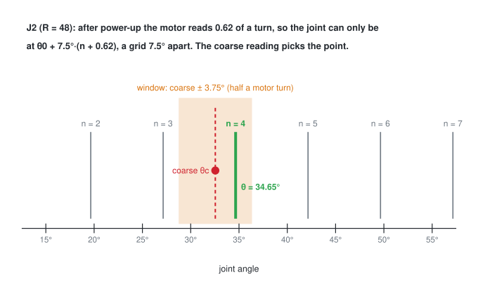

### Derivation

**Step 1: what the motor reading says.** The motor sits behind the whole drive (belt and gearbox), total ratio $R$, so
the motor turns $R(\theta-\theta_0)/2\pi$ turns while the joint goes from $\theta_0$ to $\theta$. The encoder only shows the
fraction of a turn, $m\in[0,1)$. If $(\theta_0, m_0)$ were recorded together, the turns since then are a whole number
$n$ plus the change in the fraction:

$$
\frac{R(\theta-\theta_0)}{2\pi}=n+m-m_0\qquad\Rightarrow\qquad\theta=\theta_0+\frac{2\pi}{R}(n+m-m_0)
$$

So the reading alone allows a grid of angles $2\pi/R$ apart.

**Step 2: let a coarse reading pick $n$.** A rough angle $\theta_c$ gives a rough turn count; round it:

$$
n=\operatorname{round}\left(\frac{R(\theta_c-\theta_0)}{2\pi}-(m-m_0)\right)
$$

**Step 3: when is that right?** The true $n$ is the same expression with $\theta$ in place of $\theta_c$, which is exactly a
whole number. Rounding gives the true $n$ as long as the two differ by less than $\tfrac12$:

$$
\left\lvert\frac{R(\theta_c-\theta)}{2\pi}\right\rvert\lt \frac12\qquad\Leftrightarrow\qquad\lvert\theta_c-\theta\rvert\lt \frac{\pi}{R}
$$

Past that it picks the neighbouring grid point, exactly $2\pi/R$ off, and nothing in the sum shows it. That is why the
coarse error budget matters, and why `CanBackend` refuses a start where $\lvert\theta-\theta_c\rvert$ lands in the outer third
of the window: a coarse sensor that far off can't be trusted to be inside it.

**Step 4: the ratio must be exact.** The angle is built from $n\cdot2\pi/R$, so a ratio off by a fraction $\varepsilon$
puts the angle off by about $\varepsilon\thinspace\lvert\theta-\theta_0\rvert$.

### With numbers

| Joint | $R$ | grid $360°/R$ | coarse reading must be within $\pm180°/R$ |
|---|---|---|---|
| J1 | 25 | 14.4° | ±7.2° |
| J2, J3, J4 | 48 | 7.5° | ±3.75° |
| J5, J6 | 22.2245 | 16.2° | ±8.1° |
| J7 | 15 | 24° | ±12° |

**The example** (J2, reference 0 rad at 0 turns). The joint is truly at 34.65°: $48\times34.65/360 = 4.62$ motor turns, so
the driver reads $m = 0.62$.
- Coarse 37.65° (3° high): $48\times37.65/360-0.62 = 5.02-0.62 = 4.40$, rounds to 4, $\theta = 360\times(4+0.62)/48 = 34.65°$. Right.
- Coarse 38.65° (4° high, outside ±3.75°): $5.153-0.62 = 4.533$, rounds to 5, $\theta = 360\times5.62/48 = 42.15°$: exactly
  one grid step (7.5°) wrong, and nothing in the numbers looks odd.

**Step 4 in numbers.** The wrist planetary is $(1+52/14)^2 = 22.2245$; storing 22.22 is off by
$\varepsilon = 0.0045/22.2245 = 2.0\times10^{-4}$, which costs $2.0\times10^{-4}\times180° = 0.036°$ over a 180° move, every
time. So `arm.toml` keeps every ratio exact.

**What this does not see.** $\theta$ here is the angle the *motor* implies. Backlash and gear wind-up sit between the
motor and the link, so the real link angle differs by them (§12). Only an output encoder measures the link.

| Symbol | In the code (`absolute_angle`) |
|---|---|
| $\theta$, $\theta_c$ | return value, `coarse` (rad) |
| $m$, $m_0$ | `turn`, `ref_turn` (single-turn readings in turns: the 30H `value` / 16384) |
| $\theta_0$ | `ref_angle`, saved with $m_0$ by `CanBackend.reference()` |
| $R$ | `ratio` (`Joint.ratio` × `motor_sign`, total drive ratio) |
| $n$ | `n` (whole motor turns from the reference) |

```python
import numpy as np
from deskarm.backends import absolute_angle

R = 48                                          # J2: 2:1 belt x 24:1 cycloid
truth = np.deg2rad(34.65)                       # 4.62 motor turns from the reference (0 rad, 0 turns)
turn = (R * truth / (2 * np.pi)) % 1.0          # what the driver reads after power-up: 0.62
for err_deg in (-3.0, 0.0, 3.0):                # coarse readings inside the +-3.75 deg window
    assert np.isclose(absolute_angle(truth + np.deg2rad(err_deg), turn, R, 0.0, 0.0), truth)
off = absolute_angle(truth + np.deg2rad(4.0), turn, R, 0.0, 0.0) - truth
assert np.isclose(np.rad2deg(off), 7.5)         # outside it: one whole motor turn wrong
```

---

## 17. Backlash and stiffness from a push test

**What it's for.** `gear_stiffness` and `backlash_deg` in `arm.toml` are placeholders from published printed drives, and
the physics sim (§12) and the wind-up error budget in [16](16_packaging_and_routing.md) §3 depend on them. The push test
on the bench measures both for a real gearbox. `push_fit` and `push_test` in `bench.py` do the arithmetic; the procedure
is `tests/actuator_bench.md` §1.

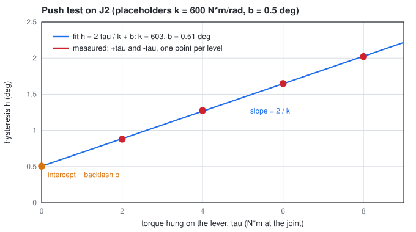

### Derivation

**Step 1: one side.** The motor holds still. A torque $+\tau$ on the output first takes up the gap (the output moves to
$+b/2$, the edge of the backlash) and then winds the gearbox spring by $\tau/k$ (§12 Step 2). So the output sits at
$+\tau/k+b/2$.

**Step 2: the other side.** $-\tau$ puts it at $-\tau/k-b/2$. The difference, the **hysteresis**:

$$
h(\tau)=\left(\frac{\tau}{k}+\frac b2\right)-\left(-\frac{\tau}{k}-\frac b2\right)=\frac{2\tau}{k}+b
$$

A straight line in $\tau$ with slope $s = 2/k$ and intercept $b$. One torque level can't separate the two; two can, and
more average the noise.

**Step 3: fit the line** (least squares, `np.polyfit`). Minimising $\sum_i(h_i-s\tau_i-b)^2$ and setting the derivatives
in $s$ and $b$ to zero gives

$$
s=\frac{\sum_i(\tau_i-\bar\tau)(h_i-\bar h)}{\sum_i(\tau_i-\bar\tau)^2},\qquad b=\bar h-s\bar\tau,\qquad k=\frac2s
$$

The deflection is the **output encoder minus the motor-implied angle**, so the stepper's own give under load (the servo
error the motor encoder sees) drops out and only the gearbox is left. Gravity doesn't matter as long as the lever is
horizontal and both sides of the test use the same lever.

### With numbers

J2's placeholders, $k = 600$ N·m/rad and $b = 0.5°$ = 0.00873 rad, at 2, 4, 6 and 8 N·m (1-4 kg on the 204 mm hole):
$h = 2\tau/600+0.00873$ = 0.01539, 0.02206, 0.02873, 0.03539 rad (0.882°, 1.264°, 1.646°, 2.028°). The points are exactly
on a line: $\bar\tau = 5$, $\bar h = 0.02539$, each 2 N·m step adds 0.00667 rad, so the slope is $0.003333$ per N·m,
$k = 2/0.003333 = 600$ and $b = 0.02539-0.003333\times5 = 0.00873$ rad = 0.5°. Back where we started.

**How precise.** The MT6701 reads 14 bits: $360°/16384 = 0.022°$ per step, about 2% of the smallest hysteresis above. Each
measured $h$ is off by up to one step, so the fitted $k$ is good to a few per cent and $b$ to about 0.02°; rounding the four
values to whole steps (the figure) gives 603 for 600. Larger torques and more levels help; averaging many readings at one
level does not, because a still magnet gives the same step every time.

| Symbol | In the code (`push_fit`, `push_test`) |
|---|---|
| $\tau$ | `torque`, `levels` (N·m at the joint: weight × g × lever length) |
| $h$ | `hysteresis` (rad), `abs(plus - minus)` |
| $k$ | returned `k` (N·m/rad) → `arm.toml` `gear_stiffness` |
| $b$ | returned `b` (rad) → `arm.toml` `backlash_deg` (in degrees) |
| $s$ | `slope` of the fitted line, $2/k$ |

```python
import numpy as np
from deskarm.bench import push_fit

k, b = 600.0, np.radians(0.5)                   # J2 placeholders in arm.toml
tau = np.array([2.0, 4.0, 6.0, 8.0])            # N*m: e.g. 1, 2, 3, 4 kg at 204 mm
lsb = 2 * np.pi / 16384                         # one MT6701 step
h = np.round((2 * tau / k + b) / lsb) * lsb     # what the encoder can see
k_fit, b_fit = push_fit(tau, h)
assert abs(k_fit / k - 1) < 0.05 and abs(np.degrees(b_fit - b)) < 0.02
```

---

## 18. Output encoder calibration

**What it's for.** D33 puts an MT6701 on the output of J2, J3 and J4 ([16](16_packaging_and_routing.md) §3.7). Its raw
reading is one joint turn in 14 bits, from wherever the magnet happened to be glued, either way round, with a slow
error (the chip's INL, ±1.0° typical and ±1.5° at most by the 2024 datasheet) on top. `encoders.py` turns that reading into the link angle (`Calibration.angle`)
and finds the correction from a slow sweep (`fit`, `sweep`). `CanBackend.read()` uses it on every joint that has one;
`read_motor()` stays the motor-implied angle of §16. The difference between the two is what the gearbox does: backlash
and wind-up, the thing the motor encoder can't see.

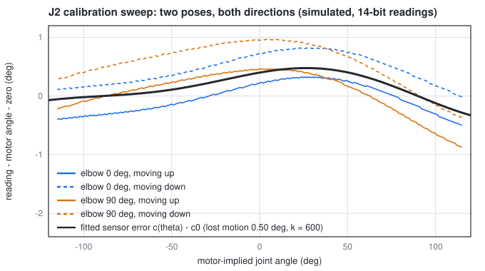

### Derivation

**Step 1: what the encoder reads.** The magnet turns with the link, so the raw angle $\varphi = 2\pi\cdot$`turn` follows
the link angle $\theta$, up to a direction $s=\pm1$ (which way the chip faces) and an error $c(\theta)$ that repeats once
per joint turn:

$$
s\varphi=\theta+c(\theta)\pmod{2\pi}
$$

$c$ holds the mounting zero and the INL. Any smooth function that repeats every turn is a Fourier series, and a magnet
off its axis mostly makes the first harmonic, an uneven field the second. So keep $K$ terms (3 by default):

$$
c(\theta)=c_0+\sum_{k=1}^{K}\left(a_k\cos k\theta+b_k\sin k\theta\right)
$$

**Step 2: what the motor says.** The motor-implied angle $\theta_m$ (§16) differs from the link by the gearbox. Moving in
direction $\sigma=\pm1$, the link trails the motor by half the lost motion $h$; and the gearbox spring carries the
holding torque $\tau$ (gravity minus the spring, §10 and §13) as $\tau=k(\theta_m-\theta)$ (§12, §17). Together:

$$
\theta=\theta_m-\frac h2\sigma-\frac{\tau}{k}
$$

**Step 3: one equation per sample.** Subtract $\theta_m$ from Step 1 and put in Step 2:

$$
y=s\varphi-\theta_m=c(\theta)-\frac h2\sigma-\frac{\tau}{k}
$$

$c$ needs $\theta$, which is unknown, so evaluate it at $\theta_m$ instead. That costs $\lvert c'\rvert\thinspace\lvert\theta-\theta_m\rvert$,
with $\lvert c'\rvert\le\sum_k k\sqrt{a_k^2+b_k^2}$: for 0.4° of first and 0.15° of second harmonic that is 0.012, times
under a degree of deflection, so about 0.01° at most. Then every sample is linear in the unknowns
$p=(c_0,a_1,b_1,\dots,a_K,b_K,h/2,1/k)$:

$$
y_i=c_0+\sum_{k=1}^{K}\left(a_k\cos k\theta_{m,i}+b_k\sin k\theta_{m,i}\right)-\frac h2\sigma_i-\frac1k\tau_i
$$

**Step 4: the sign and the wrap.** $y$ is only known modulo $2\pi$, and $s$ is unknown. Average the unit vectors
$r_s=\frac1N\sum_i e^{\thinspace i(s\varphi_i-\theta_{m,i})}$ for both signs. With the right sign every term points
near $c_0$ and $\lvert r_s\rvert\approx1$; with the wrong one the angle is $-2\theta+\text{const}$, which spreads around
the circle over a long sweep and $\lvert r_s\rvert$ is small. Keep the larger, take $\hat c_0=\arg r_s$, and unwrap every
sample next to it: $y_i=\hat c_0+\operatorname{wrap}(s\varphi_i-\theta_{m,i}-\hat c_0)$, with wrap into $[-\pi,\pi)$.

**Step 5: least squares.** Stack the samples as $Ap=y$, one row per sample, columns $1,\cos\theta_m,\sin\theta_m,\dots,-\sigma,-\tau$.
Minimising $\lVert Ap-y\rVert^2$ gives the normal equations $A^{\mathsf T}Ap=A^{\mathsf T}y$ (`np.linalg.lstsq` solves them
stably). The leftover $\lVert Ap-y\rVert$ is the part the model doesn't explain: the gearbox's fast transmission error
(once per motor or cycloid turn) and the encoder's step.

**Step 6: when one sweep can't tell the sensor from the gearbox.** Sweep J2 with the rest of the arm still and the load
is a rigid body turning about a horizontal axis, so its gravity torque is exactly $G\cos\theta+H\sin\theta$, and so is the
zero-length spring's (§13). Then the $-\tau$ column is $-G$ times the $\cos\theta$ column plus $-H$ times the $\sin\theta$
column, $A^{\mathsf T}A$ is singular, and any amount of wind-up can be traded for first-harmonic INL. Physically: the
sweep sees a sine-shaped error and can't know whether the chip or the gearbox made it. A second pose with a different
load (elbow straight, then bent) breaks the tie, because the INL is the same function of $\theta$ in both and the
wind-up isn't. `fit` checks the smallest singular value of $A$ with its columns scaled to length 1 and refuses below
$10^{-3}$ of the largest. Without a load column (`torque=None`, the bench, or J3 whose torque changes with the other
joints) the wind-up goes into the harmonics and only holds at the load it was calibrated at.

**Step 7: using it.** Given a reading, the link angle solves $\theta=s\varphi-c(\theta)$ modulo $2\pi$. Start at a
guess $\hat\theta$ (the motor-implied angle while running, the middle of the joint's range at start-up) and repeat
$\theta\leftarrow\theta+\operatorname{wrap}(s\varphi-c(\theta)-\theta)$. Each pass shrinks the error by about
$\lvert c'\rvert\approx0.012$; four passes from 2 rad away leave $2\times0.012^4\approx4\times10^{-8}$ rad. Every joint's
range is under 360°, so the middle of the range is within $\pi$ of any reachable angle and the start-up answer is unique.

**Step 8: the gross-fault check.** If $\lvert\theta-\theta_m\rvert$ is more than the gearbox can explain, something broke
(a belt jumped, a pin sheared, the magnet came loose). `CanBackend` stops at
$b+1.5\thinspace\tau_{max}/k+1°$: the whole backlash, the wind-up under 1.5 times the joint's torque limit (what the motor
gives at full current) and a degree for the sensor. With the placeholders that is 7.7° on J2 and 7.0° on J3/J4: a loose
check that catches breakage, not a single skipped belt tooth (0.4° at J2). It tightens once the bench measures $k$.

### With numbers

A simulated J2 calibration (the figure): the chip reads 123° at the joint's zero, INL $a_1=0.4°$ and $b_2=0.15°$, lost motion
$h=0.5°$, $k=600$ N·m/rad (the placeholder). Two sweeps over ±115°, up and down, 231 readings each way, at the home
pose with the elbow at 0° and then at 90°, readings rounded to 14 bits.

- **The loads.** Gravity minus the spring on J2 is only −1.00 to +0.94 N·m with the elbow straight (the spring cancels
  most of it) and −4.01 to +3.55 N·m with it bent: wind-up of 0.10° and 0.38°.
- **The fit** gives $c_0=123.0012°$, $a_1=0.3988°$, $b_1=0.0002°$, $a_2=0.0009°$, $b_2=0.1493°$, $h=0.499°$ and
  $k=600.3$ N·m/rad, with 0.0067° rms left (26 Oct masses). That is the 14-bit rounding: one step is $360°/16384=0.022°$, and rounding
  leaves $0.022°/\sqrt{12}=0.0063°$ rms.
- **The result.** The corrected reading matches the true link angle to 0.013° everywhere; the raw reading (zero removed)
  was off by up to 0.49°.
- **What goes wrong without Step 6.** Leave out the torque column and the worst error is 0.19°. Calibrate at one pose only
  and use it at the other: 0.12°. One pose *with* the torque column: the smallest scaled singular value is $6\times10^{-16}$
  of the largest, so `fit` refuses; with both poses it is 0.14.
- **Sweep slowly.** The output reading and the motor poll aren't taken at the same instant. 5 ms apart at 5°/s is 0.025°
  each way, which `fit` would read as 0.05° of extra lost motion.

| Symbol | In the code (`encoders.py`) |
|---|---|
| $\varphi$ | `2 * pi * turn` (`bridge.JointAngle.turn`, 14 bit) |
| $s$ | `Calibration.sign` |
| $c_0, a_k, b_k$ | `Calibration.c` = `[c0, a1, b1, a2, b2, ...]` (rad); $c(\theta)$ is `Calibration.error` |
| $\theta_m$ | `motor` (`CanBackend.read_motor()`) |
| $\sigma$ | `direction` (+1 / −1) |
| $\tau$ | `torque`, `gearbox_torque(arm, q, j)` (gravity minus the spring, N·m) |
| $h$, $k$ | `Calibration.lost_motion` (rad), `Calibration.stiffness` (N·m/rad; None without a load column) |
| $\theta$ | `Calibration.angle(turn, near)`, `CanBackend.read()` |
| $b+1.5\thinspace\tau_{max}/k+1°$ | `CanBackend.slip_limit` |

```python
import numpy as np
from deskarm import load_arm
from deskarm.encoders import fit, gearbox_torque

arm = load_arm()
zero, a1, b2, h, k = np.radians(123), np.radians(0.4), np.radians(0.15), np.radians(0.5), 600.0
up = np.radians(np.linspace(-115, 115, 231))
log = {"motor": [], "turn": [], "direction": [], "torque": []}
for elbow in (0, 90):                                    # two poses, two loads (Step 6)
    for d, sweep in ((1, up), (-1, up[::-1])):
        for th in sweep:
            q = np.array(arm.home, float)
            q[1], q[3] = th, np.radians(elbow)
            tau = gearbox_torque(arm, q, 1)
            link = th - d * h / 2 - tau / k              # Step 2
            raw = (link + zero + a1 * np.cos(link) + b2 * np.sin(2 * link)) / (2 * np.pi) % 1
            for key, v in zip(log, (th, np.round(raw * 16384) / 16384, d, tau)):
                log[key].append(v)
cal = fit(**log, harmonics=2)
assert cal.sign == 1 and abs(np.degrees(cal.c[0]) - 123) < 0.01
assert abs(np.degrees(cal.lost_motion) - 0.5) < 0.01 and abs(cal.stiffness - 600) < 5
th = np.array(log["motor"]); d = np.array(log["direction"]); tau = np.array(log["torque"])
assert np.max(np.abs(np.degrees(cal.angle(log["turn"], th) - (th - d * h / 2 - tau / k)))) < 0.02
```

---

## 19. Dual-loop control: putting the link on target

**What it's for.** The MKS drivers hold each *motor* within a fraction of a step, but the printed gearbox behind it
bends: held out with 1 kg, J2's link sits about 0.86° and J4's 1.51° away from where the motors are (§12, the sim),
about 17 mm at the tool. The output encoders (§18) can see that. `DualLoop` in `control.py` wraps a backend that has both readings
(`MujocoBackend` today, `CanBackend` with output encoders on the arm) and moves the motor targets so the **links** land
on the command. The drivers' own motor loop stays the inner loop; this is a slow outer loop around it. Joints without
an output encoder (J1, J5-J7 in D33) get the command unchanged.

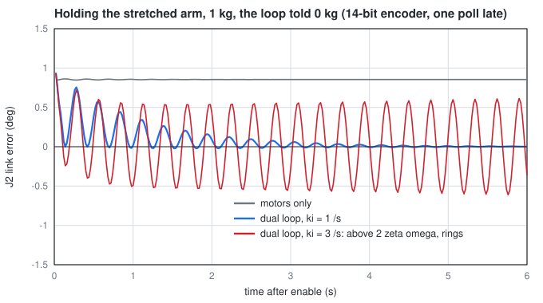

### Derivation

**Step 1: what the motor loop leaves.** At rest the gearbox carries the holding torque $\tau$ (gravity minus the
spring), so the link sits behind the motor by the static deflection of §12 Step 2:

$$
d=\theta_m-\theta=\frac{\tau}{k}+\frac b2\operatorname{sign}\tau
$$

The motor encoder can't see $d$, so commanding the motor to $q^\ast$ leaves the link at $q^\ast-d$.

**Step 2: feed-forward.** Command the motor to $q^\ast+\hat d(q^\ast)$ instead, with $\hat d$ the model's
prediction at the target (`DualLoop.deflection`: `gravity_torque` minus `spring_torque`, divided by `gear_stiffness`).
The link lands at $q^\ast+\hat d-d$: exactly on target if the model is right. The sign term jumps by $b$ when $\tau$
crosses zero, and a link with no load can sit anywhere in its gap, so the code ramps it:
$\frac b2\operatorname{clip}(\tau/\tau_b,-1,1)$ with $\tau_b=0.5$ N·m.

**Step 3: an integral for what the model gets wrong.** The payload the arm was told, the real stiffness and the
masses are all guesses. Add

$$
i\leftarrow i+k_i\thinspace\Delta t\thinspace(q^\ast-\theta),\qquad\theta_m^\ast=q^\ast+\hat d(q^\ast)+i
$$

At rest $i$ stops changing only when $\theta=q^\ast$, so whatever error the feed-forward leaves is removed. An integral
and not a proportional term, because the plant is already a position servo: a proportional outer gain $K$ would leave
$1/(1+K)$ of the error, and a large $K$ is just a fast integral by another name.

**Step 4: how large $k_i$ may be.** With the motor loop much stiffer than the gearbox (§12), the link follows the motor
command like a mass on a spring with damping, the arm's first mode $\omega$, $\zeta$:

$$
P(s)=\frac{\theta}{\theta_m^\ast}=\frac{\omega^2}{s^2+2\zeta\omega s+\omega^2}
$$

The loop is $L(s)=\frac{k_i}{s}P(s)$, and the closed loop's poles are the roots of

$$
s\left(s^2+2\zeta\omega s+\omega^2\right)+k_i\omega^2=0
$$

For $k_i\ll\omega$ there is a slow real root near $s=-k_i$ (drop $s^3$ and $s^2$: $\omega^2s+k_i\omega^2=0$), which is how
fast the error goes away, $e^{-k_it}$. The other two are the first mode, moved. Put $s=j\omega+\varepsilon$ and keep
first-order terms: $s(s^2+2\zeta\omega s+\omega^2)\approx j\omega(2j\omega\varepsilon+2j\zeta\omega^2)=-2\omega^2(\varepsilon+\zeta\omega)$,
so $-2\omega^2(\varepsilon+\zeta\omega)+k_i\omega^2=0$ and

$$
\operatorname{Re}\varepsilon=\frac{k_i}{2}-\zeta\omega
$$

The ringing dies at $\zeta\omega-k_i/2$ instead of $\zeta\omega$, and grows once $k_i\gt 2\zeta\omega$. The same bound
from the gain margin: at $\omega$ the integrator and $P$ each give −90°, so the loop is at −180° with
$\lvert L\rvert=\frac{k_i}{\omega}\cdot\frac{1}{2\zeta}$, which must stay below 1. A lightly damped printed arm has a low
ceiling, so `DualLoop.ki` is 1 /s.

**Step 5: the details that keep it quiet.**
- *Freeze the integral during moves* (any commanded joint faster than 0.5°/s). While the arm accelerates, the link lags
  for dynamic reasons the integral can't fix, and it would wind up and overshoot at the end.
- *A dead zone* of 0.013°, just over half an MT6701 step ($0.022°/2 = 0.011°$). The reading moves in whole steps, so with
  a narrower zone some targets would have no reading inside it and the integral would hunt by one step forever.
- *A clamp* $\lvert i\rvert\le b+\tau_{max}/k$: no gearbox can wind up more, so a larger correction means a fault
  (`CanBackend.slip_limit`, §18), not something to chase.
- *On enable,* the loop holds the links where they are (and the motors of the other joints), so nothing jumps.

**What it doesn't do.** Deflection from the arm's own acceleration during a move (the inertial torque over $k$), any
joint without an output encoder, and real gear friction (stick-slip in the backlash). The real $\omega$ and $\zeta$ come
from the bench and the built arm; $k_i$ is set from them.

### With numbers

**Step 1-2, stretched with 1 kg** (with the spring): the gearbox torques are −6.28 N·m on J2 and −6.52 N·m on J4, so
$\lvert d\rvert = 6.28/600 = 0.01047$ rad $= 0.600°$, plus $0.25°$, $= 0.850°$ on J2, and $6.52/300 = 1.245° + 0.25° =
1.495°$ on J4 (the code: 0.850°, 1.495°). Told 0 kg, the model predicts 0.335° and 0.820°, leaving 0.52° and 0.67°
(the CAD masses after the 26 Oct fillet pass, spring 1499 N/m at a = 70, b = 98 mm; with the 20 Oct CAD masses it was
6.32 and 6.54 N·m, 0.854° and 1.498°). The sim's motors-only error is 0.858° and 1.509° with the 20 Oct masses, not
re-run since, the servo's own give adding the rest (`tools/sim_modes.py`; 0.858° and 1.522° with the hand-estimated
masses).

**Step 4.** A 0.3° step on J2 with the motors only, stretched with 1 kg, rings at $f = 3.64$ Hz with $\zeta = 0.060$ (log
decrement over three periods; `tools/sim_modes.py`, CAD masses; 3.82 Hz and 0.054 with the hand estimates). So
$\omega = 22.9$ rad/s, $\zeta\omega = 1.37$ /s and the ceiling is $2\zeta\omega = 2.74$ /s. At $k_i = 1$ the ringing
decays at $1.37-0.5 = 0.87$ /s and the error at about 1 /s; the gain margin is $2.74$. (The $k_i$ = 2, 3, 5 runs below
are from the hand-estimated masses.) The simulation agrees (14-bit readings, one 20 ms poll late): $k_i = 2$ still settles, slowly;
$k_i = 3$ grows into a ±0.6° oscillation; $k_i = 5$ into ±2°.

**The figure,** told 0 kg: the command steps from where the link had sagged to the target (0.86° on J2), which excites
the first mode (~3.6 Hz) on purpose; the motors-only line never moves because its command is where its motor already is. With
the loop, J2 is at 0.26° after 1 s, 0.014° after 2 s and 0.003° after 8 s, and stays there (under 0.001° of movement over
the last second; these times were measured with the 565 N/m spring). A stiffness 30% off in the model ends the same way.

**A move,** home to (40, 70, 20, 80, 0, 30, 0)° at 70% speed with 1 kg: the motors alone leave J2-J4 at 0.43°, 0.64°
and 0.67°; with the loop they are within 0.035° 3 s after the move ends and 0.015° after 6 s.

| Symbol | In the code (`control.py`) |
|---|---|
| $q^\ast$ | the command (`DualLoop.command`) |
| $\theta$, $\theta_m$ | `inner.read()` (link, output encoder), `inner.read_motor()` |
| $\hat d$ | `DualLoop.deflection(q)` |
| $\tau_b$ | `torque_band` (0.5 N·m) |
| $i$, $k_i$ | `DualLoop.integral`, `DualLoop.ki` (1 /s) |
| $\theta_m^\ast$ | what `step` sends to `inner.command` |
| move threshold, dead zone, clamp | `still` (0.5°/s), `dead_zone` (0.013°), `_bound` ($b+\tau_{max}/k$) |
| $\omega$, $\zeta$ | the arm's first mode (sim: 3.64 Hz, 0.060 stretched with 1 kg) |

```python
import numpy as np
from types import SimpleNamespace
from deskarm import load_arm
from deskarm.control import DualLoop

arm = load_arm()
q = np.radians([0, 90, 0, 0, 0, 0, 0])                   # stretched out
d = DualLoop(SimpleNamespace(arm=arm), payload_kg=1.0).deflection(q)
assert np.allclose(np.degrees(np.abs(d[[1, 3]])), [0.850, 1.495], atol=0.001)       # Steps 1-2

f, zeta, ki = 3.64, 0.060, 1.0                           # first mode, stretched, 1 kg (sim)
w = 2 * np.pi * f
poles = np.roots([1, 2 * zeta * w, w**2, ki * w**2])     # Step 4
ring, slow = poles[np.argmax(poles.imag)], poles[np.argmin(abs(poles.imag))]
assert abs(ring.real - (ki / 2 - zeta * w)) < 0.05       # rings down at 0.87 /s
assert abs(slow.real + ki) < 0.1                         # the error fades at ~ki
assert np.roots([1, 2 * zeta * w, w**2, 3.0 * w**2]).real.max() > 0   # ki > 2 zeta w = 2.74: unstable
```

---

## 20. Contact detection from gear wind-up

**What it's for.** The steppers can't feel a touch: through the 48:1 printed cycloid a 10 N push at the tool is about
0.07 N·m at the motor, the same size as the gearbox friction and the detent torque, and the MKS CAN protocol reports
no current. The gearbox itself is a better sensor. It is a spring (§12), so the difference between the output encoder
and the motor encoder (D33: J2-J4) is a torque reading. `ContactGuard` in `control.py` subtracts what the arm's own
weight, spring and motion need, calls what is left the **external torque**, and stops the arm when it is too large for
too long. It wraps any backend with both readings (`MujocoBackend`, `CanBackend` with output encoders), takes
motor-side targets like that backend, and can sit under `DualLoop` (`DualLoop(ContactGuard(backend))`).

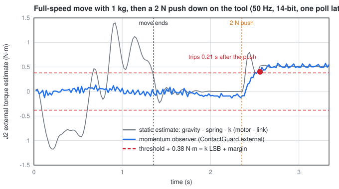

### Derivation

**Step 1: torque from wind-up.** Outside the backlash gap the gearbox carries $k$ times its twist; inside the gap it
carries nothing (§12 Step 2). With $\theta_m$ the motor reading in joint units and $\theta$ the link reading:

$$
\tau_g=k\operatorname{dz}(\theta_m-\theta),\qquad\operatorname{dz}(x)=\operatorname{sign}(x)\max\left(\lvert x\rvert-\frac b2,0\right)
$$

(`ContactGuard.gear_torque`.) $\tau_g$ is the torque the gear puts *on the link*.

**Step 2: the link's equation of motion.** The link side of each joint feels the gear, the counterbalance spring
$s(\theta)$ (§13), gravity and anything from outside:

$$
M(\theta)\ddot\theta+c(\theta,\dot\theta)+g(\theta)=\tau_g+s(\theta)+\tau_\text{ext}
$$

$M$ is the link-side mass matrix (the rotor's inertia is on the other side of the gear, so it is left out), $c$ the
Coriolis and centrifugal terms, $g$ the torque gravity needs (§10, `gravity_torque`). Standing still, $\ddot\theta$ and
$c$ are zero and

$$
\hat\tau_\text{ext}=g(\theta)-s(\theta)-\tau_g
$$

(`static_external`). That is exact at rest. During a move $M\ddot\theta$ is not zero, and that is the problem: on a
full-speed move with 1 kg the static estimate reaches 1.0-2.3 N·m on J2-J4 (figure, grey), four times what a 2 N push
makes at a bent pose. Differentiating the encoder twice for $\ddot\theta$ doesn't work either: one 14-bit step over
two 20 ms polls is $3.8\times10^{-4}/0.02^2\approx1$ rad/s² of noise.

**Step 3: the momentum observer.** Work with the momentum $p=M\dot\theta$, which needs only one difference. Since
$\dot M=C+C^T$ for a mass matrix, $\dot p=M\ddot\theta+\dot M\dot\theta$, and with Step 2:

$$
\dot p=\tau_g+s-c-g+\dot M\dot\theta+\tau_\text{ext}
$$

Everything on the right is known except $\tau_\text{ext}$. Define the residual

$$
r=K_O\left(p-\int_0^t\left(\tau_g+s-c-g+\dot M\dot\theta+r\right)dt'\right)
$$

Differentiate: $\dot r=K_O(\dot p-\tau_g-s+c+g-\dot M\dot\theta-r)=K_O(\tau_\text{ext}-r)$. So $r$ is
$\tau_\text{ext}$ through a first-order lag with time constant $1/K_O$, whatever the arm is doing, and no
acceleration was needed. (De Luca and Mattone, 2005; Haddadin et al., 2017, survey it for collision detection.)

In the code (`observe`) everything is evaluated half a poll back, between the last two readings: speed
$\dot\theta=(\theta_k-\theta_{k-1})/\Delta t$, angle and gear torque the averages of the two, $M$ and $c+g$ from MuJoCo
(`mj_fullM`, `qfrc_bias`) on the rigid arm with the payload it was told, $\dot M\dot\theta$ from the change of $M$
since the last poll. $K_O$ = `gain` = 10 /s. On the first poll after `enable` the arm is still, so $p=0$ and $r$ starts
at the static estimate.

**Step 4: how the driver follows the targets matters.** By default the physics sim's drivers follow a new target by
running at full joint speed, then waiting for the next one. At 50 Hz that makes the motor stop and go 50 times a
second, and the polls always land at the same point of that cycle, so the gear torque they see is biased by an amount
proportional to speed (1.5-1.8 N·m on J2). That is aliasing, and no observer at the poll rate can remove it. `CanBackend`
streams F5 moves at speed = distance left / step, which spreads each step over the whole poll, so `MujocoBackend` now
has `streamed=True` to do the same (the default is unchanged, so nothing else moves). Whether the real drivers follow a stream smoothly is Q8, still open; if they
stop and go, this detector will false-trip the same way (with the chasing drivers: 20 trips in 20 moves).

**Step 5: the threshold.** The link reading is rounded to one MT6701 step $\delta=2\pi/16384$ rad ($0.022°$), so
$\tau_g$ is only known to $\pm k\delta/2$. The threshold is a full step plus a margin for the model:

$$
\tau_\text{th}=k\delta+0.15\thinspace\text{N·m}
$$

which is 0.38 N·m on J2 ($k$ = 600) and 0.265 N·m on J3/J4 ($k$ = 300). The guard trips when any of J2-J4 has stayed
over its threshold for `debounce` = 0.03 s (2 polls at 50 Hz, 3 at 100 Hz). A force $F$ in direction $u$ at the tool
puts $\tau=J^Tu\thinspace F$ on the joints (§3), so the smallest force a joint can see is
$\tau_\text{th}/\lvert J_i^Tu\rvert$: the threshold over that joint's lever arm. A step in force crosses the threshold
after

$$
t=-\frac{1}{K_O}\ln\left(1-\frac{\tau_\text{th}}{\tau_\text{ext}}\right)
$$

plus the debounce and about a poll and a half of reading delay.

**Step 6: the backlash gap.** Inside the gap $\tau_g=0$, so Step 2 says the outside is carrying the whole load,
which is right: a pushed link that has crossed into its gap is held by the push. A link with no load floats in its gap
and a push moves it across with no gear torque at all, but the observer still sees it, because the push changes the
link's momentum. What hurts is a wrong gap: an error $\Delta b$ in the backlash shifts $\tau_g$ by $k\Delta b/2$,
0.52 N·m on J2 for 0.1°. The same goes for $k$ (10% off is 10% of the joint's load) and for the masses.

**Step 7: what it does on a trip.** Stop: hold the motors where they are. Then give way to the push: each poll, on the
joints whose estimate is still over half the threshold, move the motor target by
$\Delta\theta_m^\ast=\beta\thinspace\Delta t\thinspace r/k$ with $\beta$ = `back_off` = 5 /s (the wind-up the push
caused, unwound at 5 /s), never more than `back_max` = 1° from where it stopped. Commands are ignored until `enable()`.
Without the give-way the arm would keep pressing with whatever the push had reached when it tripped, because the
estimate lags the force.

**Step 8: an unknown payload.** A mass $\Delta m$ at the tool that the guard wasn't told about looks like a push:
$r=-\Delta m\thinspace g_1(\theta)$ with $g_1$ the gravity torque of 1 kg at the tool. At rest, `tare()` fits
$\Delta m=-g_1\cdot r/(g_1\cdot g_1)$ over J2-J4 and rebuilds the model with it. It can only explain errors shaped like
a tool mass; a wrong arm mass gives a different fit at every pose.

**What it can't see.** Forces with no lever on J2, J3 or J4: along the line through their axes (pulling the stretched
arm straight out), or turning only J1 or the wrist, which have no output encoder (D33). Anything that changes the
link's dynamics the model doesn't know (friction in the real gearbox, stick-slip in the gap). The real threshold needs
the measured $k$, $b$ and masses, not the placeholders.

### With numbers

All in the physics sim with streamed drivers and 1 kg the guard was told about, readings 14-bit and one poll old
(`tests/test_contact.py` has the same set-up). The sim's model is the plant, so this is the floor, not the real arm.

**Smallest push it detects, held for 0.5 s** (steps of 0.25 N, the same at 50 and 100 Hz except one case):

| Pose (°) | Down / up | Forward / back | Sideways |
|---|---|---|---|
| home (0, 30, 0, 60, 0, 60, 0) | 1.25 N | 2.0 N (1.75 back at 50 Hz) | 1.0 N |
| stretched (0, 90, 0, 0, 0, 0, 0) | 0.75 N | **not seen** (along the arm) | **not seen** (J1 only) |
| reaching (0, 60, 0, 90, 0, 30, 0) | 1.5 N | 1.0 N | 1.0 N |
| bent (40, 70, 20, 80, 0, 30, 0) | 1.75 N | 1.25 N | 1.25 N |

Each matches Step 5: stretched, J2's lever was 0.52 m when this table was run, so $0.38/0.52=0.73$ N. (With the
3-prong gripper the TCP is 30 mm further out: $0.38/0.55=0.69$ N, the same 0.75 N step. The other rows were not re-run.)

**How fast** (stretched, a step push down): 1 N trips after 0.20 s at 50 Hz (0.21 s at 100 Hz), 2 N after 0.10 s
(0.09), 5 N after 0.08 (0.06), 10 N after 0.06 (0.05), 20 N after 0.06 (0.04). For 2 N, Step 5 gives
$-\ln(1-0.38/1.04)/10=0.045$ s (0.042 s at the new 0.55 m lever) plus 0.04 s of debounce and 0.03 s of delay.

**Running into a wall** (a spring plane 10 mm under the tool, lowered straight down, 50 Hz): it trips 0.04-0.18 s after
touching. Peak force 4-5 N at 20 mm/s, 7-14 N at 50 mm/s, 9-37 N at 100 mm/s (the stiff 20 kN/m wall is the high
end: the arm's momentum, not the detector, sets it). 1.5 s later the give-way has brought it to 0-1.5 N, except the
soft wall at 100 mm/s (2.5-3.8 N, where the 1° limit stops it).

**False alarms during moves** (random targets within 60% of the joint limits, S-curve, trapezoid and time-optimal in
turn, full speed):

| Case | False trips | Largest residual / threshold |
|---|---|---|
| 1 kg, 50 Hz, 40 moves | 0 | 0.85 |
| 1 kg, 100 Hz, 40 moves | 0 | 1.17 (for less than the debounce) |
| empty, 50 Hz / 100 Hz, 20 moves | 0 | 0.53 / 0.59 |
| 1 kg, chasing drivers (Step 4), 20 moves | 20 at 50 Hz, 20 at 100 Hz | 3.4 / 6.9 |

100 Hz is noisier than 50 Hz, not quieter: the speed is one step over a shorter time.

**Model errors, standing still** (largest residual / threshold over four poses, 50 Hz): stiffness ×0.9 or ×1.1:
0.8-2.6; backlash ±0.1°: 1.1-1.7; every arm mass ×1.1: 1.8-2.4; payload told 0.9 kg instead of 1: 0.5-1.5. With
the masses 10% heavy, `tare` fits 0.70-0.84 kg depending on the pose, so it can't hide that error. Every placeholder
in `arm.toml` is worse than 10%, so **on the real arm the guard needs $k$, $b$ and the masses identified first**
(§17's push test, §18's sweep fit, and a slow pose sweep for the masses), or a much larger margin.

| Symbol | In the code (`control.py`, `ContactGuard`) |
|---|---|
| $\theta$, $\theta_m$ | `inner.read()`, `inner.read_motor()` |
| $\tau_g$ | `gear_torque(link, motor)` |
| $g$, $s$ | `arm.gravity_torque(q, payload_kg)`, `spring_torque` |
| $M$, $c+g$ | `mj_fullM`, `qfrc_bias` on `build_model(arm, payload_kg)` with the rotor armature removed |
| $\hat\tau_\text{ext}$ (still) | `static_external(link, motor)` |
| $r$, $K_O$ | `external`, `gain` (10 /s) |
| $\delta$, $\tau_\text{th}$ | `lsb`, `threshold` = `k * lsb + margin` (`margin` 0.15 N·m) |
| debounce, $\beta$, give-way limit | `debounce` (0.03 s), `back_off` (5 /s), `back_max` (1°) |
| $\Delta m$ | `tare()` |
| a push at the tool, a wall | `MujocoBackend.tool_force` (a vector, or `physics.wall(point, normal, k)`) |
| start-up wind-up | `settle()` |

On `CanBackend` the motor angle starts at the output encoder's, so the wind-up a loaded arm already has
($\tau/k + b/2$ with $\tau = g - s$) is missing from $\theta_m - \theta$ and the guard would read gravity as a push.
`settle()` puts it back with `set_angle` (once, at rest, after `enable()`); in the physics sim the motor angle is true
and it isn't needed. `tests/test_contact_can.py` runs this against `SimBus` (no arm dynamics: the plumbing only).

```python
import numpy as np
from deskarm import load_arm

arm = load_arm()
k = np.array([j.gear_stiffness for j in arm.joints])
threshold = k * 2 * np.pi / 16384 + 0.15                  # Step 5: one MT6701 step + margin
assert np.allclose(threshold[1:4], [0.380, 0.265, 0.265], atol=0.001)

q = np.radians([0, 90, 0, 0, 0, 0, 0])                     # stretched out
per_newton = arm.jacobian(q)[:3].T @ [0, 0, -1]            # N*m on each joint per N pushed down at the tool
assert np.allclose(per_newton[[1, 3]], [0.55, 0.36], atol=0.01)
smallest = (threshold / np.maximum(np.abs(per_newton), 1e-9))[1:4].min()
assert 0.65 < smallest < 0.8                               # 0.69 N; the sim needed 0.75 N (0.25 N steps)
t_cross = -np.log(1 - threshold[1] / (2 * per_newton[1])) / 10.0   # 2 N: the estimate crosses after 0.042 s
assert 0.04 < t_cross < 0.05

# Step 3 on one joint: a link (inertia I) on the gear spring k, the motor swinging it, then a 1 N*m push
I, kj, K, dt, h = 0.3, 300.0, 10.0, 0.02, 1e-4
c = 2 * 0.1 * np.sqrt(kj * I)                             # 10% damping in the gear, as in the sim
th = om = 0.0
z, r, prev, static, obs = 0.0, 0.0, None, [], []
for n in range(int(3.5 / h)):
    t = n * h
    motor = 0.15 * (1 - np.cos(2 * np.pi * 0.5 * t)) if t < 2.0 else 0.0   # one 0.5 Hz swing, then still
    vm = 0.15 * np.pi * np.sin(2 * np.pi * 0.5 * t) if t < 2.0 else 0.0
    push = 1.0 if t >= 2.0 else 0.0
    om += h * (kj * (motor - th) + c * (vm - om) + push) / I    # I theta'' = gear torque + push
    th += h * om
    if n % int(dt / h) == 0:                              # the 50 Hz poll
        if prev is not None:
            qd = (th - prev[0]) / dt                      # one difference, half a poll back
            tau = kj * ((motor - th) + (prev[1] - prev[0])) / 2
            z += dt * (tau + r)                           # no gravity on this joint, M constant
            r = K * (I * qd - z)
        prev = (th, motor)
        static.append((t, -kj * (motor - th)))            # static estimate: gravity (0) minus gear torque
        obs.append((t, r))
static, obs = np.array(static), np.array(obs)
moving = obs[:, 0] < 2.0
assert np.abs(static[moving, 1]).max() > 0.5              # the swing's inertia torque looks like a push
assert np.abs(obs[moving, 1]).max() < 0.05                # the observer takes it out
assert abs(obs[-1, 1] - 1.0) < 0.02                       # and settles on the push
```

---

## 21. Singularities in 7-DOF mode, damping, and cyclic coordinate descent

**What it's for.** A study, not a module the arm runs: `tools/ik_study.py` measures which singularities this arm
really has with all seven joints free, whether the damping of §5 needs to change near them, and whether cyclic
coordinate descent (CCD) would be a better IK solver than damped least squares. The findings and the recommendation
are in [23](23_singularities_and_ccd.md).

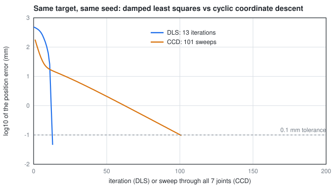

### Derivation

**Step 1: when the Jacobian loses rank.** §3's Jacobian has one column per free joint,
$(z_i\times(p-o_i),\ z_i)$. The arm is singular when the columns span less than six directions. Two joints whose axes
are the **same line** have identical columns, so they count once. In 6-DOF mode (J3 locked) that gives §3's three
cases:

- **Wrist,** $q_6=0$: J5's and J7's axes are one line through the wrist centre W, so six columns hold only five
  directions.
- **Elbow,** $q_4=0$: S, E and W are in line. Every joint either turns about a line through W or moves W at right angles
  to the line S-W, so no joint can move W along that line: the wrist can't reach further out.
- **Shoulder,** W on the J1 axis: turning J1 no longer moves W, and J2 and J4 move it only in their own plane.

**Step 2: what the seventh joint changes.** J3 turns about the upper arm. Each case again:

- **Wrist:** J5 and J7 still give one direction, but J3's column is a sixth, so the rank stays 6 unless J3's column also
  falls in line with the others. It does when $q_2=0$: the upper arm is vertical, J3's axis is J1's, and their columns
  are identical too. So **$q_2=0$ together with $q_6=0$** leaves at most five directions: singular. Either alone is not.
- **Elbow:** J3's axis runs along S-E, which is the line S-W when the arm is straight, so turning it doesn't move W
  along that line either. Still singular.
- **Shoulder:** J3's axis runs along the upper arm and misses W (unless the elbow is straight), so J3 moves W out of
  the J2-J4 plane and gives back what J1 lost. Not singular.

The measured smallest singular value $\sigma_{\min}$ of the weighted pose Jacobian ($W$ of §5) agrees, below.

**Step 3: damping near a singularity.** §5's step has gain $\sigma/(\sigma^2+\lambda^2)$ in each singular direction, at
most $1/(2\lambda)$. A common refinement (Nakamura and Hanafusa, 1986; Chiaverini, 1997) damps only near a
singularity, with no damping elsewhere so the solver converges faster:

$$
\lambda^2=\begin{cases}\left(1-(\sigma_{\min}/\varepsilon)^2\right)\lambda_{\max}^2 & \sigma_{\min}\lt \varepsilon\cr 0 & \text{otherwise}\end{cases}
$$

**Step 4: cyclic coordinate descent.** CCD (Wang and Chen, 1991) never forms a Jacobian. It turns one joint at a time,
from the tool inward, by whatever angle best reduces the error with the other joints held, and repeats the sweep. For
a joint with unit axis $z$ through $o$, a vector $v$ carried by the arm turns by $t$ as in §1 Step 4:

$$
R(t)\thinspace v=v_\parallel+\cos t\thinspace v_\perp+\sin t\thinspace(z\times v),\qquad v_\parallel=z\thinspace(z\cdot v),\ v_\perp=v-v_\parallel
$$

Match a set of such vectors to targets $u_k$ with weights $w_k$. Since $\lVert R v\rVert=\lVert v\rVert$,

$$
\sum_kw_k\lVert R(t)\thinspace v_k-u_k\rVert^2=\text{const}-2\sum_kw_k\left(u_k\cdot v_{k,\perp}\cos t+u_k\cdot(z\times v_k)\sin t\right)
$$

which is $\text{const}-2(B\cos t+C\sin t)$, smallest at

$$
t^\ast=\operatorname{atan2}(C,B),\qquad B=\sum_kw_k\thinspace u_k\cdot v_{k,\perp},\qquad C=\sum_kw_k\thinspace u_k\cdot(z\times v_k)
$$

`ccd_angle` uses four vectors: the TCP measured from $o$ (target: the target point from $o$, weight 1) and the tool's
x, y and z axes (targets: the target's axes, weight $w^2$ each). For a small orientation error $\theta$ the three axis
terms add up to about $2\theta^2$, so a radian of orientation counts like $\sqrt2\thinspace w$ metres, close to §5's $w$.
The turn is then clipped to the joint's limits; the cost is a sinusoid with its minimum at $t^\ast$, so the clip still
moves toward it along the shorter arc and lowers the cost.

**Step 5: why CCD slows down near the answer.** Each joint step is exact for that joint alone, so every sweep lowers
the error: CCD can't diverge, and it needs no inverse, which is why it is popular for long chains and animation. But it
is coordinate descent: when two joints affect the error in nearly the same way, as the parallel pitch axes J2, J4 and
J6 do, each joint undoes part of the other's work, and the error shrinks by a constant factor per sweep that gets
close to 1. DLS solves for all joints together with the coupling in $JJ^\top$ (a Gauss-Newton step), and close to the
answer each step squares the remaining error. The figure shows both: CCD's first sweep gains more, then it crawls.

### With numbers

**Which conditions are singular** (300 poses per row built to sit exactly on the condition, the other joints random
within 90% of their limits; median $\sigma_{\min}$, `ik_study.py singular`):

| Condition | 7-DOF | J3 locked |
|---|---|---|
| random poses | 0.036 | 0.026 |
| $q_4=0$ (elbow) | **0.000** | **0.000** |
| $q_6=0$ (wrist) | 0.016 | **0.000** |
| $q_2=0$ (J1 and J3 in line) | 0.012 | 0.011 |
| $q_2=0$ and $q_6=0$ | **0.000** | **0.000** |
| wrist centre on the J1 axis | 0.051 | **0.000** |

**A straight line whose IK crosses $q_6=0$** (120 steps, `ik_study.py path`): in 6-DOF mode the largest joint step is
2.40° with λ = 0.02, 2.84° with λ = 0.005 and 2.36° with the adaptive rule ($\varepsilon=\lambda_{\max}=0.04$), against
about 0.5° per step on average: the wrist has to flip J5 and J7 near $q_6=0$ whatever the damping. In 7-DOF mode the
same line needs at most 0.27° per step, because the arm never becomes singular on it ($\sigma_{\min}\ge0.039$).

**The figure** (target $q=(30,50,20,80,-40,60,30)$°, seed 20-40° off on every joint): DLS starts at 488 mm, is held to
0.2 rad per step for the first ten iterations, then goes 25.8 → 1.08 → 0.046 mm and stops at 13. CCD's first sweep
brings 488 mm down to 181 mm, then needs 101 sweeps to get under 0.1 mm.

**200 random reachable targets** (`ik_study.py ccd`; success within 0.1 mm and 1 mrad, median per solved target):

| Task, seed distance | DLS | CCD | CCD to 5 mm, then DLS |
|---|---|---|---|
| pose, 0.6 rad | 99.0%, 14 it, 3.1 ms | 50.5%, 160 sweeps, 140 ms | 98.0%, 47 ms |
| pose, 2.0 rad | 77.5%, 35 it, 7.9 ms | 43.0%, 192 sweeps, 154 ms | 84.5%, 49 ms |
| position, 0.6 rad | 100%, 8 it, 1.8 ms | 97.5%, 16 sweeps, 12.5 ms | 99.5%, 6.0 ms |
| position, 2.0 rad | 96.5%, 16 it, 3.8 ms | 95.0%, 24 sweeps, 20.5 ms | 97.0%, 9.7 ms |

For the position task CCD moves the joints much further than DLS does (median largest joint change 181-212° against
38-72°): with the orientation free, the distal joints swing wherever each exact step sends them. `solve_ik`, which
restarts DLS from the closed-form 6-DOF solutions (§4) when it fails, solves all 200 of the 2.0 rad pose targets
(median 10.9 ms).

| Symbol | In the code (`tools/ik_study.py`) |
|---|---|
| $\sigma_{\min}$ | `sigma_min(arm, q, locked)` (weighted pose Jacobian, locked columns removed) |
| $\varepsilon$, $\lambda_{\max}$ | `adaptive=(eps, lam_max)` in `dls` |
| $z$, $o$, $v_k$, $u_k$, $w_k$ | `z`, `o`, `vecs`, `targets`, `weights` in `ccd_angle` |
| $B$, $C$, $t^\ast$ | `B`, `C`, the return value of `ccd_angle` |
| $w$ | `w_rot` (0.3, as `rot_weight` in `solve_dls`) |

```python
import sys, pathlib
import numpy as np
sys.path.insert(0, str(pathlib.Path.cwd().parent / "tools"))
from ik_study import ccd_angle, sigma_min
from deskarm import load_arm

z, o = np.array([0.0, 0.0, 1.0]), np.zeros(3)                       # one joint turning about z
vecs = [np.array([0.3, 0.1, 0.2]), np.array([1.0, 0.0, 0.0])]
rot = lambda t: np.array([[np.cos(t), -np.sin(t), 0], [np.sin(t), np.cos(t), 0], [0, 0, 1]])
targets = [rot(0.7) @ vecs[0], rot(0.7) @ vecs[1]]                   # both turned by 0.7 rad
assert np.isclose(ccd_angle(z, o, vecs, targets, [1.0, 0.09]), 0.7)  # the exact turn comes back

arm = load_arm()
q = np.radians([10, 30, 20, 60, 30, 0, 0])                          # J6 = 0: J5 and J7 in line
assert sigma_min(arm, q, locked={2}) < 1e-9                         # singular with J3 locked
assert sigma_min(arm, q) > 0.005                                    # not with all seven joints
q[1] = 0.0                                                          # J2 = 0 as well: J1 and J3 in line too
assert sigma_min(arm, q) < 1e-9                                     # now singular in 7-DOF mode
```

---

## 22. What has no math

| Module | What it is |
|---|---|
| `backends.py` | `SimBackend`: each joint chases its target at its speed limit, with optional dead band (backlash) and rounding to whole microsteps. `CanBackend`: streams one absolute move per joint per step and polls positions; counts ↔ radians is `ratio × 16384 / 2π`; its start-up math is §16, its output-encoder reading §18 |
| `mks.py` | The MKS CAN frames (checksum, big-endian fields, the acceleration byte) and `SimBus`, simulated drivers. Protocol, not math: the manual is in [02](02_prior_art_research.md) §5b-2 |
| `drivers.py` | Driver set-up over CAN: a settings table, read back and written. Protocol, not math |
| `bench.py` | Bench logging to CSV; its only math, the push-test fit, is §17 |
| `program.py` | Teach-and-replay bookkeeping: a list of waypoints, saved as JSON, turned into trajectories by §7, §9 |
| `twin.py` | The browser UI. Only the quaternion conversions of §1 |
| `bridge.py`, `firmware/` | The SLCAN text protocol between the PC and the CAN bus, and the joint-angle frame (MT6701 over SSI, CRC-6). Protocol, not math: see `firmware/base_controller/README.md` |
| `tools/coupons.py`, `tools/bom_total.py` | Test-print generator and budget arithmetic |

---

## 23. Where to read more

| Section | Source | Why this one |
|---|---|---|
| §1: §5 | Lynch & Park, *Modern Robotics* (free PDF and videos, [hades.mech.northwestern.edu](http://hades.mech.northwestern.edu/index.php/Modern_Robotics)), ch. 3-6 | Rigid motions, FK, Jacobians and numerical IK with the same rotation-vector viewpoint. Note it uses the product-of-exponentials form instead of DH |
| §2, §4 | Siciliano et al., *Robotics: Modelling, Planning and Control*, ch. 2 | Standard DH (the convention used here) and the spherical-wrist decoupling |
| §5 | Buss, *Introduction to Inverse Kinematics with Jacobian Transpose, Pseudoinverse and Damped Least Squares Methods* (2004, free) | The clearest short derivation of the damped step |
| §6 | Shimizu et al., *Analytical Inverse Kinematic Computation for 7-DOF Redundant Manipulators With Joint Limits* (2008); Elias & Wen, *Redundancy Parameterization and Inverse Kinematics of 7-DOF Revolute Manipulators* (arXiv 2307.13122, v2 2024) | The closed-form arm-angle solution planned next; why every arm angle has a singularity, the stereographic angle used here, and closed-form IK for this joint layout (the KUKA iiwa's) |
| §7 | Biagiotti & Melchiorri, *Trajectory Planning for Automatic Machines and Robots*, §3.2-3.4 | Trapezoid and double-S, with every case in the table above |
| §9 | Pham & Pham, *A New Approach to Time-Optimal Path Parameterization Based on Reachability Analysis* (2018), and the [`toppra`](https://github.com/hungpham2511/toppra) library | The algorithm implemented here |
| §10, §12 | Featherstone, *Rigid Body Dynamics Algorithms*; the [MuJoCo documentation](https://mujoco.readthedocs.io) (Computation chapter) | What inverse dynamics computes and how MuJoCo models actuators and tendons |
| §11 | [SimpleFOC docs](https://docs.simplefoc.com) (theory corner); any text on PMSM d-q models | The d-q frame, torque constant and voltage limits |
| §13 | Rahman et al., *A Simple Technique to Passively Gravity-Balance Articulated Mechanisms* (1995) | Zero-length-spring balancing |
| §14 | Ericson, *Real-Time Collision Detection*, §5.1.9 | The segment-distance routine, case by case |
| §15 | Docs [03](03_actuators_gearboxes.md); How To Mechatronics' cycloidal drive tutorial | Cycloid parameters in practice |
| §16 | Docs [16](16_packaging_and_routing.md) §3; MKS SERVO42D/57D CAN manual V1.0.9 §5.1 (30H, 31H) | What the drivers report after power-up, and what the coarse reading can be |
| §17 | `tests/actuator_bench.md` §1; the arm.toml header (printed-drive stiffness from Roozing et al. and COMPAct, arXiv 2510.07197); MT6701 datasheet (v1.9, 2024; the 2020 Rev 0.1 was read first) §6.7 | Where the placeholders came from, and the encoder that limits the precision |
| §18 | Docs [16](16_packaging_and_routing.md) §3.1-3.4; MT6701 datasheet v1.9 (2024: INL, magnet placement); any linear-algebra text on least squares and the SVD (e.g. Strang, *Introduction to Linear Algebra*, ch. 4 and 7) | What the sensor's error looks like, and why a rank-deficient $A$ can't be solved |
| §19 | Åström & Murray, *Feedback Systems*, ch. 10-11 (loop transfer functions, gain margin, integral action and windup); Franklin, Powell & Emami-Naeini, *Feedback Control of Dynamic Systems*, on lightly damped plants | The stability bound and why the integral is frozen during moves |
| §20 | De Luca & Mattone, *Sensorless Robot Collision Detection and Hybrid Force/Motion Control* (ICRA 2005); Haddadin, De Luca & Albu-Schäffer, *Robot Collisions: A Survey on Detection, Isolation, and Identification* (IEEE T-RO 2017) | The momentum observer, and how thresholds and reactions are chosen |
| §21 | Kreutz-Delgado, Long & Seraji, *Kinematic Analysis of 7-DOF Manipulators* (IJRR 1992); Nakamura & Hanafusa, *Inverse Kinematic Solutions With Singularity Robustness for Robot Manipulator Control* (1986); Chiaverini, *Singularity-Robust Task-Priority Redundancy Resolution* (IEEE TRA 1997); Wang & Chen, *A Combined Optimization Method for Solving the Inverse Kinematics Problem of Mechanical Manipulators* (IEEE TRA 1991) | The singular sets of a 7-DOF arm, damping that switches on near them, and where CCD comes from |
| control theory in general | Åström & Murray, *Feedback Systems* (free, [fbswiki.org](https://fbswiki.org)) | Background for the servo model and the dual-loop work to come |
