# 19: Review of the 19 Oct Fusion models: dimensions, holes and bores, printing, PETG and heat

Reviewed 19 Oct 2026 (Josh asked for a senior-reviewer check of the new CAD, with hole and bore placement in
particular, a print run-through, and whether PETG survives the temperatures, focused on the housings). This is the
check of what [18](18_cad_mechanical_architecture.md) describes. **Where this file and 18 disagree, this file
reports the model as it is in Fusion; 18 is kept as written (§11 lists the differences).**

**How it was checked.** All read from Fusion through its MCP server, with every part and assembly opened *invisibly*
and closed without saving (Josh's open document was not touched, nothing in the hub was changed): every cylindrical
face (diameter, axis, centre, depth), hole features, timelines, parameters, occurrence transforms, file references,
Fusion's interference check and the minimum gap between every pair of bodies. Range of motion with temporary B-rep
copies swept through J2 and J4. STL exports were ray-cast for wall thicknesses, rendered in Blender (figures below)
and sliced with the Bambu Studio 2.04 command line. Disc profiles re-checked with `tools/cycloid.py`. Temperatures
are a hand model with sources (§10). **Nothing was printed, fitted or measured.**

---

## 0. Verdict

*20 Oct: J1 (findings 1-4) is rebuilt and checked clean in the saved assembly, §14. The rest stands for the 19 Oct files; from J2 out they are superseded by the `DA_` model of [20](20_cad_full_arm.md) (20 Oct night).*

**The parts print; the arm does not yet assemble or work.** Every part fits a printer and needs almost no support
(§9), and many details are right: the cheek-to-turntable bolt pattern lines up exactly, both J2 bearing seats are
concentric with a 110 mm span, the NEMA23 slots match the bolt pattern and the 92.5 mm belt centre distance in
[03](03_actuators_gearboxes.md), and both cycloid discs match `tools/cycloid.py` to 0.001 mm. But the "0 clashes" in
18 mostly means the parts that would clash are not modelled. The problems, worst first:

| # | Where | Finding | Severity |
|---|---|---|---|
| 1 | J1 base + turntable | The turntable's 6810 journal sits **13.5 mm above** the base's 6810 seat. The turntable rests on nothing (§4.1) | Blocks assembly |
| 2 | J1 base | No room for the J1 reducer: the turntable stem fills the cycloid cavity; the pin carrier's 4 bolt holes have no partners in the turntable (§4.2) | Blocks assembly |
| 3 | J1 base | The 26 ring-pin "flutes" are only **0.53 mm deep** (77° of wrap): the pins are not held (§4.3) | Blocks function |
| 4 | J1 base | The 60 mm motor hangs ~50 mm (plus its driver) below the base's bottom face, which is meant to bolt to the desk; no harness path out of the base or up through the turntable (§4.4) | Blocks assembly |
| 5 | J2 eccentric shaft | The 6804 bearings **cannot be fitted**: Ø20 lobes offset 1.5 mm between Ø20 journals and a Ø24 divider (§5.3) | Blocks assembly |
| 6 | Kinematics | Shoulder height **196 mm vs 130** in `arm.toml`; elbow to wrist centre **208 vs 180**; wrist centre to flange **35 vs 70**; no J3 (upper-arm roll) joint at all (§2) | Software and budgets disagree with the CAD |
| 7 | Elbow | Collision-free only to **about ±75°** (`arm.toml` ±140°) (§6.3) | Workspace |
| 8 | Wrist | The forearm's 6806 cradle is mostly cut away by a leftover Ø30 vertical hole; yoke v3 has no journal and no 6802 seats; the full assembly uses yoke v1 (§7) | Blocks function |
| 9 | Counterbalance | The pulley axle on the right cheek runs **perpendicular** to J2, so the cable leaves the pulley sideways; anchor 85 mm above J2, not 100; the spring lugs sit 36 mm off the arm's line, on opposite edges of the two halves (§5.4) | Blocks function |
| 10 | Upper arm | The cavity opens to the **outside**: two back-to-back channels, not the closed 60 mm box 18 describes. ~20× less torsional stiffness (§6.1) | Stiffness |
| 11 | Heat | PETG is fine for these housings **only** with the drivers in vFOC or at reduced hold current, and with no PETG bolted directly to a motor face. In CLOSE mode at full current the J1, J3/J4 and J7 motors reach 60-100 °C, past PETG's 68-69 °C heat-deflection point (§10) | Creep, loose bearings, belt slack |
| 12 | Assemblies | The full assembly uses unlinked copies (yoke v1, upper arm v4, forearm v5); the shoulder assembly uses an out-of-date upper arm v3; the forearm assembly uses forearm v2. No joints, no user parameters; duplicate files in the hub (§3) | Bookkeeping |

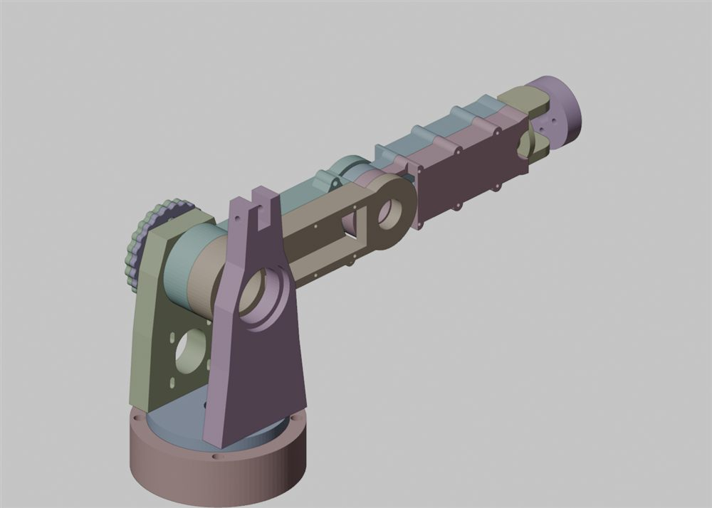

*Full assembly (v2), as saved: upper arm horizontal (J2 = 90°), elbow straight.*

---

## 1. What is in the hub (`Admin Project / DeskArm_Parts`)

| Part | Latest | Box (mm) | Solid volume | Printed (slicer) | Notes |
|---|---|---|---|---|---|
| J1_Base_Housing | v3 | Ø160 × 48 | 772 cm³ | 469 g, 19.0 h | Nearly solid puck |
| J1_Turntable_Spindle | v2 | Ø130 × 37 | 182 cm³ | 135 g, 5.0 h | |
| J1_Output_Pin_Carrier | v1 | Ø70 × 12 | 37 cm³ | 34 g, 1.3 h | In no assembly |
| J1_Cycloid_Disc | v1 | Ø77.2 × 6 | 19 cm³ | 19 g, 0.8 h | In no assembly |
| J2_Shoulder_Left_Cheek | v2 | 110 × 170 × 24 | 279 cm³ | 194 g, 7.1 h | |
| J2_Shoulder_Right_Cheek | v2 | 110 × 235 × 24 | 354 cm³ | 232 g, 7.6 h | Too tall for the A1 mini |
| J2_Cycloid_Disc (×2) | v2 | Ø96.8 × 6 | 33 cm³ | 30 g, 1.1 h each | |
| J2_Eccentric_Shaft | v1 | Ø24 × 59 | 13 cm³ | 16 g, 0.8 h | In no assembly |
| Upper_Arm_Link_Half (×2) | v4 | 82 × 265 × 30 | 216 cm³ | 195 g, 6.2 h each | Too long for the A1 mini |
| Forearm_Link_Half (×2) | v5 | 67 × 212 × 27.5 | 129 cm³ | 130 g, 4.0 h each | Too long for the A1 mini |
| Wrist_Pitch_Yoke | v3 (and a separate v1 file) | Ø58 × 58 | 64 cm³ | 52 g, 2.0 h | Two files with the same name |
| J7_Tool_Flange | v1 | Ø65 × 18 | 54 cm³ | 42 g, 1.6 h | |
| Tool_Changer_Receiver / Tool_Plate | v1 | Ø65 × 10 | 29 / 30 cm³ | 26 g, 1.0 h each | In no assembly |

Not modelled yet, but needed before any joint can turn: J1 bearing stack and eccentric hub, the J2 ring-pin housing,
output pin carrier, J2 shaft or hub through the 6810s, J2 pulleys and motor plate, the whole J3 joint, the J4
gearbox, the J5-J7 actuators (planetaries, pancake, slip ring), and the counterbalance spring and its anchor.

## 2. Kinematic dimensions against `arm.toml`

`arm.toml` is the single source of truth, and the CAD does not match it yet:

| Length | `arm.toml` | CAD (full assembly) | Effect |
|---|---|---|---|
| Desk to J2 axis (J1 `d`) | 130 mm | **196 mm** (48 base + 5 gap/flange + 8 + 135 cheek) | IK, URDF, twin, workspace, tipping, the counterbalance anchor all use 130 |
| J2 to J4 (J3 `d`) | 190 mm | 190 mm | Matches |
| J4 to wrist centre (J5 `d`) | 180 mm | **208 mm** (elbow at y = 190, J6 axis at y = 398) | Payload lever on J2/J4 grows; IK wrong |
| Wrist centre to flange (J7 `d`) | 70 mm | **35 mm**, with no J7 actuator in between | J7 has no room as drawn |
| J3 upper-arm roll | a joint | **absent**: the upper arm is one rigid clamshell from J2 to J4 | The CAD arm has 6 joints |
| J5 position | actuator at the elbow end, J6 motor inside the forearm, turning with J5 | J5 bearing at the **wrist** end (yoke stem in the forearm) | The J6 motor "inside the forearm" can't drive J6 through a roll joint behind it |

Either the CAD or `arm.toml` has to change (Josh's call, §12). *20 Oct (D36, D38): `arm.toml` takes the shoulder
(209 mm after the J1 rebuild, §14); the CAD takes 180 mm, 70 mm and the J3 joint.* Whichever does, re-run `tools/torque_budget.py`,
`python -m deskarm.counterbalance` and the tests afterwards.

## 3. Assemblies

| Assembly | Saved version | What it contains |
|---|---|---|
| `DeskArm_Shoulder_Assembly` | v7 | Base v3, turntable v2, cheeks v2 linked and current; **upper arm half v3 linked and out of date (latest v4)**; the second half and both discs are local copies |
| `DeskArm_Forearm_Assembly` | v3 | **Forearm half v2** (local copy, latest is v5) at a different offset (y −70), yoke v3, flange v1 |
| `DeskArm_Full_Assembly` | v2 | **All local copies**: upper arm v4, forearm v5, **yoke v1**, flange v1. Editing a part file won't update it |

- The hub has **5** files named `DeskArm_Forearm_Assembly`, **5** `DeskArm_Full_Assembly`, **4**
  `DeskArm_Shoulder_Assembly` and **2** `DeskArm_Wrist_Pitch_Yoke`. The ones above are the latest-modified; the others
  were not opened. Worth clearing out (Josh's decision: deleting hub files is his).
- **No joints** in any assembly, so Fusion can't show motion or limits; the sweeps in §6.3 were done by hand.
- **No user parameters** in any part; the discs, upper arm, forearm and yokes are mostly single "Base Feature" solids
  (direct edits, no history). The tolerance parameters in [print_tolerances.md](print_tolerances.md) (`tol_bearing_press` …) don't exist,
  and nothing links to the skeleton's parameters (`tools/fusion_skeleton.py`).
- The two J2 discs are both placed concentric with J2, not at ±1.5 mm as they would sit on the eccentric, so the
  interference result says nothing about them.
- **What "0 clashes" means here:** confirmed (Fusion's check returns 0 for all three), but the turntable floats
  1 mm above the base touching nothing, and the parts that would collide (reducers, motors, shafts) aren't in the
  model. It is not evidence that the arm goes together.

## 4. J1: base housing and turntable (the housing focus)

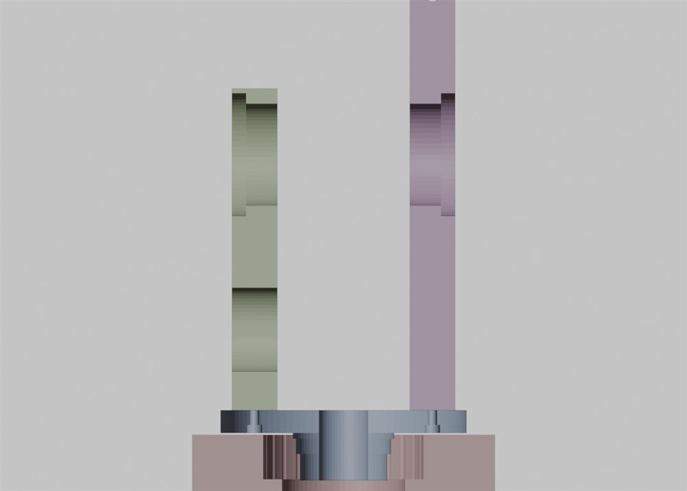

*Section through the shoulder assembly at y = 0 (base, turntable, cheeks). The turntable stem stops at the top of the
empty 6810 seat; its journal is high up inside the cycloid cavity.*

### 4.1 The turntable is not on its bearing

| Feature | World Z |
|---|---|
| Base: 6810 seat Ø65.05 | 17.0-24.5 |
| Base: Ø84 cycloid cavity | 24.5-48.0 |
| Turntable: stem Ø46 | 24.0-38.0 |
| Turntable: 6810 journal Ø49.95 | **38.0-46.0** |
| Turntable: flange underside / base top | 49.0 / 48.0 |

The journal and the seat are 13.5 mm apart along the axis; the stem reaches the top of the seat but is Ø46 (the
bearing bore is 50). The model is internally consistent, but nothing carries the turntable. The doc's own stack
(bearing, then cycloid cavity above it, then pin carrier bolted under the turntable) can't be met by these two parts:
see §4.2.

### 4.2 No room for the reducer, and missing holes

- The Ø84 × 23.5 cavity is where the J1 disc (Ø77.2 × 6), the ring pins and the output pin carrier (Ø70 × 12) must
  go, but the turntable stem (Ø46) fills its centre from the floor up. The disc's 6804 sits on the motor shaft at the
  centre: disc and stem would occupy the same space.
- The pin carrier has 4× M4 counterbored holes on PCD 40 "bolting to the underside of the turntable" (18 §3.6). **The
  turntable has no holes on PCD 40**, only the 8 cheek holes at x = ±47. And at PCD 40 the holes would be 0.75 mm
  from the stem's Ø46 edge.
- The pin carrier and the J1 disc are in no assembly, which is why this didn't show up.

### 4.3 The ring pins are not held

*Corrected 20 Oct (§14.1): the Ø78.5 cavity below would hit the lobes, which reach R 39.79 from the axis. The
rebuild holds the pins at both ends in a Ø81 cavity.*

The flutes are Ø5.05 on the R = 40 pin circle, but the cavity wall is at R = 42, so each flute is cut only
42.525 − 42 = **0.53 mm** into the wall (Fusion reports a 77° arc). A Ø5 pin needs more than half its diameter
embedded (more than 180° of wrap) to stay put; these will fall inwards when no lobe is against them, and tip under
the tangential load. The disc only needs the wall clear of its tips (r_max 38.6 mm, `tools/cycloid.py`), so **a cavity
of about Ø78.5** embeds each pin ~3.5 mm (70%) and still clears the disc by ~0.6 mm. The same rule applies to the J2
ring when it is drawn: pins at R = 50, disc r_max 48.4, so a cavity of about Ø98.

### 4.4 Where the motor and the wires go

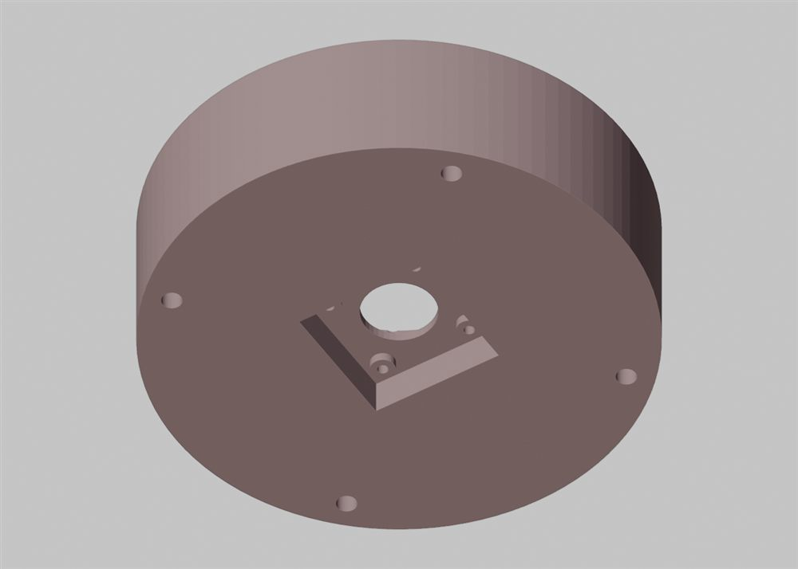

*Base from below: the 44 × 44 mm motor pocket is only 12 mm deep.*

- Motor pocket 44 × 44 × 12 mm (0.85 mm clearance per side); the motor face sits on 4 bosses at z = 9. The LDO
  42STH60 is 60 mm long, so ~50 mm of motor plus the MKS SERVO42D board on its back hangs **below the base's bottom
  face**. 18 calls the M6 holes "desk mounting", and the base can't sit on a desk. It needs a plinth or base board with
  a ≥ 46 × 46 × 80 mm opening (or the motor moved beside the axis with a belt, the alternative in [03](03_actuators_gearboxes.md)).
- **There is no harness path.** The base has no side opening, and the turntable's Ø26 central conduit ends on the
  motor shaft and eccentric directly underneath it. [03](03_actuators_gearboxes.md) planned a slot beside the motor
  with a ±170° service loop; neither part has it.
- The NEMA17 pilot (Ø22) goes through a **Ø24 clearance** hole, so the motor is centred only by four M3 screws in
  Ø3.4 holes (±0.2 mm). Off-centre input on a cycloid with e = 1.2 mm adds lost motion and binding. A Ø22.1 locating
  bore would fix it.
- The M3 heads sit on the z = 15 floor, inside the 6810's bore. They must go in before the bearing and turntable, so
  the motor can't come out without taking J1 apart.
- The motor hangs from a **3 mm PETG ceiling** (z 12-15) spanning the 44 mm pocket, the hottest place in the base
  (§10).

### 4.5 What is right on the base

| Check | Value | Verdict |
|---|---|---|
| NEMA17 bolt square | 31.0 mm, Ø3.4 | OK |
| M6 desk/plinth holes | PCD 142 (±50.2, ±50.2), Ø6.5 through, Ø11 × 6.5 counterbore (18 says 6.0) | OK; 5.75 mm from hole to OD, **3.5 mm** from counterbore to OD |
| M6 heads vs turntable | Flange edge R 65, counterbores from R 65.5 | 0.5 mm radial clearance; reachable with the turntable on |
| Bolt grip | 41.5 mm of PETG under each M6 | Long column under preload: re-torque after warm-up, or a metal sleeve |
| 6810 seat / Ø56 relief | Ø65.05 × 7.5 / Ø56 × 2 | Sizes OK; position wrong (§4.1) |

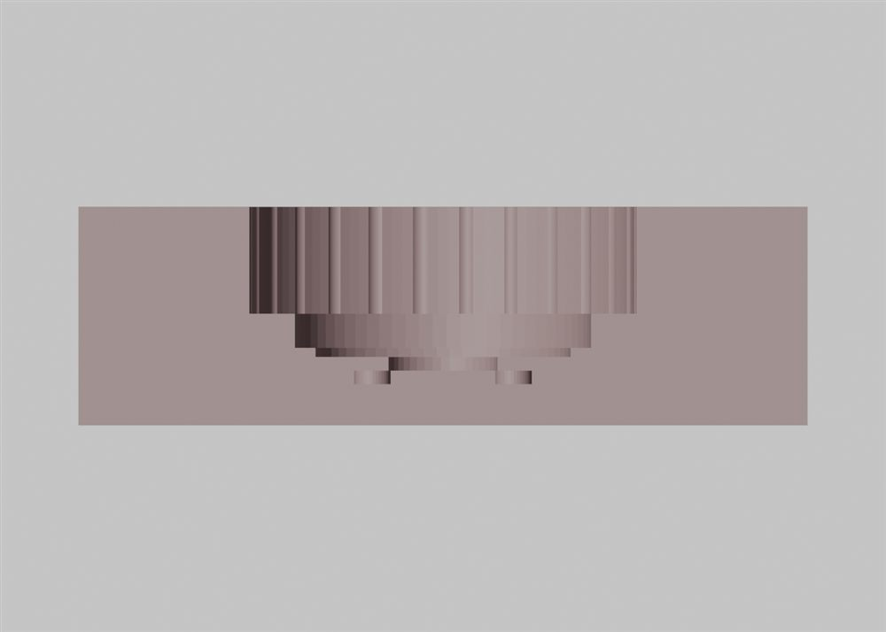

*Base sectioned at y = 0. Everything outside the Ø84 cavity is solid PETG: 772 cm³, 19 h on the A1 mini.*

### 4.6 Printing the base

Flat, bottom face down, it needs supports only under the motor-pocket ceiling and the four bosses, which hang 3 mm
below that ceiling and start in mid-air 9 mm above the bed (3.5 g of tree support in the slice). 18's "support-free
interior" is true of the bore steps in this orientation and false of the pocket; upside down it is the other way
round (5,300 mm² of annular ceilings). It fits the A1 mini with 10 mm to spare and takes **19 h** (27% of the whole
part set). Most of that is the solid ring from R 42 to R 80, which carries almost nothing: shelling it to 4-5 mm
walls with ribs would save roughly half the time and filament without losing stiffness that matters.

## 5. J2 shoulder

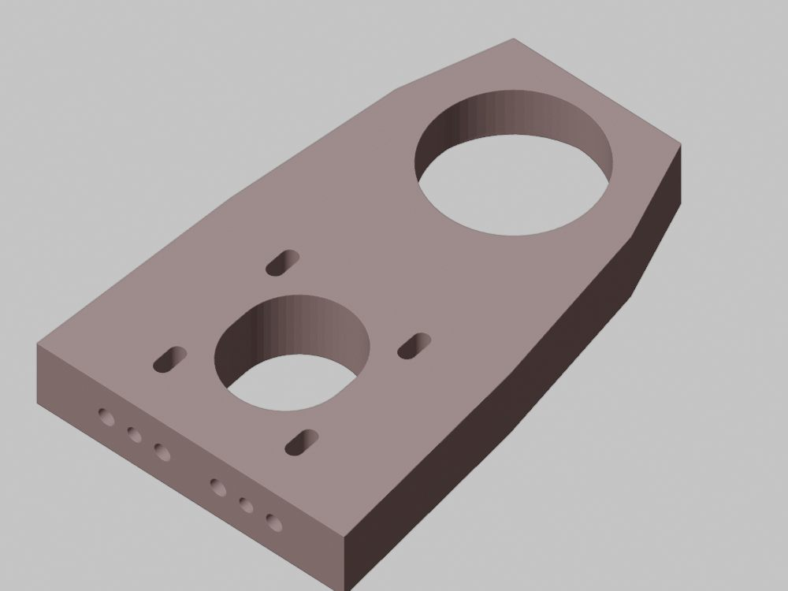

*Left cheek, outer face down as Fusion has it: NEMA23 slots and pilot slot below, J2 bearing bore above.*

### 5.1 Cheeks: what lines up

- **Foot interface: exact.** Cheek inserts at local x = ±10, ±30 and dowels at ±20 map to world y = ±10, ±30 / ±20 at
  x = ±47, the turntable's holes (worked through both cheeks' rotation matrices; 0.000 mm off).
- **J2 seats concentric.** Both Ø65.05 × 7.5 seats are on the world line y = 0, z = 196, on the outer faces; bearing
  span ~110 mm.
- **NEMA23:** slots 5.4 wide, 47.14 mm apart, ±3 mm travel; pilot slot Ø38.5 (NEMA23 pilot Ø38.1). Centre distance
  135 − 42.5 = 92.5 mm, as designed for the 276 mm belt in 03. **That 2:1 needs 20T/40T** (03); 18 mentions a 30T pulley
  on the shaft. With a 20T motor pulley that is 1.5:1, J2 = 36:1, and J2's margin falls from 1.48 to about 1.1.
- Running clearance cheek to upper arm: 5.0 mm each side (measured).

### 5.2 Cheeks: what is thin or off

| Check | Value | Verdict |
|---|---|---|
| Wall above the 6810 seat, left cheek | **2.5 mm** (seat edge y 167.5, cheek top 170) | At the bottom of 18's own 2.5-3.5 mm rule, at the press-fit hoop-stress peak. Make the cheek ~6 mm taller or shift the seat |
| Ligament beside the seat | 9.5 mm (left), **7.5 mm** (right) | Acceptable, not generous |
| Shoulder bore behind the seat | Ø54 | Inside the 52-54.5 mm inner-ring band that 18 quotes for the turntable step, so the stationary shoulder can touch the rotating inner ring or seal. The base uses Ø56 for the same bearing: match it |
| Foot | 4 M4 inserts over ±30 mm, 24 mm thick | At full J2 motor torque (~43 N·m at the output) the outer inserts see roughly 0.6 kN if the cheek carries the reducer (hand estimate). Check the insert choice, or widen the pattern into the cheek's 110 mm width |
| NEMA23 mounting | 1.1 kg motor on 4 M5 through slots in PETG, belt tension through the slot clamp | Creep at motor temperature loosens the belt (§10). An aluminium motor plate |
| Where the motor goes | Motor 76 mm long; gap between cheeks 70 mm with the arm swinging in it, 5 mm each side | Body outboard, shaft inboard into the 5 mm gap: no room for a 15 mm belt and pulleys. The discs are outboard of the left cheek (x −60 … −72), so the belt has to be outboard too. **The J2 drive train doesn't close yet** |

### 5.3 Eccentric shaft: the bearings can't go on

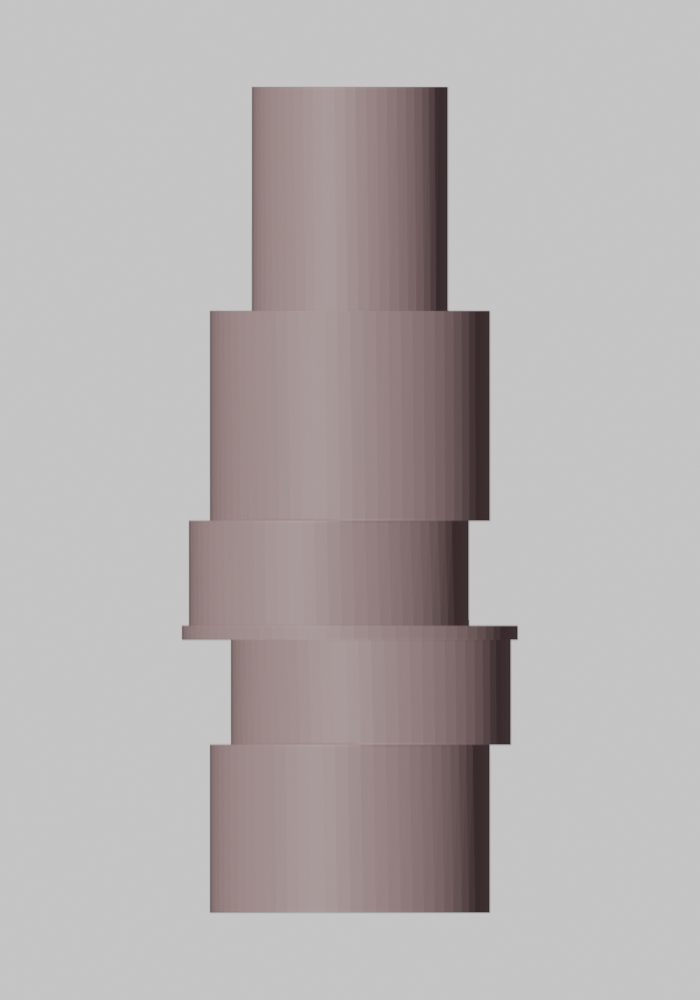

*Journal Ø20 (z 0-12), lobe Ø20 at +1.5 mm, divider Ø24, lobe Ø20 at −1.5 mm, journal Ø20, pulley spigot Ø14.*

A 6804 (bore 20) slides along a Ø20 journal and then meets a Ø20 lobe that sticks out 1.5 mm on one side; it can't
move sideways while it is still on the journal. Lobe 1 is boxed in by the journal and the Ø24 divider, lobe 2 by the
divider and the other journal. **Neither eccentric bearing can be assembled.** Fixes: split the shaft at the divider
(two halves, pinned or keyed), or make the journals ≤ Ø16 so a bearing passes over them. The Ø8 encoder bore leaves
4.5 mm beside the lobes, as stated. Printed upright, the layer lines run across the shaft, its weakest direction for
torsion: open decision A7 (metal core) stands.

### 5.4 Counterbalance tower

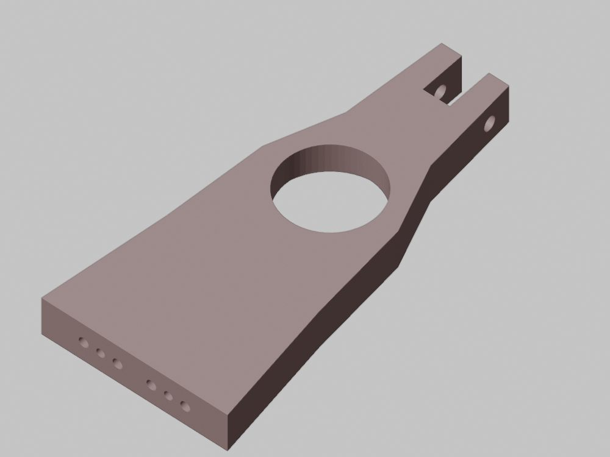

*Right cheek: the slot at the top is 16 mm wide, and the Ø8.2 axle hole runs through its side walls.*

- **Axle orientation.** The Ø8.2 hole runs along the cheek's *width* (world y), so the two 608 "pulleys" turn in the
  x-z plane. The arm swings in the y-z plane, so the cable from the arm arrives sideways and will ride off the
  bearings. The axle has to be parallel to J2 (through the cheek's thickness), as 18's text says ("X = −12, through");
  the model differs from the doc.
- **Anchor height.** Axle 85 mm above J2 (cable leaves at 85 ± 11 mm); `arm.toml` sizes the spring for a = 100 mm.
  Only k·a·b matters, so either move the axle up 15 mm (the tower ends at y 235, so it gets taller) or re-run
  `python -m deskarm.counterbalance` with 0.085.
- **Lug position.** The Ø5.2 lug is 150 mm along the arm (b correct) but 36 mm off its centre line, in the swing
  plane. The spring model assumes the attachment is on the line, so its torque curve shifts by atan(36/150) ≈ 13.5°.
  That leaves up to ~2 N·m of imbalance with the current 8.5 N·m k·a·b (hand estimate). And because the two halves
  are the same part rotated 180°, **their lugs end up on opposite edges** of the arm. Put the lug on the split plane,
  or model the offset in `counterbalance.py`.
- Margins are fine: 7.9 mm of wall around the axle hole, 10.9 mm above it. Bearings in the slot: 1 mm each side and
  1 mm to the slot bottom.

## 6. Links

### 6.1 Upper arm: open channels, not a box

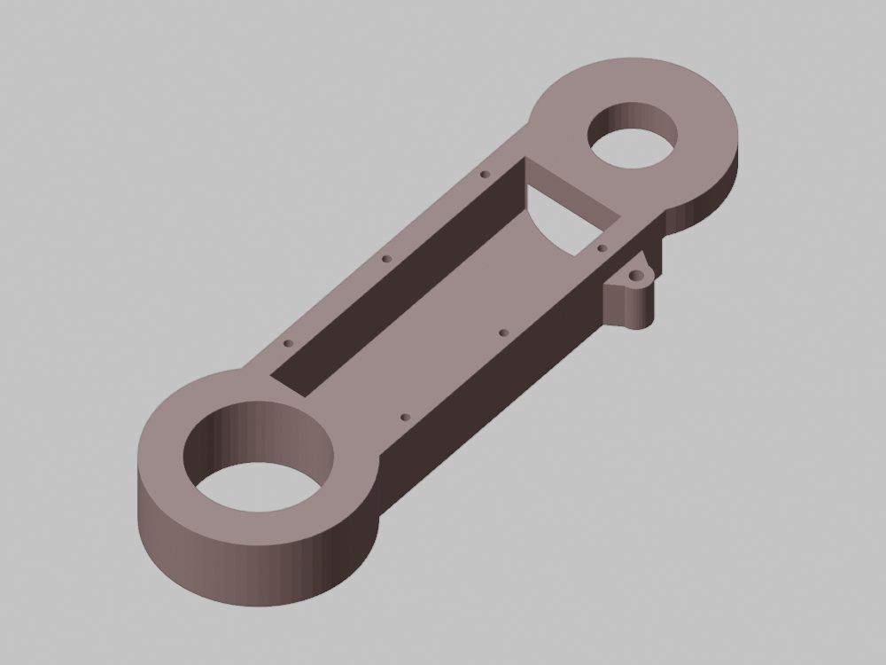

*Upper-arm half seen from its outer face: the 42 mm cavity opens outward, and breaks through into the elbow fork
recess at its far end.*

- The split face is z = 0 (the side with the Ø72 fork recess). The 42 × 26 mm cavity opens on the **outer** face
  z = 30, leaving a 4 mm web at the split. Two halves make an H-section with an 8 mm web, not the closed "rigid
  60 mm box section" of 18.
- In-plane bending (gravity) is still good: I ≈ 7.6 × 10⁵ mm⁴, more than a 60 × 60 × 4 mm box. **Torsion is not:**
  J ≈ 3.6 × 10⁴ mm⁴ open against ~8.6 × 10⁵ mm⁴ if the same walls formed a closed box. 4 N·m of twist (1 kg sideways
  at 0.4 m) twists the link about 1.8° (G ≈ 0.65 GPa for printed PETG), ~8 mm at the tool; closed, ~0.1°. Hand
  estimates, and the halves only touch through 6 M3 bolts, so the real section is softer still.
- **Fix:** open the cavity to the split face instead, as the forearm already does. The halves then close into a box,
  the wires run inside, and the print orientation stays the same.
- The cavity end breaks into the fork recess (the crescent window by the elbow). The shoulder hub keeps only 5 mm
  between the Ø50 bore and the cavity on the beam side (15 mm elsewhere).
- Clamshell: 6 × M3 through 60 mm of plastic, with no inserts, counterbores or dowels. Nothing but friction keeps the
  halves from sliding. Add 2-3 dowel pins or a tongue and groove, and inserts with shorter screws.
- **The Ø50 shoulder bore is a bore, not a journal:** nothing yet goes into the 6810 inner rings, and nothing
  transmits the reducer's torque to the arm.

### 6.2 Forearm

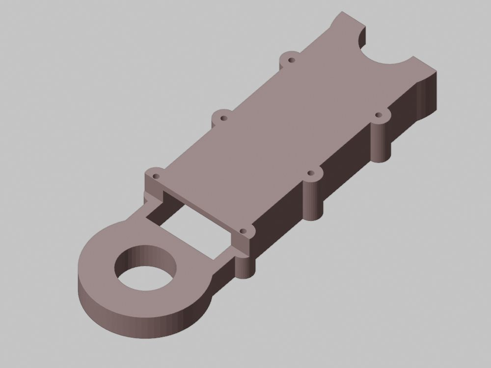

*Forearm half from its outer face: the window beside the elbow hub, and the U-notch at the wrist end left by the old
hub.*

- The cavity opens to the split face (a closed box when mated): 43 × 47 mm inside, 4 mm skins, ~6 mm side walls.
  **0.35 mm per side around a 42.3 mm NEMA17**, and it is sealed in, which matters for heat (§10).
- **A window through both skins next to the elbow hub** (local y ≈ 25-38), left by the hub step cut. It sits where
  the forearm's bending moment is highest.
- Ears: Ø12 bosses with Ø3.4 holes at ±27.5 mm, 4.3 mm wall: OK. But the nearest screws are 40 mm from the bearing
  cradle, so the split cradle can gape. Add a pair of screws beside the bearing.

### 6.3 Range of motion (swept in Fusion with B-rep copies, 10° steps)

| Joint | `arm.toml` | Free in the CAD | First contact |
|---|---|---|---|
| J2 (elbow straight) | ±120° from vertical | Free over the full ±120° | Only past ±140° (arm into turntable/base) |
| J4 | ±140° | **±70° clear, contact from ±80°** | Forearm body against the upper arm's side walls |

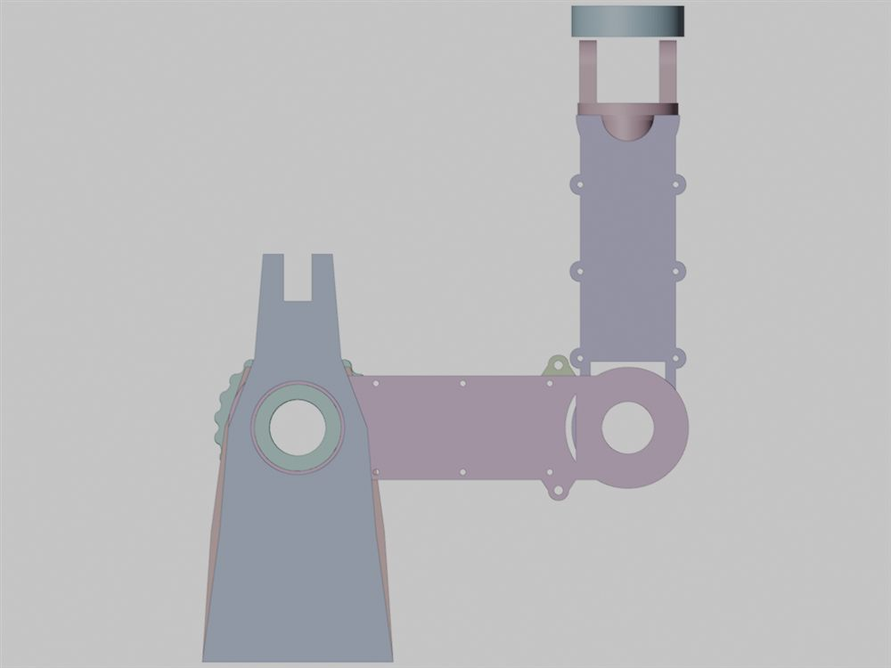

*Elbow at 90°: the forearm's wide body overlaps the upper arm (3.4 cm³ at 90°, 6.7 cm³ at 150°).*

Folded poses and most of the near-base workspace need the elbow past 75°. The forearm needs a long, narrow neck,
or the hub step continued, before it reaches the upper arm's walls.

## 7. Wrist, flange, tool changer

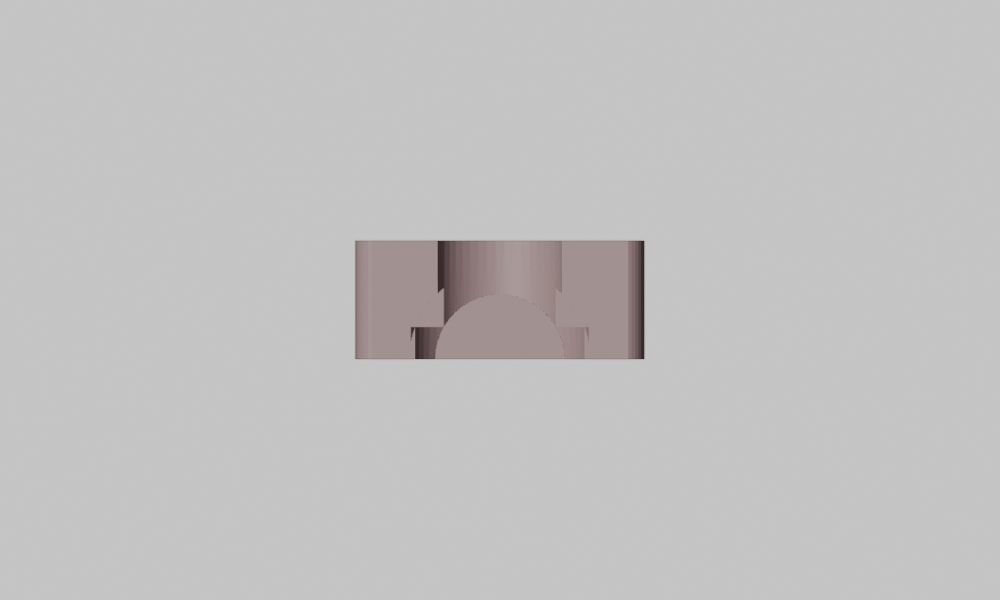

*Forearm half cut at y = 176, looking along the forearm: the half-round 6806 cradle at the bottom, with its crown
cut away by the leftover Ø30 vertical hole.*

- **6806 cradle (J5):** the axial half-round seat (Ø42.05 × 7.5) is correct, but the old transverse hub left a Ø30
  vertical hole and a Ø42.05 vertical counterbore at y = 180. Together they remove the crown and the root of the
  cradle: Fusion reports only ~21-31° arcs of seat per half, about 100-120° in total. The bearing's load (gravity
  when the forearm is level) bears on the missing crown. Delete the vertical features and re-cut the cradle.
- **One 7 mm deep-groove bearing** carries the wrist, tool and payload moment (~2.5-3.5 N·m). Expect wobble. Two
  bearings ≥ 15-20 mm apart, or a 4-point-contact bearing.
- **Yoke v1** (in the full assembly): Ø29.95 journal 12 mm long, but positioned so only **4.5 mm** of it is inside
  the 7 mm seat, and its Ø58 flange touches the forearm end face with **0 mm** running clearance. The J6 ears are
  10 mm thick with **no holes**.
- **Yoke v3** (latest; in the forearm assembly): **no journal** (just a Ø58 × 22 base with the Ø16 conduit), and the
  ears thinned to **4.5 mm** with plain Ø15.5 holes. A 6802 is 5 mm wide, so its seat can't fit a 4.5 mm ear. Neither
  version has the "dual 6802 seats Ø24.05 × 5.5" that 18 lists.

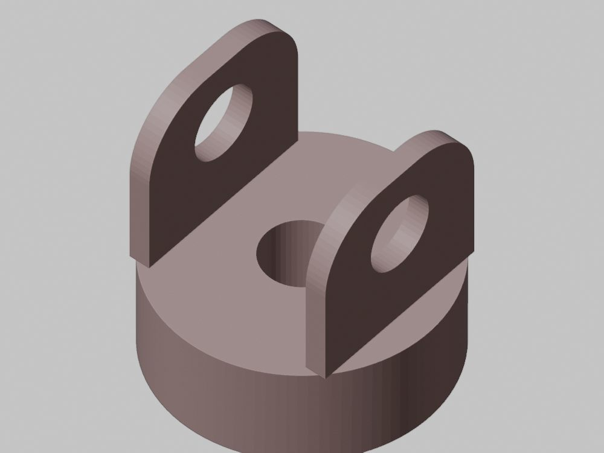

- **J7 flange:** M5 rear-entry pockets Ø7.2 × 8 with a 10 mm shoulder and Ø5.5 front holes: good idea, and 4.65 mm
  to the Ø15 slip-ring bore, 13 mm to the rim. But no kinematic seats, no 6806 seat (the timeline has a
  "Bearing_6806_Step" that left no geometry), and no centring spigot or dowel hole. The pattern is
  ISO 9409-1-**31.5**-4-M5, not "50-4-M5".
- **Tool changer:** the receiver's M5 holes have no counterbores (18 says counterbored), so the heads stand in the
  mating face. The magnet pockets at R 28 leave **1.45 mm** to the rim. The tool plate's "spherical seats" are Ø6 × 3.5
  cylinders. The receiver's dowels stand vertically, so a ball between two vertical pins is located sideways but not
  height-wise: it isn't a kinematic V. Low priority until the arm moves.

## 8. Hole and bore register

| Interface | CAD | Check | Verdict |
|---|---|---|---|
| Base → plinth, 4× M6 | Ø6.5 / Ø11 × 6.5, PCD 142 | 3.5 mm counterbore-to-rim | OK |
| J1 motor, 4× M3 | Ø3.4 on 31.0 □, bosses Ø8 (2.3 mm wall) | Pilot is clearance | Centre the motor on the pilot (§4.4) |
| J1 6810 seat / journal | Ø65.05 × 7.5 at z 17-24.5 / Ø49.95 × 8 at z 38-46 | Axial positions | **13.5 mm apart** (§4.1) |
| Turntable → cheeks, 8× M4 | Ø4.5, Ø8 × 4.2 counterbores from below, 4 dowels Ø5.0 / Ø5.05 | Pattern vs inserts | Exact; screws go in before the turntable is lowered |
| Pin carrier → turntable, 4× M4 PCD 40 | Holes only in the carrier | Partner holes | **Missing** |
| J1 ring pins | 26 × Ø5.05 on R 40, cavity R 42 | Embedment | **0.53 mm** (§4.3) |
| J1 output pins | 8 × Ø6.05 × 8 pockets / disc holes Ø8.5 on R 26.1 | 6 + 2e + 0.1 | OK |
| J2 6810 seats | Ø65.05 × 7.5, concentric, span 110 | Wall above (left) | **2.5 mm** (§5.2) |
| J2 seat shoulder | Ø54 | vs inner ring | Open to Ø56 |
| NEMA23, 4× M5 | 5.4 slots, 47.14 □, ±3 mm | Belt C = 92.5 mm | OK |
| Cheek foot, 4× M4 inserts + 2 dowels | Ø5.8 × 9, Ø5.05 × 9 (horizontal) | Wall 9.1 mm | OK; horizontal insert holes print slightly oval |
| Counterbalance axle | Ø8.2 along world y | Direction | **90° wrong** (§5.4) |
| 6804 in discs | Ø32.05 | Assembly onto the shaft | **Impossible** (§5.3) |
| J2 output holes | 6 × Ø11.1 on R 30.7 | 8 + 2e + 0.1 | OK (no carrier yet) |
| Upper arm clamshell, 6× M3 | Ø3.4 through 30 + 30 at x ±25.5 | 2.8 mm to the cavity, 14.5 mm to the edge | OK; add dowels and inserts |
| Spring lug | Ø5.2 in Ø12 boss, 3.4 mm wall | Position | Off the line by 36 mm, mirrored (§5.4) |
| Elbow | Ø30 bores, fork recess Ø72 / hub Ø65, 2 mm side and 3.5 mm radial clearance | Bearings | No J4 bearing or actuator yet |
| Forearm clamshell, 6× M3 | Ø3.4 in Ø12 ears, 4.3 mm wall | Near the cradle | Nearest screw 40 mm away |
| 6806 cradle (J5) | Ø42.05 × 7.5, split | Contact arc | **~100-120°** (§7) |
| Yoke journal / 6802 seats | v1: Ø29.95, no seats; v3: no journal, Ø15.5 in 4.5 mm ears | - | **Neither works** (§7) |
| J7 flange, 4× M5 | Ø7.2 × 8 rear pockets, Ø5.5 front, PCD 31.5 | Walls 4.65 / 13 mm | OK |
| Tool changer magnets | Ø6.1 × 3 at R 28 in Ø65 | Rim | **1.45 mm** |

**Fits in general:** every seat is drawn at ±0.05 mm, below what an FDM printer holds without calibration (± 0.1-0.2 mm).
The coupons in [print_tolerances.md](print_tolerances.md) come first, then the seat sizes become parameters set from them.

## 9. The print run (Bambu Studio 2.04 CLI, PETG)

Settings as 18 recommends: 0.20 mm layers, **6 walls, 40% gyroid, 6 top and 6 bottom layers**, tree supports where
needed (threshold 40°), Bambu PETG HF profile, textured PEI. A1 mini profile for parts that fit; parts that don't
were sliced on the Bambu H2D profile **as a stand-in for the CORE One L**, which Bambu Studio has no profile for.
The CORE One L's own times will differ somewhat.

| Part | Qty | Printer | Orientation | Time | PETG | Support |
|---|---|---|---|---|---|---|
| Base housing | 1 | A1 mini | bottom down | 19.0 h | 469 g | 3.5 g (motor pocket, bosses) |
| Turntable | 1 | A1 mini | flange top down, stem up | 5.0 h | 135 g | none |
| Pin carrier | 1 | A1 mini | flat | 1.3 h | 34 g | 0.2 g |
| J1 disc | 1 | A1 mini | flat | 0.8 h | 19 g | none |
| J2 discs | 2 | A1 mini | flat | 2.2 h | 61 g | none |
| Eccentric shaft | 1 | A1 mini | upright | 0.8 h | 16 g | 1 g |
| Left cheek | 1 | A1 mini | **inner face down** | 7.1 h | 194 g | 0.3 g |
| Right cheek | 1 | CORE One L (H2D proxy) | inner face down | 7.6 h | 232 g | 0.9 g |
| Upper arm halves | 2 | CORE One L (proxy) | split face down | 12.5 h | 390 g | 17 g (under the elbow ears) |
| Forearm halves | 2 | CORE One L (proxy) | outer skin down | 8.0 h | 260 g | 14 g (under the hub) |
| Yoke v3 | 1 | A1 mini | base down | 2.0 h | 52 g | 1.5 g |
| J7 flange | 1 | A1 mini | front face down | 1.6 h | 42 g | none |
| Tool changer pair | 2 | A1 mini | flat | 2.0 h | 52 g | none |
| **Total** | 16 prints | | | **~70 h** | **~1.96 kg** | ~40 g |

Reading it:

- **Everything prints.** Five prints (right cheek, both upper-arm halves, both forearm halves) need the CORE One L:
  the right cheek is 235 mm tall, the upper arm 265 mm and the forearm 212 mm, all over the A1 mini's 180.
- **Change two orientations from 18:** print the **cheeks inner face down** (18 says outer face down). That puts the
  6810 seat on top, opening upward, instead of on the bed with a 5.5 mm ceiling to bridge (1,294 → 261 mm² of
  overhang), and keeps elephant's foot off the bearing bore. The upper arm prints **split face down** (18 says up):
  with the cavity opening outward, split face up turns the 42 mm web into a bridge (5,430 mm²). This flips back once
  the cavity is moved to the split face (§6.1).
- Bores that must be round print vertical, which is good (base, cheeks, turntable, discs, shaft). The exception is the
  forearm's 6806 cradle, a horizontal half-cylinder that comes out with stair-steps: ream it or sand it to the bearing.
- The 70 h covers only what exists. Gearbox housings, the J3-J7 actuators, pulleys and the base plinth are still to
  come; the BOM's 5 kg of PETG still looks right.
- **First prints:** the coupons, then a 3 mm ring of each bearing seat (as [print_tolerances.md](print_tolerances.md)
  already says), then the turntable and the base once §4 is fixed.

## 10. PETG and heat

### 10.1 The limits (sources)

| Material | Heat deflection (0.45 MPa) | Source |
|---|---|---|
| Prusament PETG | **68 °C** (ISO 75) | Prusament PETG data sheet v1.1, 2022 |
| Bambu PETG HF | **69 °C**, Vicat 70 °C | Bambu PETG HF listings (reseller copies of the TDS; Bambu's PDF not read) |
| Generic PETG | Tg 70-80 °C | General guides; varies with the brand |
| Prusament ASA | **~93 °C** | Retailer copies of the Prusament ASA sheet; a generic ASA sheet gives 92 °C (ASTM D648) |
| PETG thermal expansion | ~70-80 × 10⁻⁶ /K (80 in the Filkemp PETG sheet), steel ~12 | One datasheet; treat as approximate |

Heat deflection is measured at only 0.45 MPa. Under a bolt head or in a press fit the local stress is many MPa, and
PETG creeps well below its HDT. Working rule used here: **PETG ≤ ~50 °C where it is under sustained bolt preload or a
press fit, ≤ ~60 °C for lightly loaded walls; above that, ASA or a metal part in the load path.**

### 10.2 How hot the motors get (hand model, not measured)

Copper loss at standstill P = 2·I_rms²·R (hot copper, R × 1.2). Thermal resistance from each motor's surface area,
anchored at 4.5 K/W for a 60 mm NEMA17, which agrees with the usual datasheet class "≤ 80 K rise at rated current,
2 phases on" (80 K / 16.8 W = 4.8 K/W; insulation class B or the 180 °C class in LDO's listings). Ambient 25 °C.
"Enclosed" = still air in a printed pocket, Rth × 1.6 (an assumption).

| Motor (where) | CLOSE, rms = rated, HoldMa 90% | CLOSE, Ma = rated read as peak, 90% | CLOSE, HoldMa 50% (default) | vFOC, ~35% load |
|---|---|---|---|---|
| J1 LDO 60 mm (base pocket) | 98 °C (enclosed 143) | 62 (84) | 48 (61) | 36 (43) |
| J2 NEMA23 (on the cheek) | 70 (96) | 47 (61) | 39 (47) | 32 (36) |
| J3/J4 LDO 60 mm | 98 (143) | 62 (84) | 48 (61) | 36 (43) |
| J5/J6 LDO 40 mm (in the forearm) | 79 (112) | 52 (68) | 42 (52) | 33 (38) |
| J7 LDO 20 mm pancake | 149 (224) | 87 (124) | 63 (86) | 44 (55) |

The first column is not realistic as continuous running (a winding past ~130 °C would cook). It shows why the
current setting matters more than the material. **The answer to "is PETG OK" is the driver mode**, which ties to the
open peak-or-RMS question and to the recommended mode (SR_vFOC, or CLOSE with HoldMa 90%).
CLOSE with HoldMa 90% at full current puts every NEMA17 joint over PETG's limit; vFOC, which only draws the current
the load needs, keeps every housing under 55 °C even enclosed.

### 10.3 Housing by housing

| Housing | Exposure | Verdict for PETG | What to do |
|---|---|---|---|
| **Base (J1 motor)** | Motor face clamped to four Ø8 PETG bosses (2.3 mm wall) by M3 preload; 3 mm ceiling 3 mm above the motor face; the 6810 seat 8 mm above it; motor and driver in a closed plinth | **Marginal to no** in CLOSE mode; fine in vFOC | Aluminium spacers through the bosses (or an aluminium motor plate), vent the plinth, vFOC |
| **Left cheek (NEMA23)** | 1.1 kg motor bolted straight to PETG, carrying belt tension through slot friction | Fine in vFOC; **belt-tension creep** at 60 °C+ | Aluminium motor plate or an ASA cheek |
| **Forearm (J5/J6)** | Two motors sealed in a 43 × 47 mm PETG box, 0.35 mm side gap | **Worst enclosure** in the design | Vents or a fan, 1 mm side clearance, vFOC; ASA if the motors stay inside |
| J7 wrist (not drawn) | Pancake is the worst heat density | Must be current-limited: it needs only ~0.1 N·m | Set Ma low; ASA housing |
| Turntable, links, discs, flange | No motor contact | PETG fine | - |

**Bearing fits drift with temperature.** PETG expands ~6× more than steel. At +20 K a Ø65 PETG seat opens by about
0.075 mm (+35 K: 0.13 mm), turning the +0.05 seat into a loose one, while the Ø49.95 PETG journal grows into the
inner ring by ~0.06 mm (+35 K: 0.10 mm) and creeps under the hoop stress. That is why 18's "clamp the bearings
axially, don't rely on press fits" is right. Only the J1 seat sits next to a motor; the J2 seats are 92 mm from the
NEMA23 through PETG and will stay near ambient.

**18's thermal numbers** ("50-65 °C" motors, standoffs cutting heat flow "by > 60%") have no source and aren't
reproduced here. A 3 mm gap does cut contact area (the bosses touch ~165 mm² against ~1,380 mm² for the whole face),
but the bosses are the bolted, loaded, hottest PETG in the base.

**Measure it.** A thermocouple or NTC on each motor case during the bench tests (`tests/actuator_bench.md` §0) replaces
this table. The risk register already lists "motor heat softens PETG: temperature logging".

## 11. Where 18 (and the 19 Oct history entry) differ from the model

| 18 says | The model has |
|---|---|
| 6810 seat + journal form the J1 bearing | 13.5 mm apart (§4.1) |
| Flutes "firmly backed by the solid rim" | 0.53 mm deep (§4.3) |
| Pin carrier bolts to the turntable underside on PCD 40 | No holes in the turntable |
| "Support-free interior printing" (base) | Pocket ceiling and bosses need support (§4.6) |
| Upper arm "rigid 60 mm box section", "internal cavity" | Open outward channels (§6.1) |
| Right cheek axle Ø8.2 at X = −12, through the thickness | Along the width at x = ±8 (§5.4) |
| Forearm "wrist hub Ø60 with stepped 6806 seat" | Cut-down cradle (§7) |
| Yoke: Ø29.95 journal and dual 6802 seats Ø24.05 × 5.5, 9 mm walls | v1: journal, no seats; v3: no journal, Ø15.5 holes in 4.5 mm ears |
| J7 flange: 3 kinematic ball seats; "ISO 9409-1-50-4-M5" | No seats; the PCD 31.5 pattern is ISO 9409-1-31.5-4-M5 |
| Receiver M5 holes counterbored; tool plate seats spherical, M4 counterbored | Plain holes; Ø6 cylinders |
| Revisions in the inventory (upper arm v3, forearm v2, yoke v3 …) | Latest: upper arm v4, forearm v5, yoke v3 *and* a v1 file; the assemblies use mixed versions (§3) |
| M6 counterbore 6.0 deep | 6.5 |
| J2 disc e = 1.5 | Model agrees; [03](03_actuators_gearboxes.md) says 1.6. Both pass `tools/cycloid.py`: pick one and sweep the docs |
| 30T pulley on the eccentric shaft | 03 plans 20T/40T; `arm.toml`'s 48:1 needs 2:1 |
| "0 clashes … complete 7-DOF arm" | 0 clashes, true; but no J3, and the missing parts are why (§3) |
| Motors at 50-65 °C; standoffs cut heat flow > 60% | Unsourced; depends on the driver mode (§10) |

[print_tolerances.md](print_tolerances.md)'s new "CAD Nominals" table quotes "6.0 mm dowel pin flutes (J2 reducer),
PCD 100": no J2 ring part exists yet.

## 12. What to do, in order

**Decisions for Josh first** (each changes the geometry). *Decided 20 Oct by Josh, with the
reasoning in [09](09_decisions_open_questions.md) D36-D39: 1 → keep the stack, 209 mm once J1 has two bearings (applied to
`arm.toml`); 2 → coaxial, hanging through the base board on ~70 mm feet; 3 → J3 into the upper arm, J5 at the elbow end, forearm 180 mm and
wrist 70 mm (the CAD changes); 4 → PETG with aluminium motor plates or spacers, drivers in SR_vFOC, ASA only for
J7 (and the forearm if its motors are enclosed).*

1. **Shoulder height**: keep the CAD's 196 mm (then `arm.toml` J1 `d` = 0.196, and re-run the budget, spring,
   tests and URDF), or bring it towards 130 (shorter cheeks and a lower turntable).
2. **Where the J1 motor goes**: below the base in a plinth (needs ~80 mm of height and a harness slot), or beside
   the axis with a belt (03's alternative, frees the centre for the harness).
3. **J3 and J5**: put the J3 roll joint into the upper arm (as `arm.toml`, the IK and the budget assume), or decide
   it is dropped for now; and put J5 at the elbow end (plan) or keep it at the wrist (CAD), which moves the J6 motor.
4. **Motor-side housings**: ASA on the CORE One L (D16 allows it), or PETG with aluminium motor plates and
   spacers. Either way, run the drivers in vFOC.

**Then the fixes** (none needs a purchase):

1. J1 re-layout: the 6810 at the top of the base with the turntable journal in it; the cavity ~Ø78.5 so the pins are
   70% embedded; the pin carrier bolted under the turntable with matching holes; the motor centred on its pilot; a
   harness slot; shell the base.
2. Eccentric shaft: split at the divider, or journals ≤ Ø16.
3. Upper arm: cavity to the split face, lug on the centre plane, dowels and inserts; a Ø50 hub or tube through both
   6810s, keyed to the arm.
4. Forearm: delete the vertical Ø30/Ø42/Ø60 leftovers, re-cut a full 180° cradle, two J5 bearings, close the window
   by the hub, narrow the neck until the elbow reaches ±140°, 1 mm side clearance and vents around the motors.
5. Right cheek: axle through the thickness, parallel to J2, at the height the spring is sized for; the left cheek's
   seat wall ≥ 5 mm; shoulder bores Ø56.
6. One yoke with a journal, 6802 seats in ≥ 7 mm ears, and ≥ 0.5 mm running clearance to the forearm.
7. Fusion bookkeeping: rebuild the full assembly from *linked* latest parts, add joints with the `arm.toml` limits,
   clear out duplicate files (Josh's call), and make the fits user parameters.
8. Then: re-run this review (interference, sweeps, slices) and move the CAD masses and centres of mass into
   `arm.toml`.

Nothing here was printed, fitted or measured; the slicer times are estimates for the settings above; the temperatures
are a model with stated assumptions; strength and stiffness numbers are hand estimates.

---

## 13. Addendum, 19 Oct (evening): re-check and a test assembly with joints

Asked by another session on Josh's behalf: go through every part and assembly again with the Fusion MCP tools (server
`fusion`, now configured), re-check §0, §8 against the current geometry, re-run the interference, gap and
range-of-motion checks, and build sub-assemblies and a full assembly from linked parts with joints, saving nothing
without Josh's approval. **§0, §12 above are kept as written;** what changed is listed in §13.6.

**How it was checked.** Every part file was opened invisibly and closed unsaved; its cylindrical faces, bodies,
volumes and timelines were dumped and compared with §1 and §8. For the tests a model was built **in memory only**,
inside the empty duplicate file `DeskArm_Shoulder_Assembly` (lineage `I2et4M…`, v1, no occurrences), opened
invisibly and never saved: 17 occurrences, all **linked** to the latest part files, in seven rigid groups, with
as-built joints at J1, J2, J4, J5 and J6 (§13.4). Fusion's interference analysis, `measureMinimumDistance` and
joint-driven sweeps ran on it. Josh's open documents (`Liquor_compass v4` and a `DeskArm_Forearm_Assembly v1`) were
not touched. Nothing in the hub was created, edited or saved.

### 13.1 Nothing changed since the review

Every part is at the version in §1, last modified between 04:47 and 08:21 UTC on 19 Oct; the review was written
after that (its files are dated 12:35-12:38 PDT = 19:35 UTC). The geometry dump matches §1, §4, §8 and the register in
§8 to the 0.01 mm printed: the same seats, bores, bolt circles and flutes, the same Ø8.2 axle along the cheek's width,
the same shaft lobes. **Every finding in §0 is still open** (§13.2). No part has user parameters; the yoke v1, upper
arm and forearm are still single-feature or few-feature bodies (timelines of 1-4 items).

Two things the review didn't say:

- **The yoke "v1" file is the newer one.** `DeskArm_Wrist_Pitch_Yoke` lineage `STHy…` (v1, 07:58 UTC) was saved
  after lineage `DyRb…` (v3, 07:34 UTC). v1 has the Ø29.95 journal and 10 mm ears without holes; v3 has no journal
  and Ø15.5 holes in 4.5 mm ears (§7). The test model uses the v1 file because it has the journal the forearm's 6806
  needs; which one is meant is Josh's call.
- **All 14 assembly files were opened this time** (the review opened the latest-modified three). Five
  `DeskArm_Forearm_Assembly` (forearm half v2 at y −70, v3 ×2, v4, v5; yoke v3 or v1), five `DeskArm_Full_Assembly`
  (two reference `DeskArm_Shoulder_Assembly v7`'s parts with the upper arm v3 out of date, three hold local copies),
  four `DeskArm_Shoulder_Assembly`, **one of which is empty** (`I2et4M…`, the one used as scratch here). None has a
  joint or a user parameter.

### 13.2 Status of the §0 findings

| # | Finding | Status, as re-measured |
|---|---|---|
| 1 | Turntable journal 13.5 mm above the 6810 seat | **Open.** Journal z 38-46, seat z 17-24.5 (turntable at z +53, flange 1.00 mm above the base) |
| 2 | No room for the J1 reducer; pin-carrier holes without partners | **Open**, and worse (§13.3 b). Placed in the cavity, the disc overlaps the turntable stem by 4.85 cm³ and the carrier by 13.57 cm³ |
| 3 | Ring-pin flutes 0.53 mm deep | **Open.** 26 × Ø5.05 on R 40, cavity Ø84 |
| 4 | J1 motor below the base, no harness path | **Open.** Pocket 44 × 44 × 12, Ø24 pilot clearance, no side opening |
| 5 | 6804s can't go onto the eccentric shaft | **Open.** Journal Ø20 z 0-12, lobes Ø20 at x +1.5 (z 12-19.5) and −1.5 (z 20.5-28), divider Ø24 |
| 6 | Lengths vs `arm.toml`, no J3 | **Open.** In the test model's zero pose: J2 at z 196, J4 at 386, J6 at 594, flange face at 629 (arm.toml 130 / 320 / 500 / 570) |
| 7 | Elbow clear only to about ±75° | **Open: ±74°** (§13.5) |
| 8 | 6806 cradle cut away; yokes don't work | **Open.** Ø30 and Ø42.05 vertical features at y 180 still there; yoke v1 journal 4.5 mm into the 7.5 mm seat, its flange 0.00 mm from the forearm end |
| 9 | Counterbalance axle 90° off, anchor 85 mm, lugs 36 mm off-line and mirrored | **Open.** Ø8.2 along the cheek's local x (world y), at local y 220 |
| 10 | Upper arm cavity opens outward | **Open** (same single-feature body, 216.1 cm³) |
| 11 | PETG only with vFOC / low hold current | Unchanged (no geometry involved) |
| 12 | Mixed, unlinked versions, no joints | **Fixed for bookkeeping** (19 Oct night): `DeskArm_Arm_Assembly` and five sub-assemblies, all linked, with joints (§13.8). The old duplicates are still in the hub |

### 13.3 New findings

a. **The 7 mm 6804s don't fit the 6 mm discs, and the two J2 discs touch.** Both cycloid discs are 6.0 mm thick with
   a through Ø32.05 bore (J1 and J2), but a 6804 is 20 × 32 × **7** mm, so each bearing stands 0.5 mm proud of both
   faces. The assembly puts the two J2 discs face to face (0.00 mm apart), so their bearings would overlap by 1 mm.
   The shaft's lobes are 7.5 mm wide with a 1 mm divider, a lobe pitch of 8.5 mm, against 6 mm between the discs as
   placed: either the discs get 7.5-8 mm thick, or they sit 2.5 mm apart with a spacer.
b. **The J1 pin carrier's pins come out of the face that bolts to the turntable.** The 8 × Ø6.05 pin pockets open
   on its top face (z 4-12 from the top), and the M4 counterbores are on the bottom face, so the screws go up through
   the top face into the turntable. With the top face against the turntable the pins point into the turntable, not
   into the disc. One of the two features has to move to the other face (or the carrier is bolted from above, through
   the turntable flange).
c. **J6 turns only ±23° with the flange where the forearm assembly puts it.** There is no J6 output part: the flange
   (Ø65) floats 17 mm past the J6 axis and 2 mm beyond the yoke's ear tops, and swung about J6 it hits the ears at
   ±24° (`arm.toml` ±120°). The missing J6 output member and J7 actuator decide the real range; until then this is
   only what the current parts allow.
d. **The eccentric shaft has nothing to run in.** Placed with its divider at the disc interface (x −66), its inner
   journal sits in the left cheek's Ø54 bore with 16.8 mm of radial gap; no part carries a bearing for either journal
   (the J2 ring housing is not modelled). Known missing part (§1), now measured.
e. **The CAD's axes are turned 90° from the skeleton.** The parts have J2/J4/J6 along world X and the arm swinging in
   the Y-Z plane; `tools/fusion_skeleton.py` (and its reading of `arm.toml`'s DH frames) puts J2/J4/J6 along +Y with x
   forward. Nothing breaks, but masses and centres of mass read from this CAD must be rotated before they go into
   `arm.toml`, and the parts are not placed in the skeleton.
f. **Fusion moves only one half of an unrigid group.** In the first test build a joint on a group of two halves moved
   one half and left the other; the first sweeps were wrong until each group got a rigid group. Any saved assembly
   needs rigid groups (or rigid joints) inside each sub-assembly. This is a Fusion behaviour, noted so nobody repeats
   it.

### 13.4 The test assembly (built in memory; saved later as six files, §13.8)

Built by `tools/fusion_test_assembly.py` (deleted 20 Oct, superseded by `tools/fusion_arm_full.py`; it ran inside Fusion and needed an empty
design saved in the same hub project and never saved). Zero pose = `arm.toml`'s: arm straight up, every joint at 0. Placement is the saved CAD's, turned +90° about the J2
axis to stand the arm up; parts that don't mate are at their intended places and the mismatch is recorded, nothing was
edited:

| Group | Linked parts (latest versions) | Placed |
|---|---|---|
| G0 J1 base (grounded) | Base v3, J1 disc v1 | Disc on the cavity floor (z 24.5-30.5), offset e = 1.2 mm along x: overlaps the turntable stem (finding 2) |
| G1 J1 turntable | Turntable v2, pin carrier v1 | Turntable at z +53 as saved (journal 13.5 mm above the seat). Carrier flipped, pins down onto the disc, z 30.5-42.5: overlaps the stem (finding 2, §13.3 b) |
| G2 J2 shoulder (rigid to G1) | Both cheeks v2, 2 × J2 disc v2, eccentric shaft v1 | Cheeks as saved. Discs at x −66…−60 and −72…−66 as saved, moved ±1.5 mm onto the lobes. Shaft with its divider at x −66 and the pulley spigot outboard (§13.3 a, d) |
| G3 upper arm | 2 × upper-arm half v4 | As saved, standing up |
| G4 forearm | 2 × forearm half v5 | As saved |
| G5 wrist yoke | Yoke (the v1 file, §13.1) | As saved, turned 90° about its roll axis so that J6 is parallel to J4 at J5 = 0 (`arm.toml` convention); the saved CAD pose is J5 = ±90° |
| G6 flange + tool changer | J7 flange v1, receiver v1, tool plate v1 | Flange as saved; receiver on the flange face (M5 patterns and Ø15/Ø16 bores line up); tool plate face to face with the receiver (magnets at R 28 and the 3 ball seats / pin pairs at R 23 line up) |

Joints (as-built revolute, limits from `arm.toml`): **J1** G1/G0 about +Z at the origin, ±170°; rigid G2/G1;
**J2** G3/G2 about −X through z 196, ±120°; **J4** G4/G3 about −X through z 386, ±140°; **J5** G5/G4 about +Z at
z 566, ±180°; **J6** G6/G5 about −X through z 594, ±120°. Positive J2 and J4 tip the arm toward +Y, the way the
saved CAD leans: **J2 = +90° reproduces the saved full assembly exactly** (flange at y 415-433, z 196 ± 32.5).
J3 (no joint in the upper arm) and J7 (no actuator between the J6 output and the flange) are not modelled.

**Interference at the zero pose:** two clashes, both finding 2 (disc × turntable 4.85 cm³, pin carrier × turntable
13.57 cm³). Fusion reports nothing else, coincident faces excluded.

**Gaps at the mating faces** (`measureMinimumDistance`, zero pose):

| Pair | Gap (mm) | Reading |
|---|---|---|
| Base / turntable | 1.00 | Flange above the base top; the bearing doesn't carry it (finding 1) |
| Turntable / each cheek | 0.00 | Bolted faces |
| Left cheek / J2 disc 1 | 1.00 | |
| J2 disc 1 / disc 2 | 0.00 | §13.3 a |
| Left cheek / shaft | 16.81 | §13.3 d |
| Each cheek / upper-arm half | 5.00 | Running clearance, as §5.1 |
| Upper-arm halves; forearm halves | 0.00 | Split faces |
| Upper arm / forearm (elbow) | 2.00 | Side clearance, as 18 §4.3 |
| Forearm / yoke | 0.00 | Yoke flange on the forearm end face: no running clearance (finding 8) |
| Yoke / flange | 2.00 | Nothing joins them (§13.3 c) |
| Flange / receiver; receiver / tool plate | 0.00 | Bolted / mating faces |

### 13.5 Range of motion (joints driven in Fusion, 10° steps, then 1° at the boundary; everything else at 0)

| Joint | `arm.toml` | Clear in the CAD | First contact |
|---|---|---|---|
| J1 | ±170° | Free (checked at ±45, 90, 170°) |, (the J1 motor and harness aren't modelled) |
| J2 (elbow straight) | ±120° | **±139°** | ±140°: upper arm against the turntable flange rim (0.13 cm³) |
| J4 (J2 = 0) | ±140° | **±74°** | ±75°: the forearm's 30 mm hub neck, which runs 38 mm along the forearm, meets the rim of the upper arm's Ø72 fork recess at R 36 (2 × 0.002 cm³); 0.67 cm³ at 90°, 9.2 cm³ at 140° (by then the forearm's full width) |
| J5 | ±180° | Free over ±180° (30° steps) |, (but 0 mm running clearance at the yoke flange) |
| J6 | ±120° | **±23°** | ±24°: flange against the yoke ears (§13.3 c) |
| J3, J7 | ±170°, ±360° | Not modelled | - |

### 13.6 What this changes in §0, §12

- §6.3's J4 limit is confirmed (±70° clear at 10° steps; ±74° at 1°), but its **volumes don't reproduce**: Fusion
  gives 0.67 cm³ at 90° (19 §6.3: 3.4 cm³) and 9.2 cm³ at 140° (19: 6.7 cm³ at 150°). The first contact is the
  hub neck on the recess rim, and the forearm body against the side walls only at larger angles. The fix in §12 (a
  long narrow neck, or a deeper/larger fork recess) is unchanged.
- §6.3's J2 "first contact only past ±140°" is at ±140° itself (turntable rim); free over the ±120° needed.
- §12's fix list gains: thicker discs or a spacer between them (§13.3 a); move the pin carrier's pins or
  counterbores to the other face (§13.3 b); a J6 output member between the yoke and the flange that clears ±120°
  (§13.3 c); place the parts in the skeleton's frame, or rotate the masses when they go into `arm.toml` (§13.3 e);
  rigid groups in every saved sub-assembly (§13.3 f).
- No number in `arm.toml` changed, so the torque budget and the tests were not re-run for this addendum.

### 13.7 Not done yet

- ~~The sub-assemblies and the full assembly are not in the hub.~~ Saved later that night with Josh's approval:
  §13.8.
- The four decisions in §12 are unchanged and still Josh's; nothing here assumes an answer. The duplicate hub files
  are listed (§13.1), not deleted.
- ~~Not checked: the yoke v3 file in the model, the J1 sweep in fine steps~~ (done 20 Oct, §13.9). Still not done:
  slices or prints.

### 13.8 Saved: five sub-assemblies and the full assembly (19 Oct, night)

Josh said "save". Six **new** files in `Admin Project / DeskArm_Parts`, each v1; no existing file was edited, and the
empty template (`DeskArm_Shoulder_Assembly`, lineage `I2et4M…`) is still v1 and empty (each file was built in it,
opened invisibly, and written with `saveAs` under the new name). Every part is **linked** at its latest version, the
placements and joints are those of §13.4, and each group with more than one part has a rigid group.

| File | Lineage | Contents | Joints |
|---|---|---|---|
| `DeskArm_SA1_J1_Base_Turntable` | `hM3fH0x2RJS4Pe9TRhWm1w` | Base v3 + J1 disc (group "J1 base", grounded); turntable v2 + pin carrier (group "J1 turntable") | **J1** revolute, ±170° |
| `DeskArm_SA2_J2_Shoulder` | `dKxEXpALTEWoPFYt85jyaw` | Both cheeks v2, 2 × J2 disc v2, eccentric shaft v1 |, (rigid) |
| `DeskArm_SA3_Upper_Arm` | `-FTfPEKARByit2QER3JSTA` | 2 × upper-arm half v4 |, (rigid) |
| `DeskArm_SA4_Forearm_Elbow` | `buzbndBuRFyOfLSx3FwG5Q` | 2 × forearm half v5 |, (rigid) |
| `DeskArm_SA5_Wrist_Tool` | `_j9i71ZHSFKcaTYgI8GsNg` | Yoke (the "v1" file, §13.1) in group "Wrist yoke"; J7 flange, receiver, tool plate in group "Flange + tool changer" | **J6** revolute, ±120° |
| `DeskArm_Arm_Assembly` | `AKBQgdJpRGSmL9n61j_puQ` | Links SA1-SA5 at the identity (zero pose); SA1 grounded; SA2 rigid to SA1's turntable | **J2** ±120°, **J4** ±140°, **J5** ±180° |

Lineages are `urn:adsk.wipprod:dm.lineage:` + the id. Checked on the saved full assembly (opened invisibly, driven,
closed unsaved): J2 = +90° puts the wrist at y 355-453, z 163.5-228.5, the saved CAD pose; J4 and J5 move their
groups; **J1 and J6, which live inside SA1 and SA5, can be driven from the full assembly** (J1 = 45° turns the
turntable and the shoulder rides with it; J6 = 20° tilts the flange), through
`createForAssemblyContext`. At the zero pose Fusion reports the same two clashes as §13.4 (4.85 and 13.57 cm³).
The ranges in §13.5 were measured in the in-memory model with the same placements; they were not re-swept in the
saved files. J3 and J7 still have no joint (no parts).

**Mismatches carried in these files** (placed at their intended positions, not fixed): the turntable 13.5 mm above
its bearing (finding 1); the J1 disc and pin carrier inside the turntable stem (finding 2, §13.3 b); the J2 discs
touching and their 6804s 1 mm too wide (§13.3 a); the shaft without bearings (§13.3 d); the yoke journal 4.5 mm into
its seat with 0 mm running clearance (finding 8); the flange not carried by anything, so J6 clears only ±23°
(§13.3 c); the lengths 196 / 208 / 35 mm against 130 / 180 / 70 (finding 6).

**Fusion crashed once** while the first attempt at the full assembly also drove the inner joints in the same script;
nothing was half-saved (the five sub-assemblies were already saved and uploaded). After the restart the MCP add-in
listened on port 58846 instead of the configured 55337.

### 13.9 Re-swept in the saved files (20 Oct)

§13.7 listed three things as not done. All three were run on 20 Oct with `tools/fusion_sweep.py` (new; it opens
`DeskArm_Arm_Assembly` invisibly, drives the joints, runs Fusion's interference check and closes unsaved) and one
in-memory swap in `SA5`. Nothing in the hub changed: every part and assembly is at the version listed in §13.8.

**A trap first.** The saved joints carry the `arm.toml` limits (J1 ±170°, J2 ±120°, J4 ±140°, J5 ±180°, J6 ±120°),
and **Fusion clamps a value past a limit without an error**: the first run showed J2 "clear to ±160°" because it
never left 120°. The tool lifts the limits in memory before it sweeps.

| Joint | §13.5 (in-memory model) | Saved files, 20 Oct |
|---|---|---|
| J1 | Free (±45, 90, 170°) | **Free over ±180° in 10° steps** (the motor and harness are still not modelled) |
| J2 | ±139°; 0.13 cm³ at ±140° | **Same:** clear at ±139°, 0.129 cm³ turntable-upper arm at ±140° |
| J4 | ±74° | **±73°**: at ±74° the forearm hub neck already touches the fork-recess rim by 0.0001 cm³ (0.1 mm³) per half; 0.67 cm³ at 90°, 9.2 cm³ at 140°, as §13.6 |
| J5 | Free (30° steps) | Free at ±90°, 180° |
| J6 | ±23° | **Same:** 0.0009 cm³ yoke-flange at ±24°. At 120° the flange and tool changer also run into the forearm (1.5 + 3.8-3.9 + 0.34 cm³ per half), so a J6 output member (§13.3 c) has to clear the forearm too, not only the yoke ears |

**The yoke "v3" file is no better** (swapped for v1 in `SA5` in memory, J6 swept, closed unsaved): it clears the same
±23° (0.0004 cm³ at ±24°), clashes less at 30-60° (0.02-0.21 vs 0.05-0.49 cm³) and more at 120° (16.1 cm³ with
the flange plus 3.9 cm³ with the receiver, against 11.9 and 0.28). The flange, not the yoke version, sets the J6
limit. Keep v1 as the base. Not checked: v3 against the forearm (SA5 holds only the wrist).

So the §13.5 numbers stand, with J4 tightened by a degree. The next sweep is worth running only after a fix lands.

---

## 14. J1 rebuilt (20 Oct), after the four decisions

Josh delegated the four §12 decisions (20 Oct); they are D36-D39 in [09](09_decisions_open_questions.md). The first fix,
the J1 re-layout, was then made in the hub by `tools/fusion_j1.py`. It rebuilds each J1 part file from numbers in the
script, with the fits as user parameters (`seat_fit`, `journal_fit`, `pin_fit`, `press_fit`, `clear_fit`). The old
versions stay in each file's version history.

### 14.1 What changed, and why

| Part (file, version) | 19 Oct | 20 Oct | Why |
|---|---|---|---|
| Base housing (v4) | 48 mm, one 6810 seat, Ø84 cavity, 0.53 mm pin flutes, motor pocket, M6 counterbores on top, solid (772 cm³) | **61 mm**, two 6810 seats on a 10 mm land (Ø58), Ø81 disc cavity, Ø72 carrier cavity, 26 pin holes R40 (z 6.5-28), Ø100 recess for the motor plate, M6 inserts from below, harness trough (R66-76) and slot at the back, shelled with 8 ribs (534 cm³) | docs/03 asks for two spaced output bearings (one thin 6810 can't carry the ~22 N·m tipping moment); the lower 6810 can only go in from below, so the floor became a separate plate |
| Motor plate (new, v1) |, (floor of the base) | Ø99.6 × 6.5, NEMA17 pilot Ø22 + `clear_fit`, Ø24 cam passage, 4 × M3 counterbored, 26 pin sockets (3.5 mm), 4 × M4 midway between pins | Holds the motor and the bottom ends of the ring pins; bolts into the base recess |
| Eccentric cam (new, v2) | - | Collar Ø23, two Ø20 lobes ±1.2 mm 180° apart (7 mm each), Ø22 spacer between the inner rings, Ø5.2 bore with a D key over z 12-22.5 only, M3 set screw in the collar (axial hold, on the round part of the shaft) | Two discs, as the build checklist asks (cancels the wobble). v1 had the key full length and would not have gone onto the shaft (§14.6); **v3 is two pieces** with shoulders centred on each lobe, because a one-piece cam can't be assembled (§14.7) |
| Cycloid disc (v2, used twice) | One disc, 6 mm (imported body) | **7 mm** (the 6804's width), profile from `tools/cycloid.py` (26 pins, R40, Rr 2.5, e 1.2, 0.10 clearance), 6804 seat, 8 × Ø8.4 output holes | §13.3 a; disc B is disc A turned 180° about the axis |
| Pin carrier (v2) | Pins pocketed from the bolting face, holes with no partner | Ø70 × 12.5 + Ø54 boss that clamps the lower inner ring, 8 × Ø6 pockets from the disc side, 4 × M4 counterbored at 22.5° (clear of the pins) into inserts in the stem | §4.2, §13.3 b |
| Turntable (v4) | Journal 13.5 mm above its seat, Ø26 conduit on top of the motor shaft | Flange 62-74 with the same cheek holes, step Ø53.5 on the upper inner ring, Ø50 journal through both bearings, 4 × M4 insert holes on the stem's bottom face, Ø20 lightening bore; **inner spacer** (Ø50.1/55 × 10) as a second body | §4.1; the harness goes outside (D37), so the centre needs no conduit |

The stack (z from the board): motor face 0, plate 0-6.5, disc A 7.5-14.5, disc B 15.5-22.5, carrier 23-36.5, 6810s
36.5-43.5 and 53.5-60.5, base top 61, turntable flange 62-74, J2 at 74 + 135 = **209 mm**. That is why D36 ended
at 209, not 196. Height changes no gravity torque or tipping number, but the spring sizing samples the
reachable poses above the board, and it now gives **574 N/m** (was 565): `arm.toml` and the docs follow.

**§4.3 was wrong about the cavity.** It sized the cavity from the disc's r_max (38.6 mm, in the disc's own frame), so
Ø78.5 would hold the pins 70% embedded. In the housing frame the disc sits 1.2 mm off the axis, and its lobes reach
**R 39.79**, past the pin circle minus 0.21 mm. A cavity that clears the lobes can't wrap the pins, so they are held
at both ends instead: 3.5 mm in the motor plate and 5 mm in the base shelf above the discs, with a 2 mm flute in the
Ø81 wall behind them. The steel pin spans 16.5 mm between its supports; at J1's full motor torque that bends it to
about 14 MPa (hand estimate, ~42 N per pin).

### 14.2 How it was checked

- **The whole stack in memory** (`tools/fusion_j1_check.py`, nothing saved): every part plus envelopes of the bought
  parts (two 6810s, two 6804s, 26 ring pins, 8 output pins, the motor), with the cam at 0°, 45° and 90° and the discs
  and carrier following the 25:1 kinematics (disc turns −t/25). Fusion's interference check finds **nothing** except
  the cam's D flat against the round shaft envelope (an artefact of the envelope, 15.8 mm³). Re-run 20 Oct with the
  real LDO D shaft turning with the cam (§14.6): **clear at 0°, 45°, 90°, 180° and 270°**, nothing left over.
- **The disc-to-pin gap** was checked numerically first (`tools/cycloid.py` profile, 20,000 points): exactly 0.10 mm at
  every cam angle with the −t/25 sign, and up to −2.3 mm (a clash) with +t/25, so the kinematics in the check are
  right. In Fusion every pin then measures 0.094-0.101 mm from the disc.
- **The saved full assembly** (`DeskArm_Arm_Assembly` v2, `tools/fusion_sweep.py`): the zero pose is **clear**; the two
  J1 clashes of §13.8 (4.85 and 13.57 cm³) are gone. J1 is free at 45°, 90° and 170°; J2 ±139° (0.129 cm³ on the
  turntable rim at 140°, the same geometry as before); J4 ±73°, J5 free, J6 ±23°, as §13.9. J1 = 45° with J2 = 90°
  is clear.
- `SA1` v2 was rebuilt by `tools/fusion_assembly.py sa1` (groups "J1 base" with base, plate, cam and both discs, and
  "J1 turntable" with the turntable and carrier, each with a rigid group; J1 ±170°). `tools/fusion_assembly.py arm`
  moved the full assembly to `SA1` v2, lifted `SA2`, `SA5` by 13 mm and recreated the rigid joint and J2/J4/J5 at
  z 209/399/579.

**What tripped on the way** (for the next session): the add-in drops a script over about 16 KB without an error (it
just returns an empty message); Fusion keeps an imported module between runs (reload it); a fitted spline closed
with `isClosed` afterwards, or fitted through points spaced unevenly in arc length, deviates by up to 0.1 mm near the
seam (resample at equal arc length); saved joints clamp silently at their limits (§13.9).

### 14.3 Bought parts it needs (not yet in `bom.csv`, which waits for the 11.11 order)

26 × dowel pin Ø5 × 25 (ring pins); 8 × Ø6 × **25** (output pins: the 6 × 30 bought on 8 Oct are 5 mm too long here);
2 × 6810 and 2 × 6804 (bought); 4 × M4 heat-set inserts + M4 × 16 (carrier to stem); 4 × M4 inserts + M4 × **10** (plate
to base; × 12 would bottom in the 9 mm insert hole); 4 × M3 × **6** (motor: the plate puts 3 mm under the head and LDO's threads are only 4.5 mm deep); 4 × M6 inserts + M6 bolts through the board; 1 × M3 set screw. The base board needs a
~Ø64 hole under the base for the motor and its driver, and ~70 mm feet (D37). The motor's shaft is now from LDO's drawing (§14.6); still
worth a caliper check on arrival.

### 14.4 Assembly order (the parts only fit one way)

1. Upper 6810 into its seat from the top; base upside down, lower 6810 from below against the land.
2. Bolt the cheeks to the turntable (their screws come from under the flange), then the turntable stem down through
   both bearings with the inner spacer between the inner rings.
3. Lay it on its side: carrier onto the stem's bottom face (M4 into the inserts), which clamps the inner rings.
4. Output pins into the carrier, ring pins into the shelf holes.
5. On the bench: motor onto the plate (M3 × 6); lower cam down the shaft, its set screw through lobe A onto the flat;
   disc A with its 6804 onto lobe A; upper cam, set screw through lobe B; disc B with its 6804 onto lobe B (each set
   screw is tightened before its bearing covers it). Then push plate, motor and discs into the base from below,
   turning the shaft until the lobes find the ring pins (the output pins fit the Ø8.4 holes at any cam angle), and
   bolt the plate in (M4 × 10).
6. Stand it on the board and bolt it from below; the harness loops in the trough to the back of the turntable.

### 14.5 Not done

The other fixes of §12 (the J2 eccentric shaft and discs, the cheeks, the upper arm with the J3 joint, the forearm
with J5 at the elbow, the yoke and a J6 output part, J7) are untouched. Nothing was printed. The disc's motion was
checked at three cam angles, not swept. The cam and the carrier hold the discs axially with 0.5-1 mm of play and
no thrust washer. The bearing preload depends on the printed parts' lengths (tolerance coupons first). The masses in
`arm.toml` are still the estimates; take the J1 masses from these files once the rest of the arm exists.

### 14.6 The motor shaft, and the final check (20 Oct)

**From LDO's own drawing** (LDO-42STH60-2004AC Rev A, linked from the West3D listing; Spool3D sells the same part):
shaft Ø5 (−0.002/−0.012) × 24 ± 0.5 mm, with the flat only on the last 15 ± 0.5 mm (4.5 mm across, so 0.5 mm deep);
pilot Ø22 (0/−0.052) × 2.0; M3 on 31 mm, **4.5 mm deep**; 2.0 Ω, 3.3 mH, 102 g·cm², 0.5 kg. Three changes followed:

- *(Superseded by §14.7: cam v3 is two pieces, set screws through the lobes onto the flat.)* **Cam v1 would not have fitted:** its D key ran the full 19.5 mm, but the shaft is round for its first 8-10 mm. v2 keys
  only z 12-22.5, inside the flat whether the 24 mm counts from the body face or from the pilot, with the ±0.5
  tolerances (10.5 mm of key: about 14 MPa on the PETG at the 0.85 N·m holding torque, a hand estimate). The set screw
  stays in the collar and only holds the cam axially. The shaft tip (23.5-24.5, or 26 from the pilot) is in the
  carrier's Ø26 bore.
- **Motor screws M3 × 6**, not × 8 (3 mm of plate under the head, 4.5 mm threads).
- **`arm.toml` J1/J3/J4: 2.0 Ω and 3.3 mH** (were Spool3D's 2.1 / 4.1). Standstill margins are unchanged; at full speed
  J3/J4 rise 1.28 → 1.54 and J1 9.96 → 11.03 N·m (lower inductance, higher corner speed).

**Final check, 20 Oct:** Python tests 189 passed (3 skipped, CI only); firmware host tests and both compile checks
pass; real ESP32-S3 and C3 builds compile clean (307 KB, 303 KB); every joint passes the budget; the spring sizes at
574 N/m; the design-option table runs; 277 local markdown links, none broken. In Fusion: the J1 stack with the D
shaft clear at five cam angles; `SA1` v3 and `DeskArm_Arm_Assembly` v3 updated to cam v2 with every joint valid; the
saved assembly clear at the zero pose, J1 ±170°, J2 ±139°, J4 ±73°, J5 ±180°, J6 ±23° and four combined poses
(J1 45° + J2 120°; J1 −135° + J2 −120°; J1 90° + J2 90° + J4 70°; J2 −90° + J4 −70° + J5 90° + J6 20°). First contacts
unchanged: J2 140° (0.129 cm³ on the turntable rim), J4 74° (0.1 mm³), J6 24° (0.9 mm³).

### 14.7 Mating check (20 Oct, last): does each part bear where it should?

Asked: are the parts mating, does the logic hold, do the holes line up. "No interference" says nothing about contact,
so `tools/fusion_j1_check.py 0 mates` now measures 36 gaps that should be zero or a set value, with the bearings split
into inner and outer rings (6810-2RS: inner-ring shoulder Ø52-55, housing shoulder ≤ Ø63, from SKF; 6804: ring
diameters ~23.6 / 28.4). Four faults turned up and were fixed:

| Fault | Fix |
|---|---|
| **The one-piece cam could not be assembled.** A shoulder under lobe A and a Ø22 spacer above it trap the lower 6804: its 20 mm bore passes neither | Two pieces (cam v3: `J1_Cam_Lower`, `J1_Cam_Upper`), each keyed on the shaft flat (the key sets the 180° phase) and held by an M3 set screw through its lobe onto the flat, tightened before its bearing goes on |
| **No designed preload.** Rings + spacer are 7 + 10 + 7 = 24 mm and the stem was 24 mm, so the carrier bolts would clamp the stem, not the rings | The stem stops 0.2 mm short (turntable v5): the carrier boss lands on the lower inner ring first |
| **The cam shoulders were round about the shaft**, so each eccentric inner ring was carried on a crescent | Each shoulder is round about its own lobe (Ø23, ±1.2 mm); the lower one sits 0.3 mm above the plate |
| **Inner spacer Ø55**, at the 6810's da max, against the seals | Ø54 |

Measured after the fixes (cam at 0°): flange step, spacer (both ends) and carrier boss **0** to the inner rings and
1.0-3.25 mm clear of the outer rings; land and seats **0** to the outer rings, 1.55 mm clear of the inner rings; stem
to carrier **0.2** (the preload gap); both cam shoulders and the spacer halves **0** to the 6804 inner rings and
0.58-1.66 clear of the outer rings; cam halves 0 to each other, 0.3 above the plate; key to shaft flat 0.05; disc
seats 0.025 (the `seat_fit`); disc A 1.0 above the plate and 1.0 below disc B, disc B 0.5 below the carrier; ring
pins 0 to the plate sockets and the shelf, 0.094 to the discs; output pins 0 to the carrier, 0.5 above the plate (1.0
above the M3 heads they pass over), 0 to the disc holes; plate 0 to the base, motor 0 to the plate. All as designed.
Interference: clear at cam 0°, 45°, 90°, 180°, 270°.

**Holes** (every vertical hole axis in the saved assembly, grouped where two parts share it): 26 ring-pin and 4 M4
axes shared by base and plate; 4 M4 axes by carrier and stem inserts; 12 axes (8 M4 + 4 dowels) by the turntable and
the two cheeks; both lobes coaxial with their discs; the main axis shared by base, plate, cam, carrier and turntable.
None is off. Screws: M3 × 6 (motor), M4 × 10 (plate), M4 × 16 (carrier: 6.3 mm in the insert), M4 × 16 (cheeks:
9 mm insert holes).

**The check had a bug, now fixed:** Fusion lets a cut in one component cut bodies in other components, and the disc is
drawn at the origin before it is moved, so its 6804 seat and output holes (z 0-7) were also cutting the check's
copies of the motor plate and the lower cam. The saved part files were never affected (each is built alone), but the
earlier "clear" results ran against a plate with eight extra holes. Every cut and join in `tools/fusion_j1.py` now
names its own bodies, and everything above was re-run after the fix.

**Saved:** cam v3, turntable v5, `SA1` v4, `DeskArm_Arm_Assembly` v4. The saved assembly is clear at the zero pose, at
J1 ±170°, J2 ±139°, J4 ±73°, J5 180°, J6 ±23° and in combined poses.

**Beyond J1 the arm still does not mate.** The J2-onward parts are the 19 Oct ones, and the §0 findings still stand
for them: the J2 6804s can't go onto the eccentric shaft and the discs are 6 mm against 7 mm bearings, the shaft has
no bearings, the counterbalance axle is turned 90°, the upper arm has no J3 joint and open channels, the forearm
cradle is cut away (and J5 sits at the wrist), the yoke journal has no running clearance, J6 clears only ±23°, and
there is no J7. The collision sweeps pass because those parts are placed, not mated.

