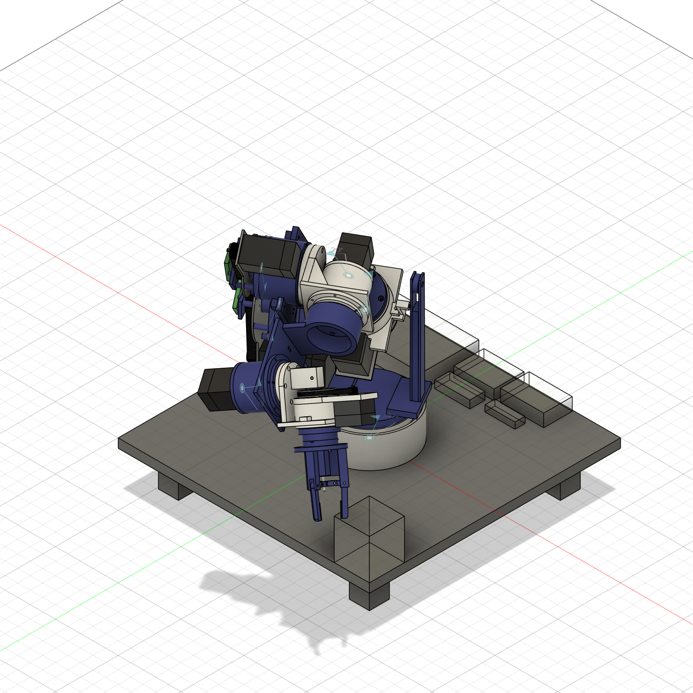
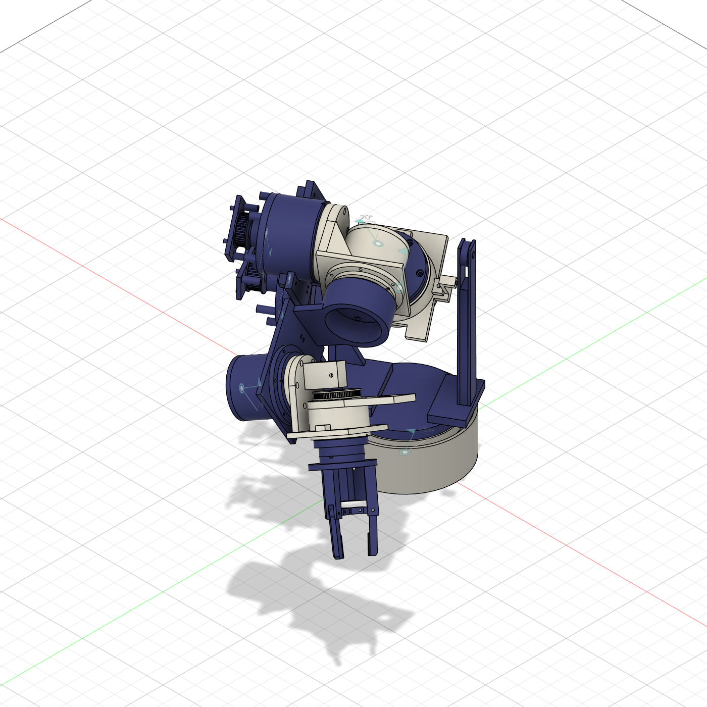

# 20: The full arm in Fusion: modules, links, assembly, ranges and holes

Built 20 Oct 2026 (Josh asked: make all the 3D parts, the sub-assemblies and the full assembly, properly mated, sized
and with the holes aligned, and check the arm isn't copied too closely from anyone else's design). This is the model
that replaces the 19 Oct parts from J2 outward ([18](18_cad_mechanical_architecture.md), reviewed in
[19](19_cad_review.md)); J1 is the hub rebuild of 19 §14. **Everything below was checked in Fusion, in the model.
Nothing was printed, fitted or measured.**

---

## 1. How it is built

Every part is generated by Python, run inside Fusion through its MCP add-in:

| File | What it holds |
|---|---|
| `tools/fusion_lib.py` | Sketch-and-extrude helpers, hub save/registry, `report`, `interference` (with a `detail` mode: which occurrences and where) |
| `tools/fusion_arm.py` | The numbers (fits, bearings, motors, the cycloid and planetary modules), the module builders, the in-memory module checks, the CLI |
| `tools/fusion_arm_j7.py` | The J7 module |
| `tools/fusion_arm_asm.py` | Where each module sits (`MODULES`), bought-part envelopes, the module sub-assemblies |
| `tools/fusion_arm_links.py` | The links and the tool changer, drawn directly in world coordinates |
| `tools/fusion_arm_full.py` | The full assembly `DA_ARM`, the joint sweep, the hole-alignment probe |
| `tools/fusion_run.py` | Runs a command: `software/.venv/Scripts/python.exe tools/fusion_run.py <cmd>` |
| `tools/fusion_files.json` | Name → hub lineage id of every `DA_` file |

Commands: `build <C2|C34|P56|P7> <part> [--save]`, `check <module> <input angles…> [mates]`, `bought <name|all>`,
`sa <module>`, `link <name|all>`, `arm`, `sweep '[{"J4": 120}, …]' [detail]`, `sweep holes`, `ids`. The add-in drops
scripts over ~16 KB, so the runner sends a stub that imports these modules from `tools/`.

**World frame** = the `arm.toml` base frame at the zero pose (arm straight up), mm, J1 on +Z, the base board at z 0.
The CAD's pitch axes (J2, J4, J6) run along X, so the arm swings in the y-z plane. That is a 90° J1 offset from the
DH frames. **CAD joint angles are `arm.toml` angles**, and `arm.toml` x = −CAD y, y = CAD x. Checked by driving J1-J6 in
`DA_ARM` (`sweep tool`): the tool plate lands within 0.01 mm of the FK at every pose tried, including all six
together. That also confirms the CAD has `arm.toml`'s link lengths. J7 is the same by construction, but this probe
can't show it: the point is on its axis.

The hub folder `Admin Project / DeskArm_Parts` holds 62 `DA_` files. 46 are printed or bought parts, each in its own
file with the fits as user parameters (`seat_fit` 0.05, `journal_fit` −0.05, `pin_fit` 0.05, `press_fit` 0,
`clear_fit` 0.2 mm, [print_tolerances](print_tolerances.md)). There are 4 module sub-assemblies (`DA_SA_C2`, `_C34`,
`_P56`, `_P7`), 10 links and tool parts, and `DA_ARM`. `DA_SA_P56_dup_old` and `DA_SA_P7_dup_old` are stale
duplicates for Josh to delete.

## 2. The modules

Each module has its axis on local +z and its input face at z 0. Its sub-assembly holds two rigid groups: "fixed"
(grounded: housing, cover, motor, belt…) and "out" (carrier and flange), joined by one revolute joint.

| Module | Joints | Reduction | Bearings | Motor |
|---|---|---|---|---|
| **C2** cycloid | J2 | 2:1 HTD-3M (20T → 40T, 282 mm × 15) × 24:1 cycloid (25 pins Ø6 on R 50, e 1.6) = 48:1 | 2 × 6802 input shaft, 2 × 6804 lobes, 2 × 6810 output | NEMA23 76 mm |
| **C34** cycloid | J3, J4 | 2:1 HTD-3M (231 mm × 10) × 24:1 (25 pins Ø5 on R 36, e 1.1) = 48:1 | as C2 | NEMA17 60 mm |
| **P56** planetary | J5, J6 | two stages 14 / 19 / 52, module 1.0, 3 planets: 22.22:1 (D30) | 2 × 6806 output; planets on 623s and Ø3 pins | NEMA17 40 mm, coaxial below |
| **P7** | J7 | GT2 5:1 (16T → 80T, 220 mm × 6) × 3:1 planetary 24 / 12 / 48 = 15:1; the sun is hollow (Ø15) | 6804 sun, 2 × 6806 output | NEMA17 20 mm pancake beside the axis |

Details that matter:

- **Odd pin count.** With N = 25, disc B sits 180° out of phase only if its outline is also turned by
  −180/(N−1)°, so `DiscB` is its own part. Without that turn the two discs overlapped 410 mm³.
- **One-piece input shaft** with Ø15 journals and Ø20 lobes, on two 6802s. Retention is a land in the housing (C2)
  or an outer spacer plus retainer (C34). A 0.2 mm preload gap is built into each output stem.
- **Input extension `ext`** (C2 22 mm, C34 14 mm) moves the input bearing, motor plate and belt outboard on a boss
  with posts, so the motor ends short of the output face. C2 needs it for link 2 at J2 ±120°. C34 needs it for the
  forearm at the elbow.
- **Mounting tabs** at 0°, 180° and 270° (local), away from the motor at +y. M4 (C) or M3 (P7) screws into inserts in
  the links.
- `check <module> … mates` builds the module with bearing and pin envelopes in memory. It runs Fusion's interference
  check at several input angles and measures every designed contact and gap: bearing on shoulder, pin in socket,
  the preload gaps. All four modules pass (19-20 Oct).

## 3. The layout

| Joint | Module | Placement | Notes |
|---|---|---|---|
| J1 | hub rebuild (19 §14) | under the turntable | two 6810s, cam v3 |
| J2 | C2 | axis on X at z 209, module at x −131 | NEMA23 92.5 mm below J2; a left stand carries the tabs |
| J3 | C34 | axis on Z, module base at **z 245** | motor behind the arm (−y) |
| J4 | C34 | axis on X at z 399, module at x −124.5 | motor on link 3's side, alongside the forearm (top z 490) |
| J5 | P56 | axis on Z, module base at **z 390** | its motor hangs below the base and straddles the J4 axis |
| J6 | P56 | axis on X at z 579, module at x −118 | |
| J7 | P7 | axis on Z, base at z 598, **turned 90°** | motor along +X, the J6 axis direction |

The links are plates and collars that bolt module to module:

- **Left stand.** A collar on the J2 tabs with a motor window, and a foot on the turntable's x = −47 holes. Its outline
  stays within R 82 of J2 above the axis, then tapers.
- **Right tower and counterbalance pulley.** A fork holding an M8 axle and a 608 at a = 70 mm above J2 in the cable
  plane x 70, with a spring anchor low on the web.
- **Link 2.** A side plate on the J2 flange, a collar under J3's tabs, and a tongue and riser to the cable lug at
  b = 98 mm.
- **Link 3.** A plate on the J3 flange, narrowed to ±30 mm, and a U-collar on J4's tabs.
- **Forearm.** A side plate on the J4 flange and a collar under J5's mount flange, with gussets outside the J5
  housing.
- **Link 5.** A plate on the J5 flange, a ring riser to z 494 (R 32-40, clear of the flange screws), an arm, and a
  collar on J6's mount flange.
- **Link 6.** A side plate on the J6 flange and a bridge on J7's −y, +y and −x tabs; the bridge stops at x 35, short
  of the J7 motor.
- **Tool changer.** The receiver is on the J7 flange (ISO 9409-1-31.5-4-M5 plus a Ø5 dowel). It has 3 balls,
  3 magnets and 6 pogo pins against the tool plate's V-grooves, magnets and pads. The tool plate takes the gripper on
  6 blind M3 inserts at PCD 40.

`DA_ARM` inserts SA1 (J1, grounded), the ten links and the six module sub-assemblies, and chains them with 16 rigid
joints to the module groups. Each arm joint is that module's own revolute joint, driven from the assembly with
`createForAssemblyContext`. There are 118 occurrences, and the zero pose is clear.

## 4. Decisions made while building (D40)

The first full sweep found three problems:

- the forearm met the upper arm at a 96° elbow fold;
- link 2 met the J2 driver at J2 ±120°;
- with the J7 motor on +y, J6 hit the J5 module at −90°.

Each fix is listed with its reason:

1. **J3 moved down 28 mm (z 273 → 245), J5 moved down 40 mm (430 → 390).** Both are roll joints along their links,
   so the kinematics (`arm.toml` d values) are unchanged. The elbow's limit is set by how far below it the upper
   arm's top (the J3 flange and link 3) sits, and by how wide the forearm is near the elbow. Lower J3 raises the
   first; lower J5 brings the forearm's wide parts close to the axis, where they swing less deep. J5's motor then
   passes the elbow axis, in an x band where nothing else is.
2. **J4 range ±140° → ±120°.** Fusion now measures the elbow clear to ±120° and in contact from ±122°. The contact is
   link 5's riser ring on link 3's disc (1.2 mm³ at 122°). ±140° would need J3 about 50 mm
   lower. That puts the counterbalance lug inside link 3's sweep, so the whole counterbalance would have to move off
   the cable plane. The KUKA LBR iiwa's elbow also has ±120°.
3. **Counterbalance a = 70, b = 98 mm** (was 100 / 150 in `arm.toml` and 80 / 105 in the first CAD). The lug on link 2
   has to pass under link 3, whose plate sweeps R ≤ 97 about J3. It also has to clear the pulley:
   |a − b| ≥ pulley radius + lug + margin. The tower fork has to stay under link 3 as well. Only k·a·b sets the
   torque, so the spring re-sizes to 1252 N/m with the hand-estimated masses, and **1499 N/m** with the CAD masses of
   §9 (`python -m deskarm.counterbalance`): 28-146 mm of cable and 219 N peak tension, against 125 N before. The
   spring is now deferred ([21](21_checks_and_review.md) §1, D41).
4. **J7 turned 90°.** Its motor now lies along the J6 axis, so tipping J6 either way moves it sideways rather than
   down into the forearm. The receiver's dowel and link 6's inserts follow the new orientation.
5. **Smaller fixes:**
   - C2 `ext` 22, for the J2 driver at ±120°.
   - The left stand reshaped. Its old 160 × 215 plate met link 3's U-collar at J2 ±114°.
   - Link 3's plate narrowed (±40 → ±30).
   - Link 5 given a ring riser, so its arm passes above the J4 motor.
   - The tool plate's gripper holes moved off the coupling. Two of them landed on a V-groove and a magnet pocket.

## 5. Ranges, measured

`sweep` sets the joints in `DA_ARM` and runs Fusion's interference check on every body. Angles are CAD angles.

| Joint | `arm.toml` | Clear at | First contact |
|---|---|---|---|
| J1 | ±170° | ±170° | - |
| J2 (rest at 0) | ±120° | ±120° | ±125°: link 3's U-collar on the left stand (1.1 mm³) |
| J3 | ±170° | ±170° | - |
| J4 | **±120°** | ±120° | ±122°: link 5's riser ring on link 3's disc (1.2 mm³; 341 mm³ at 125°) |
| J5 | ±180° | 90°, 180°, −90° | - |
| J6 | ±120° | ±45°, ±90°, ±120°, 125° | - |
| J7 | ±360° | 90°, 180°, 360° | - |

Combined poses, all clear:

- home (J2 30, J4 60, J6 60), the same with all signs flipped, and with J4 flipped;
- J2 ±90° with J4 ∓120°, and J2 −90° / 60° with J4 120°;
- J3 ±90° with J4 ±120° (and J6 120°);
- J4 120° with J6 −120°.

**Not clear:** J4 120° with J6 120°. That folds the tool back onto the J3 motor behind the upper arm (10 cm³). It is
self-collision, which the software's capsule check ([14](14_math_guide.md) §14) must forbid. The capsules have not
been compared against the CAD yet.

## 6. Holes

`sweep holes` probes the whole arm at the zero pose. For every hole (R ≤ 6 mm) in a link or tool part, it looks for a
cylinder (hole or pin, R ≤ 12) in another part whose axis lines up within 0.05 mm. Result: **101 hole axes, 11 without
a partner, all expected:**

- the spring anchor on the tower and the cable clevis pin on link 2, which take a spring hook and a cable eye;
- the receiver's 3 ball seats, which sit over V-grooves, not holes;
- the tool plate's 6 gripper inserts, since there is no gripper model yet. (Since 20 Oct night the 3-prong gripper
  uses all six.)

Every screw, insert and dowel between links and modules lines up: the J2-J7 flange patterns, the tabs, the J5/J6
mount flanges, the J7 tabs and the turntable feet. Inside the modules the same was checked by `check … mates`.

## 7. Originality

Josh asked whether the arm is copied too closely from anyone else's design. It is not. The geometry is our own, and
the shared ideas are generic or credited.

- **No foreign files.** Every part comes from the scripts above. The cycloid profiles come from `tools/cycloid.py`
  (the epitrochoid equations, [14](14_math_guide.md)) and the gears from `tools/gears.py` (involute construction).
  The only STL/DXF files in the repo are outputs of those tools. No STEP, STL, URDF or code from another arm was
  imported or traced.
- **The nearest designs** are Petar Crnjak's Faze4 and PAROL6 ([CREDITS](../CREDITS.md),
  [02](02_prior_art_research.md)):
  - Faze4 has printed cycloidal drives on the big joints and a planetary on the small wrist joint. We use the same
    split as a principle, and it is credited.
  - PAROL6 uses metal planetary gearboxes and belts on a 6-DOF arm with offsets (URDF 110.5 + 23.4 / 180 / 43.5 /
    176.35 mm).
  - Ours is a **7-DOF SRS arm without offsets** (209 / 190 / 180 / 70 mm), with an upper-arm roll joint neither has.
  - It is built from bolt-together actuator modules joined by flat plate links, where Faze4 has shell links with
    built-in gearboxes.
  - It has a zero-length-spring counterbalance on a cable.
- **Generic or standard elements:** cycloidal and planetary reducers (textbook mechanisms), timing belts, NEMA
  motors, MKS drivers, ISO 9409-1 flanges, a Maxwell kinematic coupling, heat-set inserts.
- **Licences:** PAROL6 is GPLv3 and Faze4's repo shows both MIT and CERN-OHL-S. We copy nothing from either, so
  neither applies. If any of their files is ever used, it must go in with its licence noted (CREDITS rule).

## 8. Not verified

- Strength and stiffness of the plate links (no FEA). The counterbalance lug and tower would see up to ~220 N, plus about
  twice that at the pulley axle.
- Printability of the links (orientation, supports, the 6 mm walls), and whether the screws and inserts can actually
  be reached at assembly.
- Cables and harness (not modelled), the J3 through-tube, the slip ring.
- The capsule model against the CAD.
- The masses (§9) are the CAD's volumes times assumed densities; the PETG fill and the hardware allowances are
  guesses until the first module is weighed.
- J1 is as checked in 19 §14. It was swept with the arm (±170° clear), not re-checked part by part.

## 9. Masses from the CAD

`tools/fusion_run.py sweep bodies` writes the volume and centre of every solid in `DA_ARM` at the zero pose to
`tools/cad_bodies.json` (121 bodies). `python tools/cad_masses.py` then:

- takes printed parts from the slicer's grams ([21](21_checks_and_review.md) §3: 6 walls, 40% gyroid). Unsliced parts
  (J1) use 0.90 g/cm³, the sliced housings' median; the first version used 0.80 for everything. Other densities:
  - aluminium plates and bought pulleys 2.70, belts 1.20;
- puts the catalogue motor and driver masses on the CAD's motor and driver boxes;
- adds what is not drawn as point masses on each module's axis:
  - bearings (6810 52 g, 6806 22, 6804 18, 6802 8, 623 1.6);
  - steel pins (25 ring pins and 8 output pins per cycloid; planet pins);
  - 15-40 g of screws and inserts per part;
  - the J1 motor under the board, the spring hardware, the coupling's balls and magnets;
  - the 0.35 kg gripper (not drawn);
- groups them by the joint that carries them, and prints the `arm.toml` block.

| Carried by | Estimate (until 20 Oct) | CAD | |
|---|---|---|---|
| base | 1.40 | 1.46 | with the J1 motor envelope |
| J1 | 2.19 | 2.78 | the J2 module is ~1 kg with its pins and bearings |
| J2 | 0.95 | 1.57 | J3 module + motor 0.55 + link 2 + J2 output |
| J3 | 1.30 | 1.49 | J4 module + motor 0.55 + link 3 |
| J4 | 0.51 | 0.89 | J5 module + motor + forearm |
| J5 | 0.83 | 0.83 | |
| J6 | 0.37 | 0.53 | with the slip ring and its holder (21 Oct) |
| J7 | 0.43 | 0.23 | the drawn 3-prong gripper is 0.119 kg with its pads (the placeholder was 0.35) |
| **total** | **7.98** | **9.79** | past the shoulder 4.39 → **5.54** |

What changed in the numbers:

- **Torque budget** (`tools/torque_budget.py`): every joint still passes.

  | Joint | Margin before | CAD masses | With the 3-prong gripper (TCP 0.08 → 0.11 m) |
  |---|---|---|---|
  | J2 | 1.53 | 1.35 | 1.32 |
  | J3 | 1.54 | 1.52 | 1.44 |
  | J4 | 1.54 | 1.60 | 1.51 |
  | J5 | 1.29 | 1.35 | 1.18 |
  | J6 | 1.29 | 1.44 | 1.23 |
  | J7 | 1.78 | 2.07 | 2.06 |

  The last column is the 1 kg payload 30 mm further out: the wrist joints lose most, and J5 is now the thinnest.

  The heaviest parts (the J4 and J6 modules and their motors) sit 80-140 mm to one side of the arm's centreline,
  where the CAD puts the pitch actuators. So J3 and J5 now carry gravity torque when the arm is horizontal, and the
  worst pose is no longer on the ±90° grid. The budget now refines its grid pose joint by joint.
- **Spring:** 1499 N/m, 219 N peak, and deferred (D41).
- **Tipping:** 13.2 kg is needed with margin (12.8 with the 0.08 TCP), and arm + board + PSU is 13.5 kg: just
  enough (clamps for margin).
- docs/14 §10, §11, §13 and §19 are recomputed, the sim figures with `tools/sim_modes.py` ([21](21_checks_and_review.md) §7).

Weigh the first printed module against `stl/da/slice.json`, then re-run `cad_masses.py`, the counterbalance sizing
and the budget.

## 10. The print and display assemblies, and the CAD in the twin (21 Oct)

Josh asked for two more versions of the arm: one with only the 3D-printed parts, and one with everything, "just so it
can be visually seen and move around", and then for the model in the simulator. Built by `tools/fusion_arm_display.py`
(commands in its docstring) from `DA_ARM`'s parts, in the same hub folder:

| File | Holds | Parts |
|---|---|---|
| `DA_ARM_Print` | the printed parts only: PETG and the TPU pads | 87 |
| `DA_ARM_Display` | everything in `DA_ARM`: printed parts, motor, belt and pulley envelopes, metal plates, encoder boards, slip ring, base board and the electronics spaces | 113 |

Both are laid out the same way:

- every part is a linked insert of its own `DA_` (or J1 `DeskArm_`) file at its `DA_ARM` zero-pose place, so a part
  edit shows up in all three assemblies;
- one rigid group per moving body, `L0 base` (grounded) to `L7 tool`, and seven top-level revolute joints J1-J7 with
  the `arm.toml` limits (J7 free). Drag a link or use Drive Joints. In `DA_ARM` the joints sit inside the linked module
  sub-assemblies, which is awkward to drive by hand;
- coloured by material: PETG grey at the base, then white and blue on alternate bodies; TPU and belts rubber; motors
  black; plates and pulleys aluminium; slip ring and gripper drive steel; encoder boards green; the electronics
  spaces frosted glass.

 

*Both files at J1 30°, J2 40°, J4 70°, J5 20°, J6 40° (Fusion render).*

**Checked (in Fusion, 21 Oct):**

- both clear at the zero pose (Fusion interference check);
- the joints turn the same way as `DA_ARM`'s: the tool plate lands within 0.01 mm of `DA_ARM`'s at two poses
  (`CHECK` in the builder);
- every part moves with its body: at two poses, the largest difference between a part's motion and its body's is
  4 × 10⁻¹³ mm (`display frames`);
- each body moves exactly as the twin's URDF link: rotation within 1 × 10⁻⁶ and position within 0.001 mm, at
  J1-J7 = (30, 90, 20, 60, 40, −45, 90)° and (−150, −100, 160, 110, −170, −100, 270)° (`tools/cad_meshes.py check`).

**In the simulator.** `display mesh` exports every part, and `tools/cad_meshes.py` merges them per body and material
and moves each body into its URDF link frame, in metres. The result is 30 STLs in `software/deskarm/data/meshes`:
14 MB, about 300 000 triangles at Fusion's low mesh setting. `to_urdf(arm, meshes=MESH_DIR)` draws them instead of
the cylinders. The twin (`python -m deskarm.twin`) shows them on the measured arm, with the ghost kept as light
cylinders; `--primitive` turns them off. MuJoCo still uses the primitive URDF: its masses already come from the CAD
(§9), and the meshes would only change the picture. `test_urdf_with_cad_meshes` checks that every link has its
meshes and that the gripper sits on the J7 axis.

Three Fusion API behaviours cost time here. The builder works around each one:

1. **Linked parts nested in empty components don't follow joints.** The first version put each body's parts in
   an empty "body" component and jointed those. A part placed with a non-identity transform stayed where it was when
   its body turned, even after Capture Position. That was 79 of 113 parts: the module parts, which are drawn in module
   coordinates. Top-level parts in rigid groups move correctly, as `DA_ARM`'s sub-assemblies always did.
2. **`addExistingComponent` may compose the given transform with the first occurrence's** (nested, it did). The
   builder checks every placement and corrects or stops.
3. **STL export of an occurrence ignores its place** (top level), or misplaces it once joints have moved (nested).
   The export is therefore in part coordinates, with the places written beside it (`places.json`). Pose checks
   compare transforms, never exported meshes.

The build takes ~96 s for `DA_ARM_Display`, close to the add-in's 120 s per call. That is why reading `DA_ARM`'s parts
(`display leaves` → `tools/cad_leaves.json`) is a separate call. Re-run `leaves`, then `print`/`full --save`, `mesh`
and `cad_meshes.py` after a part moves in `DA_ARM`. A part that only changes shape updates both assemblies through its
link, but its twin mesh still needs `mesh` + `cad_meshes.py`.
