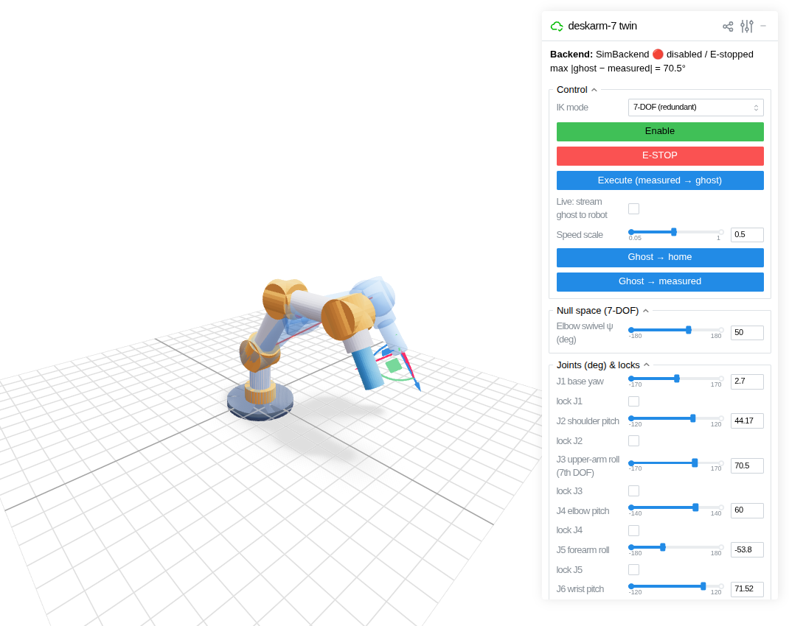
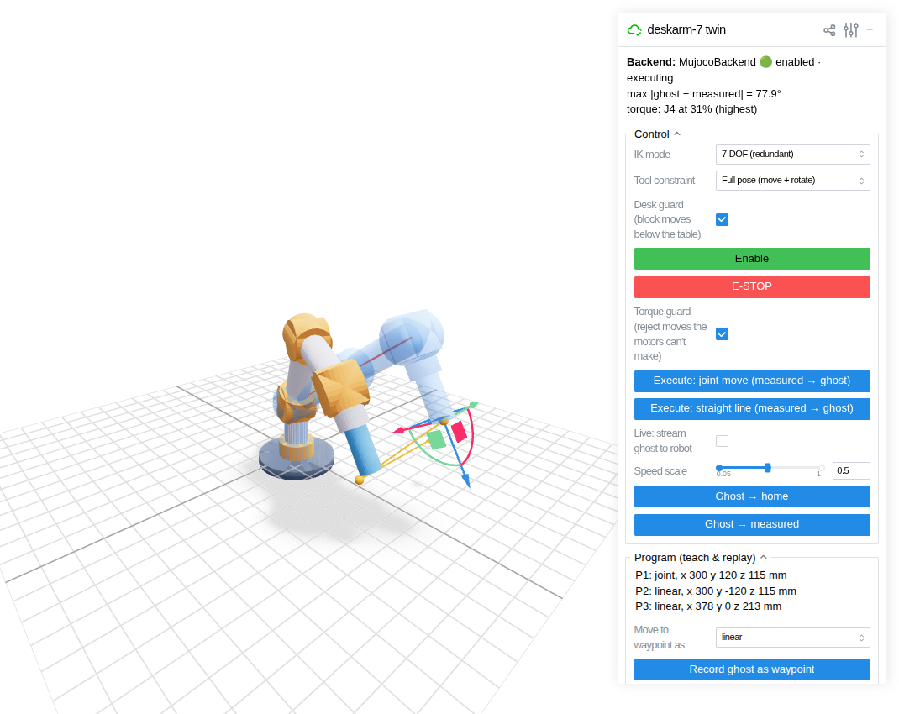

# deskarm: software for the 7-DOF desk arm

Kinematics, inverse kinematics, trajectories, a simulated robot, and a browser-based
**digital twin**, all driven by one config file: [`deskarm/data/arm.toml`](deskarm/data/arm.toml).

**Learning the math:** [docs/14_math_guide.md](../docs/14_math_guide.md) explains every module's math with a picture, the
equations, a symbol-to-variable table and a runnable example. Each module's docstring names its section.



## Quick start (Windows PowerShell, also works on Linux/macOS/Raspberry Pi)

```powershell
cd software
py -3.11 -m venv .venv            # Python 3.11 or newer
.venv\Scripts\activate            # Linux/macOS: source .venv/bin/activate
pip install -e ".[twin,sim,dev]"
pytest                            # FK, IK, trajectories, TOPP-RA, collisions, motors, masses, physics, URDF, twin, bridge, tools
python -m deskarm.twin            # open http://localhost:8080 (your iPhone works too: http://<pc-ip>:8080)
```

Options:
- `--backend physics --payload-kg 0.5`: **MuJoCo physics**: gravity, link inertia, reflected rotor inertia, and each
  joint's torque limit (motor torque × ratio × efficiency from `arm.toml`). Moves the motors can't make
  stall the joint and fault the arm, as the MKS drivers would. Add `--backdrivable` to see a BLDC-style arm fall when disabled.
  Add `--dual-loop` to close an outer loop on the link angle of J2-J4 (`deskarm.control.DualLoop`, 14 Oct): the links
  land on target instead of sagging on their gearboxes. Add `--contact-guard` to stop and give way when the tool
  touches something (`deskarm.control.ContactGuard`, 15 Oct; docs/14 §20).
  The physics also includes:
  - **Torque that falls with speed** (`motor.py`): a stepper keeps its holding torque only up to a corner speed
    (~250 rpm for the NEMA23, ~370-480 rpm for the LDO NEMA17s at 24 V) and then delivers roughly constant power. A joint that
    holds a load and lifts it slowly can still stall lifting it fast. Computed from the datasheet values in `arm.toml`
    (`hold_torque`, `rated_current`, `resistance`, `inductance_mh`) and planned at `[drive] torque_derate` = 75%.
  - **An itemised mass model** (`[[masses]]` in `arm.toml`): every motor + driver + gearbox, printed link and the tool, placed
    where it sits. 9.77 kg total, from the CAD (docs/20 §9; docs/22 §5a for the fillets). The arm starts each run in static equilibrium (links already sagged onto their gear springs).
  - **Gearbox springiness and backlash** (`gear_stiffness`, `backlash_deg` per joint): each joint is a motor and a link joined by a
    torsional spring with a dead band. The links sag by τ/k + backlash/2 while the motors sit exactly on target, and the arm
    rings at a few Hz after fast moves, which is what a printed arm does. `--rigid` turns it off.
  - **The J2 counterbalance spring** (`[counterbalance]`), acting even with the motors off.
- The measured arm is drawn with the **CAD meshes** of `DA_ARM_Display` (`deskarm/data/meshes`, from
  `tools/cad_meshes.py`, docs/20 §10); the ghost stays as light cylinders. `--primitive` draws cylinders for both.
- `--backlash-deg 0.3` and `--step-deg 0.00375` (kinematic backend): printed-gearbox backlash and microstep quantization.
- `--config my_arm.toml` loads a different geometry.



## Using the twin
| Control | What it does |
|---|---|
| **Gizmo** at the tool | Drag/rotate it: IK moves the **blue ghost** to follow |
| **IK mode** | *7-DOF*: numerical IK using all joints. *6-DOF*: J3 locked at 0, closed-form IK |
| **lock Jn** | That joint stays put while IK moves the others (7-DOF: full pose still reachable) |
| **Tool constraint** | *Full pose*, *Position only* (orientation free), *Keep tool vertical* (points down, free spin), *Lock orientation* (translate only), *Horizontal plane* (fixed height + orientation). The gizmo restricts itself to match |
| **Collision guard** | Warns when the ghost goes below the table **or hits itself** (tool folded into the shoulder, forearm into the base…), pauses Live streaming, and refuses to Execute a move whose path would collide |
| **Motion profile** | *Trapezoid* (fastest simple profile), *S-curve* (jerk-limited: smoother, gentler on printed gears; slower than the trapezoid, most on short moves), *Time-optimal* (TOPP-RA: fastest timing that respects every joint's speed/acceleration limit **and the torque its motor has at that speed** with the payload, pose by pose). Applies to joint moves, straight lines and programs |
| **Elbow swivel ψ** | Null-space motion: the elbow rotates around the shoulder-wrist axis while the tool stays still |
| **Enable / E-STOP** | Arm the (simulated) robot / stop immediately |
| **Execute: joint move** | Synchronized trapezoidal move from the grey *measured* arm to the ghost |
| **Execute: straight line** | The tool travels in a straight line (SLERP for orientation) to the ghost, re-timed to respect every joint's limits; refused if the line leaves the workspace or crosses a singularity |
| **Torque guard** | Inverse dynamics (MuJoCo) along the planned move: refuses moves that need more torque than a joint's motor has **at that speed**. The readout shows how much torque *holding* the ghost pose takes (this part needs only numpy, so it also works without MuJoCo) |
| **Program (teach & replay)** | Record the ghost as a waypoint (joint or straight-line move), preview the path in 3D, play once or loop, save/load JSON in `programs/` |
| **Live** | Streams every ghost change straight to the robot |

## Package layout
| Module | Contents |
|---|---|
| `kinematics.py` | `ArmModel` (DH), `fk`, `frames`, geometric `jacobian`, shoulder/elbow/wrist points, the mass list (`gravity_torque`, `link_inertials`), per-joint torque limits vs speed (`torque_limit`, `speed_at_torque`), TOML loader |
| `motor.py` | `stepper_torque`: voltage-limited torque-speed envelope of a hybrid stepper from datasheet values |
| `ik.py` | `analytic_ik_6dof` (Pieper, J3 = 0), `analytic_ik_7dof` (all 7 joints at a chosen arm angle ψ, up to 8 solutions) and `feasible_psi`, `solve_dls` (damped least squares + locks + null space + tasks: pose / position / tool-axis), `swivel` / `swivel_angle` (arm angle), `singularity_warnings`, `workspace_violations` / `trajectory_violation` (desk), `solve_ik` dispatcher (`psi=` holds the elbow; closed-form fallback when least squares fails) |
| `trajectory.py` | `TrapezoidalTrajectory`, `SCurveTrajectory` (jerk-limited double-S): all joints start and stop together. `joint_move(profile=…)` |
| `topp.py` | `time_optimal`: TOPP-RA (reachability analysis, Pham & Pham 2018) with joint velocity/acceleration and **speed-dependent torque** limits, no solver dependency |
| `collision.py` | Self-collision check: arm as 7 capsules plus the CAD's off-centre actuators (`ATTACHED`, checked against Fusion on 112 poses, docs/21 §5), `self_collisions`, `min_clearance`, `trajectory_collision` |
| `counterbalance.py` | J2 zero-length spring: `spring_torque`, sizing CLI `python -m deskarm.counterbalance` (numpy only) |
| `backends.py` | `SimBackend` (rate limits, backlash, step quantization). `CanBackend`: the real arm over CAN (streams absolute moves, polls positions, faults stop and hold; `read()` = link angle from calibrated output encoders, `read_motor()` = motor side) and `absolute_angle` (exact angle at start-up from a coarse one, docs/14 §16) |
| `control.py` | `DualLoop`: outer loop on the link angle around any backend with `read()` = link and `read_motor()` = motor: feed-forward of the predicted gear sag plus a slow integral on the link error (frozen during moves, dead zone, clamp); docs/14 §19. `ContactGuard`: external torque on J2-J4 from the encoder difference (momentum observer), stops and gives way on a touch; docs/14 §20 |
| `encoders.py` | Output encoders (MT6701, D33): `Calibration` (raw reading → link angle), `fit` (sign, zero, INL harmonics, lost motion and stiffness from slow sweeps), `sweep` (drives one joint through `CanBackend` to log one), JSON `save`/`load`; docs/14 §18 |
| `mks.py` | MKS SERVO42D/57D CAN frames (checksum, F5 move, acceleration byte, replies, F7 stop) and `SimBus`, simulated drivers that behave like a python-can bus |
| `drivers.py` | Set up and read back every MKS driver over CAN from one table: `--assign`, `--calibrate`, `--write`, `--jog` |
| `bench.py` | One actuator on the bench through `CanBackend`: CSV logger (`--sine`, `--hold`) and the push test (`--push`); docs/14 §17 |
| `startup.py` | Saved angles, start-angle choice, hall check and homing sweep for J1/J7 |
| `urdf.py` | URDF generated from the DH table and the mass list (matches FK exactly; tested against yourdfpy and MuJoCo) |
| `physics.py` | `MujocoBackend` (stepper servos whose torque limit follows the torque-speed curve, stalls, gearbox compliance + backlash, counterbalance, `read_motor()` vs `read()`, `external_torque` push test, backdrivable option) and `TorqueModel` (inverse dynamics, trajectory torque check against the limit at each sample's speed) |
| `cartesian.py` | `linear_path` (IK along the tool line; arm angle planned by `elbow.py` in 7-DOF mode), `linear_move` (… timed with any profile), pose interpolation |
| `elbow.py` | `plan_arm_angle`: the arm angle for a whole line by dynamic programming (joint motion, limit margin, capsule clearance) |
| `program.py` | Teach & replay: `Program`, `Waypoint`, JSON save/load, `tcp_path` |
| `twin.py` | Viser web UI (incl. live singularity warnings) |
| `bridge.py` | ESP32-S3 base controller: `open_bus()` (python-can slcan; waits until the bridge answers, because the board can reset when its USB port is opened) + `decode_status()` for the E-stop/bus status frame |

## Sizing the counterbalance

```
python -m deskarm.counterbalance              # k for the a/b in arm.toml, cable stroke, peak tension
python -m deskarm.counterbalance --a 0.08 --b 0.12 --payload-kg 0 0.5
```

A *zero-length* spring (tension = k × length; in practice a spring whose cable runs over a pulley at the anchor, pre-tensioned
so it pulls with zero force at zero cable length) gives exactly k·a·b·sin(θ) at the shoulder. That cancels a *rigid* arm at
every J2 angle, but the real arm changes shape and payload, so no spring balances everything. The tool picks k to minimize the
**worst-case** J2 static torque over ~600 random reachable, collision-free poses and 0-1 kg at the TCP. With the CAD's
a = 70 mm, b = 98 mm and the CAD masses: **~1500 N/m** (1503 with the 26 Oct masses; `arm.toml` keeps 1499), worst
case 16.5 → 6.9 N·m (less than half), 28-146 mm cable length, ~220 N peak. Deferred (D41): set `stiffness = 0` if the arm runs without it. Only k·a·b matters for the torque: a = 100 mm, b = 150 mm did the same job with ~574 N/m and ~125 N.
Sizing for one pose instead (cancel the stretched arm + 0.5 kg) balances that pose exactly but over-balances the folded
or empty arm, so its worst case is higher (the tests check this). The masses are the CAD's, in `arm.toml` `[[masses]]`:
re-run after any CAD change. Real extension springs have initial tension, which the model doesn't include yet.

## Placeholders to replace with measurements
- `gear_stiffness` / `backlash_deg` per joint (now 300-600 N·m/rad and 0.5° for the cycloids, 60-120 N·m/rad and 0.6-0.8° for
  the wrist planetaries, from published printed drives; see the comments in `arm.toml`): measure them on the actuator test bench (docs/08 Phase 1) with the same
  push test as `tests/test_physics.py::test_backlash_and_stiffness_from_a_push_test`: hang a known torque, reverse it, read
  the output encoder. Hysteresis = 2τ/k + backlash.
- The `[[masses]]` list comes from the CAD and the slicer since 20 Oct (`tools/cad_masses.py`) and the capsules were
  checked against the CAD; weigh the first printed actuator to confirm the slicer's grams.
- Motor data per joint (`hold_torque`, `rated_current`, `resistance`, `inductance_mh`, `rotor_inertia`): the LDO and LKD
  listings and drawings for the motors bought on 8 Oct (rotor inertias are typical values); measure R and L on the bench.
- `[drive] torque_derate` (0.75) and each `efficiency`: from the torque-vs-speed bench test.
- `vmax_deg` / `amax_deg`: set so the drives manage them with the rated payload. Re-check with
  `python ../tools/torque_budget.py` after any mass or ratio change.
Bench procedure and results table: [`tests/actuator_bench.md`](../tests/actuator_bench.md).

## Driving the real arm (`CanBackend`)

Written 12 Oct from the MKS CAN manual V1.0.9 and tested only against `mks.SimBus`; **nothing has talked to a real
driver yet**. `python -m deskarm.twin --backend can-sim` runs the twin through the same code against simulated drivers.

```
python -m deskarm.twin --backend can --channel COM5        # the bridge's port; /dev/ttyACM0 on Linux
```

```python
from deskarm import load_arm
from deskarm.backends import CanBackend
from deskarm.bridge import open_bus
arm = load_arm()
backend = CanBackend(arm, open_bus("COM5"), arm.home)   # the arm must stand at arm.home when the drivers power up
```

What it assumes about each driver. `deskarm.drivers` sets and checks all of it over CAN from one table (13 Oct;
written from manual V1.0.9, **not yet run against a driver**):

```
python -m deskarm.drivers --channel COM5 --assign J3     # first, for each driver: only it on the bus (they all ship as id 1)
python -m deskarm.drivers --channel COM5 --calibrate J3  # encoder calibration with the motor UNLOADED (off the gearbox)
python -m deskarm.drivers --channel COM5                 # read every driver back and compare with the table
python -m deskarm.drivers --channel COM5 --write         # write what differs, read back again
python -m deskarm.drivers --channel COM5 --jog J3        # one motor turn toward positive counts: watch which way
python -m deskarm.drivers --sim                          # any of these against simulated drivers
```

| Setting | Value | Why |
|---|---|---|
| CanID | J1-J7 = 1-7 | `ids` default; `--assign` |
| CanRate | 500k, the same as the bridge | `open_bus` default (if the tool can talk to a driver, it already is) |
| Mode | SR_vFOC (5) | Bus control: in a bus mode the En pin is ignored and F3 enables (manual §9.2.2); vFOC raises the current to Ma when the load needs it |
| MStep | 16 | The F5 speed field is in rpm only at 16/32/64 (manual §9.1) |
| Ma | The motor's rated current, from `arm.toml` | Until the peak-vs-RMS bench test (`tests/actuator_bench.md`); the tool refuses more than the board's maximum (42D 3000 mA, 57D 5200 mA) |
| Over-current protection (Protect) | Off (the default) | When it trips the driver releases the shaft and the arm drops; `CanBackend` polls the stall flag (3EH) and stops-and-holds instead |
| Interpolation (Mplyer) | On (the default) | Smoother low-speed motion |
| CanRSP | Respond, active (the default) | `CanBackend` reads the replies |
| Cal | Done unloaded, after the driver is on its motor | Manual §5.2.1; the tool reports "NOT CALIBRATED" from the version reply (40H) |
| Board | 42D everywhere, 57D on J2 | `driver` in `arm.toml`; the tool checks the version reply |

**Direction is not a driver setting over CAN.** The driver's Dir only applies to the pulse interface (manual §5.2.7), so
the earlier plan here ("set Dir so positive counts turn the joint the positive way", 12 Oct) could not have worked.
Each joint has `motor_sign` in `arm.toml` instead (default 1): run `--jog`, and if the joint turned the negative way
(right-hand rule about its axis, J1/J3/J5/J7 along +Z, J2/J4/J6 along +Y at the zero pose), set `motor_sign = -1`.
The cycloid reverses, a belt or planetary doesn't, and the motor's mounting decides the rest, so find it on the bench.

Where the angles come from: the drivers count from 0 at power-up, so start-up needs the pose. Until the output encoders
exist that means "stand the arm at its home pose (a jig) before powering up". With a coarse reading (output encoders,
saved angles) and a reference saved once with `backend.reference()`, pass `ref=` and the start is exact
(`absolute_angle`, docs/14 §16). `read_motor()` is the angle the **motors** imply: backlash and wind-up don't show in
it. `read()` is the same except on joints given an output-encoder calibration (`encoders=deskarm.encoders.load()`, 14 Oct),
where it is the measured link angle; those joints also take their start angle from the encoder.

Added 13 Oct (all against `SimBus` only):
- `deskarm.startup`: `save` the angles after an E-stop or at shutdown (`~/.deskarm/state.json`, plus the reference
  once), `start_angles` picks each joint's start (output encoder, else the saved angle, trusted only on hall joints
  J1/J7), and `home` sweeps a hall joint onto its switch. `CanBackend` checks the hall (the driver's IN_1, 34H) every
  step on joints with `hall_deg` in `arm.toml`, and faults if it disagrees with the angle.
- `CanBackend(..., mode="speed")`: the fallback if Q8 says streamed moves are stop-start. It sends speeds (F6) and
  closes the position loop here.
- `CanBackend.output`: the latest output-encoder frame per joint (raw).
- `python -m deskarm.bench`: one actuator on the bench, logged to CSV (`--sine`, `--hold`) and the push test (`--push`,
  docs/14 §17). See `tests/actuator_bench.md`.

Added 14 Oct (against `SimBus` only): output encoders in `CanBackend` (`encoders=` joint name → `Calibration`). Such a
joint reads its link angle from the encoder, starts from it, and faults if the encoder goes quiet or disagrees with the
motor by more than the gearbox can wind up (`slip_limit`: 7.7° on J2, 7.0° on J3/J4 with the placeholders). Calibrate
first:

```
python -m deskarm.encoders --channel COM5 --joint J2      # bench: sweep the joint both ways, fit, save to ~/.deskarm/encoders.json
python -m deskarm.encoders --sim --joint J2               # the same against a simulated driver and encoder
```

On the arm, call `encoders.sweep` at two poses with different loads (elbow straight, then bent) and `fit` the joined
logs: one pose can't tell the sensor's error from the gearbox's wind-up (docs/14 §18 Step 6).

## Next steps (see docs/05 and docs/11)
- `CanBackend` on a real MKS SERVO42D on the test bench: `tests/actuator_bench.md` §0, including Q8 (does the driver
  follow streamed moves smoothly?). Expect to adjust the speed rule in `CanBackend.step` once that is answered.
- A driver-behaviour model in the sim (the MKS drivers plan their own trapezoid per command) once the bench shows how they
  respond to streamed setpoints.
- Continuous J7 (multi-turn) instead of the ±360° software limit.
- ~~Replace the cylinder visuals with Fusion STL meshes~~: done 21 Oct (`tools/cad_meshes.py`, docs/20 §10).
- ~~Dual-loop control in sim~~: `deskarm.control.DualLoop` (14 Oct). Next: run it on `CanBackend` with the bench
  encoder, and set `ki` from the real arm's first mode (docs/14 §19 Step 4).
- Hand mirroring (MediaPipe), ZIG SIM iPhone teleop, analytic arm-angle IK.
